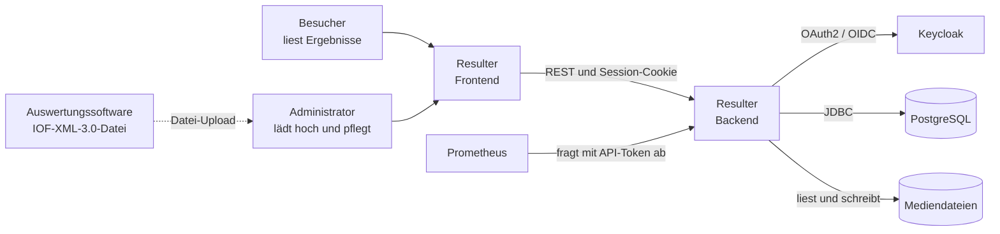
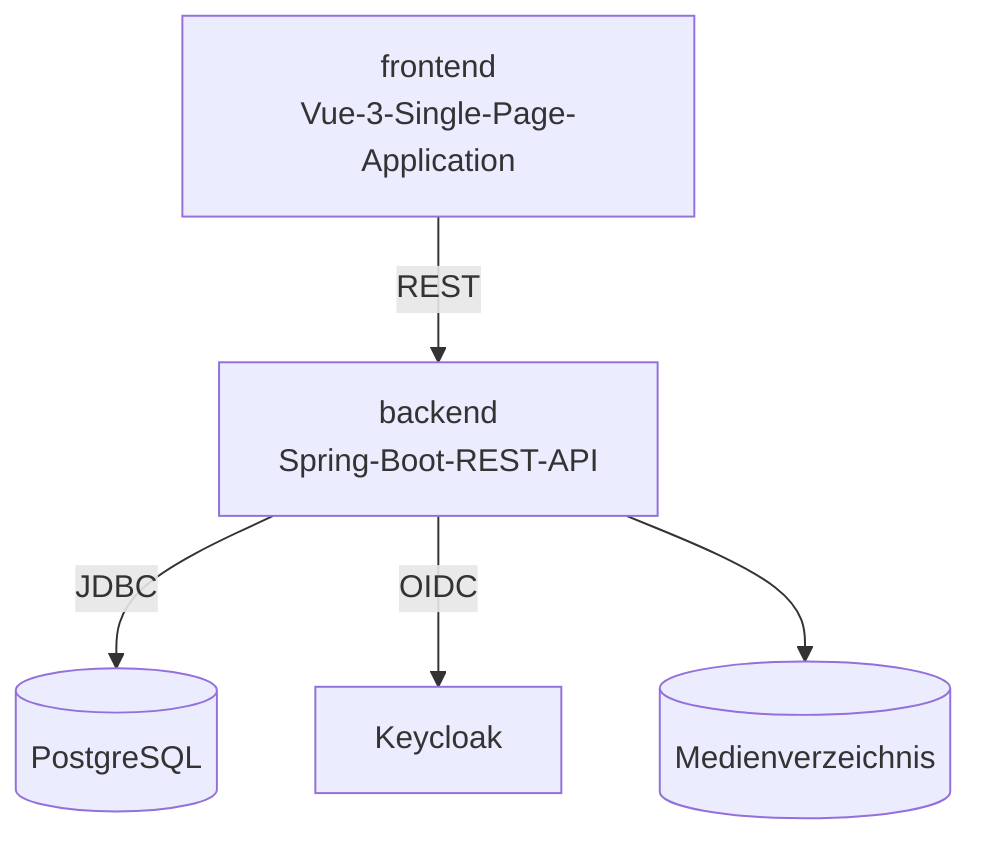
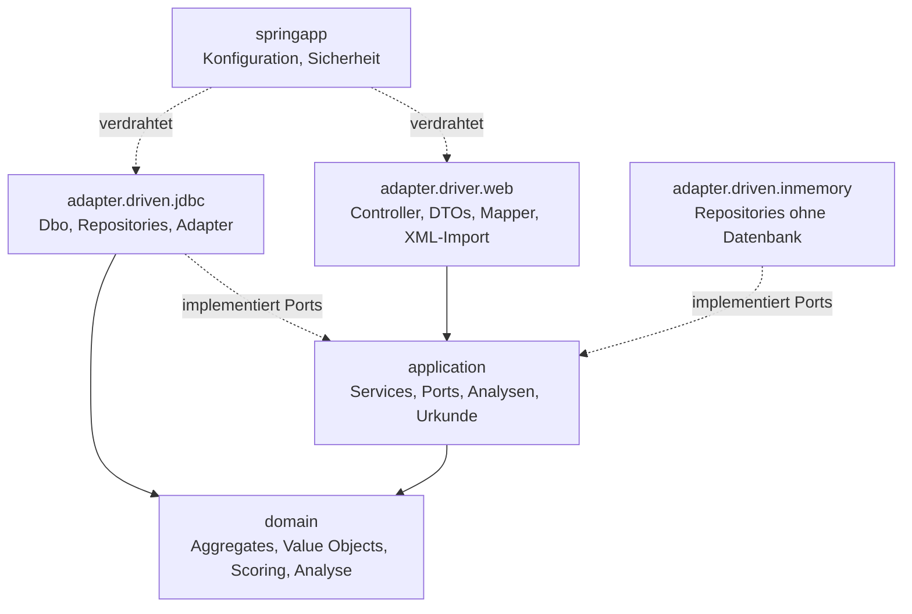
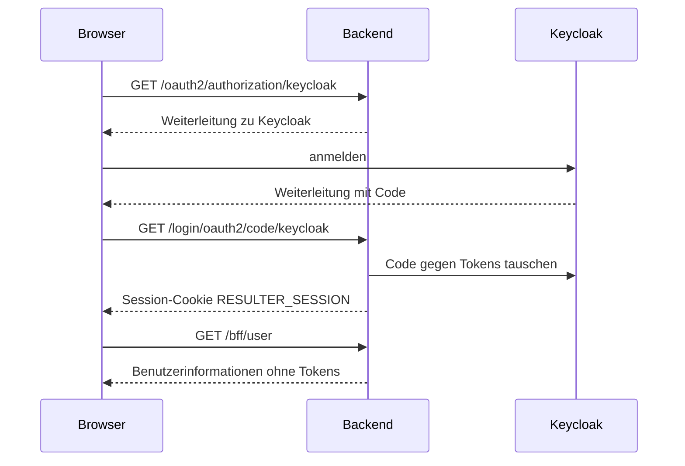
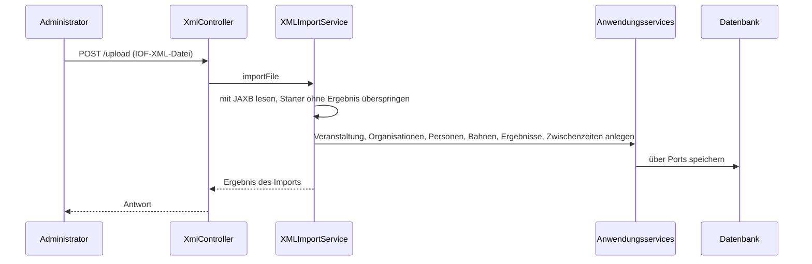
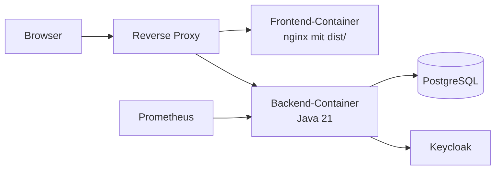
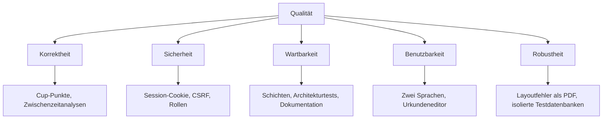

# Architektur (arc42)

> **Deutsch** · [English](architecture.md)

Diese Seite ist die technische Dokumentation von Resulter. Sie folgt der Struktur von
[arc42](https://arc42.org/overview/) und bleibt bewusst nah an dem, was der Code tatsächlich tut.
Entscheidungen und ihre Begründung stehen in den [ADRs](adr/README.de.md); diese Seite verweist darauf,
statt sie zu wiederholen. Jede Änderung an der Architektur aktualisiert das betroffene Kapitel im
selben Commit in beiden Sprachen ([ADR 0021](adr/0021-bilingual-application-and-documentation.de.md)).

## 1. Einführung und Ziele

Resulter ist eine Webanwendung für Orientierungslauf-Vereine und Veranstalter. Sie importiert
Ergebnisdateien, veröffentlicht Ergebnislisten, berechnet Cup- und Ranglistenpunkte, analysiert
Zwischenzeiten und erstellt Urkunden für jede Teilnehmerin und jeden Teilnehmer einer Veranstaltung.

### Anforderungen

| Anforderung | Ausprägung |
| --- | --- |
| Ergebnisse importieren | Ergebnisdateien im IOF-XML-Standard 3.0 laden Administratoren hoch; daraus entstehen Veranstaltungen, Rennen, Bahnen, Personen, Organisationen und Ergebnislisten |
| Ergebnislisten | Ergebnislisten je Veranstaltung, Klasse und Rennen, inklusive Zwischenzeiten |
| Cups und Ranglisten | Cup-Punkte für Nebel-Cup, Kristall-Cup und die Nord-Ost-Rangliste, je Cup-Typ eine Berechnungsstrategie |
| Zwischenzeitanalyse | Ranking, mentale Stärke, Anomalieerkennung und Hängererkennung je Ergebnisliste |
| Urkunden | Ein Urkundenlayout je Veranstaltung als JSON, im Browser bearbeitet und im Backend als PDF erzeugt |
| Zugriffsschutz | Anonymes Lesen der öffentlichen Listen, Anmeldung über Keycloak, jede andere Anfrage nur für die Rolle `ADMIN` |
| Zwei Sprachen | Oberfläche und Dokumentation auf Deutsch und Englisch |
| Betrieb | Health- und Metrik-Endpunkte für Prometheus, Container-Images aus der CI |

### Qualitätsziele

| Rang | Ziel | Nachweis |
| --- | --- | --- |
| 1 | Korrekte Ergebnisse und Cup-Punkte | Unit-Tests der Domäne, eine Strategie je Cup-Typ |
| 2 | Sicherer Zugriff | Session-Cookie statt Tokens im Browser, CSRF-Schutz, Rollenprüfung in den Security-Ketten |
| 3 | Wartbare Struktur | Hexagonale Schichten durch ArchUnit und jMolecules geprüft, Feature-Ordner im Frontend |
| 4 | Verständlich in zwei Sprachen | `vue-i18n`, zweisprachige Dokumentation durch `docs-parity` in der CI geprüft |

### Stakeholder

| Rolle | Erwartung |
| --- | --- |
| Besucherin oder Besucher | Schnelle, lesbare Ergebnislisten und Analysen ohne Anmeldung |
| Veranstalter oder Verein | Einfacher Upload von Ergebnisdateien und Urkunden im eigenen Aussehen |
| Administratorin oder Administrator | Stammdaten, Medien und Urkunden lassen sich im Browser pflegen |
| Entwicklerin oder Entwickler | Klare Schichten, ein reproduzierbarer Build und dokumentierte Entscheidungen |
| Betreiberin oder Betreiber | Container-Images, Health-Endpunkt und Metriken, Konfiguration über Umgebungsvariablen |

## 2. Randbedingungen

| Art | Randbedingung | Konsequenz |
| --- | --- | --- |
| Technisch | Java 21, Spring Boot 4.2, Maven | der Build nutzt den Maven-Wrapper und das Parent-POM `resulter-parent` |
| Technisch | Spring Boot 4 nutzt Jackson 3 (`tools.jackson.*`) | neuer JSON-Code darf `com.fasterxml.jackson.*` nicht importieren |
| Technisch | Vue 3, TypeScript, Vite, pnpm, Nx | Frontend-Befehle laufen über `pnpm` in `frontend/` |
| Technisch | PostgreSQL im Betrieb, H2 für Läufe ohne Server | Schemaänderungen nur über Liquibase, kein datenbankspezifisches SQL ohne Absicherung |
| Technisch | Anmeldung nur über Keycloak (OAuth2/OIDC) | die Anwendung verwaltet keine Passwörter |
| Technisch | Eingabeformat IOF Data Standard 3.0 | `IOF.xsd` liegt im Repository, die Klassen werden generiert |
| Organisatorisch | Lizenz CC BY-NC-ND 4.0 | [ADR 0020](adr/0020-license-cc-by-nc-nd-4-0.de.md) |
| Organisatorisch | Dokumentation auf Englisch und Deutsch | `scripts/docs-parity.mjs` prüft, dass beide Fassungen dieselbe Gestalt haben |
| Organisatorisch | Das Repository ist öffentlich | keine Zugangsdaten und keine Deployment-Details in Dateien, Konfiguration kommt aus der Umgebung |

## 3. Kontext und Abgrenzung

### Fachlicher Kontext

Die Auswertungssoftware, die die Ergebnisdateien erzeugt, gehört nicht zum System. Resulter liest nur
die exportierte XML-Datei.

### Technischer Kontext

| Nachbar | Schnittstelle | Anmerkung |
| --- | --- | --- |
| Browser | HTTPS, REST (JSON), Cookie `RESULTER_SESSION`, Header `X-XSRF-TOKEN` | der Browser hält nie ein Access-Token |
| Keycloak | OAuth2 Authorization-Code-Flow, JWT-Prüfung über die Issuer-URI | Benutzer, Realm-Rollen und Gruppen liegen dort |
| PostgreSQL | JDBC, Schema durch Liquibase | enthält auch die Tabelle `spring_session` |
| Dateisystem | Verzeichnisse aus `resulter.media-file-path` und `resulter.media-file-path-thumbnails` | hochgeladene Bilder und PDFs mit Vorschaubildern |
| Prometheus | `/actuator/prometheus` mit statischem Bearer-Token | [ADR 0019](adr/0019-observability-with-prometheus-and-grafana.de.md) |
| API-Clients | Bearer-JWT an derselben REST-API | [ADR 0004](adr/0004-bff-with-keycloak-and-session-cookie.de.md) |

Die REST-API beschreibt OpenAPI (`springdoc`, `/v3/api-docs` und `/swagger-ui`).

## 4. Lösungsstrategie

1. **Hexagonale Architektur im Backend.** Schichten `domain`, `application` und `adapter`;
   Abhängigkeiten zeigen nach innen, die Ports gehören zur Anwendung
   ([ADR 0001](adr/0001-hexagonal-architecture-backend.de.md)).
2. **Backend-for-Frontend.** Das Backend führt den OAuth2-Ablauf aus und gibt dem Browser nur ein
   Session-Cookie ([ADR 0004](adr/0004-bff-with-keycloak-and-session-cookie.de.md)).
3. **Leichtgewichtige Persistenz.** Spring Data JDBC mit einem vom Domänenmodell getrennten
   Persistenzmodell, Liquibase für das Schema ([ADR 0002](adr/0002-spring-data-jdbc-instead-of-jpa.de.md),
   [ADR 0003](adr/0003-postgresql-and-liquibase.de.md)).
4. **Auswertungen als Strategien und Services.** Cup-Regeln sind Domänenstrategien, Analysen sind
   Anwendungsservices ([ADR 0015](adr/0015-evaluations-cup-strategies-and-split-time-analysis.de.md)).
5. **Urkunden als Daten.** Ein JSON-Layout im Fließtextmodell, gegen ein Schema geprüft und mit iText
   erzeugt ([ADR 0009](adr/0009-certificate-layout-as-json-flowing-text-with-itext.de.md),
   [ADR 0010](adr/0010-certificate-json-schema-validation.de.md)).
6. **Feature-Ordner im Frontend.** Ein Ordner je Fachbereich, Serverdaten in TanStack Query,
   Client-Zustand in Pinia ([ADR 0007](adr/0007-frontend-stack-and-structure.de.md)).
7. **Regeln im Werkzeug statt in Konventionen.** ArchUnit, jMolecules, Typprüfung, Linting,
   Secret-Scan und die Paritätsprüfung der Dokumentation laufen automatisch.
8. **Dokumentation als Teil der Änderung.** arc42 gibt jedem Detail einen Ort; Diagramme sind
   Mermaid-Blöcke und damit als Text prüfbar.

## 5. Bausteinsicht

### Ebene 1: Container

| Container | Verzeichnis | Verantwortung |
| --- | --- | --- |
| frontend | `frontend/` | Oberfläche, Routing, Sprachumschaltung, Urkundeneditor |
| backend | `backend/` | REST-API, Import, Berechnungen, Urkundenerzeugung, Sicherheit |
| database | `compose.yml`, `backend/src/main/resources/db/` | Persistenz, Sessions, Schemaversionen |
| monitoring | `prometheus/`, `grafana/` | Erfassung und Anzeige der Betriebsmetriken |
| documentation | `docs/`, `doc/` | Handbuch, ADRs, Pläne und diese Seite |

### Ebene 2: Backend

| Paket unter `de.jobst.resulter` | Inhalt |
| --- | --- |
| `domain` | Aggregates, Value Objects, `scoring` (Cup-Strategien), `analysis` (Zwischenzeitmodelle), `comparators`, `aggregations` |
| `application` | `*ServiceImpl`-Use-Cases, `port` (Repository- und Service-Schnittstellen), `analysis` (Ranking, Tabelle, mentale Stärke, Anomalien, Hänger), `certificate` (Layoutmodell und PDF-Erzeugung), `auth` |
| `adapter.driver.web` | REST-Controller mit `dto` und `mapper`, `XMLImportService`, generierte JAXB-Klassen |
| `adapter.driven.jdbc` | `*Dbo`, Spring-Data-Repositories, `*RepositoryDataJdbcAdapter`, eigene Abfragen |
| `adapter.driven.inmemory` | Repositories für Tests und lokale Läufe, umgeschaltet über `resulter.repository.inmemory=true` |
| `springapp` | Spring-Konfiguration: Security-Ketten, Sessions, Routing der Datenquelle, OpenAPI |

Die Abhängigkeitsregeln prüfen
[`HexagonalArchitectureTest`](../backend/src/it/java/de/jobst/resulter/HexagonalArchitectureTest.java)
und
[`JMoleculesRulesUnitTests`](../backend/src/test/java/de/jobst/resulter/domain/JMoleculesRulesUnitTests.java):
Die Domäne hängt von nichts außerhalb ihrer selbst ab, die Anwendung nicht von Adaptern, Adapter nicht
voneinander.

### Ebene 2: Domäne

Die Root-Entitäten und ihre Value Objects stehen in
[`aggregates.md`](../backend/src/main/java/de/jobst/resulter/domain/aggregates.de.md). Verweise
zwischen Aggregates laufen über IDs, nicht über Objektreferenzen.

| Aggregate | Bedeutung |
| --- | --- |
| `Event` | Ein Wettkampf mit Beginn und Ende, Status, Organisationen und Ergebnislisten |
| `Race` | Ein Rennen einer Veranstaltung, erkennbar an seiner Nummer |
| `Course` | Eine Bahn mit Länge, Steigung und Posten |
| `ResultList` | Die Ergebnisse einer Veranstaltung mit `ClassResult`, `PersonResult` und `PersonRaceResult` |
| `SplitTimeList` | Die Zwischenzeiten einer Person in einem Rennen |
| `Person`, `Organisation`, `Country` | Stammdaten |
| `Cup`, `CupScoreList` | Ein Cup eines bestimmten `CupType` und seine berechneten Punkte |
| `EventCertificate`, `MediaFile` | Urkundenlayout je Veranstaltung und die hochgeladenen Medien |

Cup-Punkte berechnen Implementierungen von `CupTypeCalculationStrategy` in `domain/scoring`, je eine
für `ADD`, `NOR`, `KJ`, `NEBEL` und `KRISTALL`. Die Analysemodelle in `domain/analysis` halten die
Ergebnisse der vier Zwischenzeitauswertungen.

### Ebene 3: Urkundenerzeugung

Das Paket `application/certificate` ist der in sich geschlossenste Teil des Backends.

| Klasse | Verantwortung |
| --- | --- |
| `JsonSchemaValidator` | prüft das Layout-JSON gegen das Schema, das `/certificate_schema` ausliefert |
| `DocumentDefinition`, `ParagraphDefinition`, `MarginsDefinition` | das Layoutmodell |
| `TextBlock`, `MediaBlock` und ihre Deserializer | die zwei Arten von Blöcken in einem Absatz |
| `JsonToTextParagraph` | wandelt das Layoutmodell in iText-Absätze um |
| `TextBlockProcessor` | ersetzt Platzhalter durch die Daten der Teilnehmerin oder des Teilnehmers |
| `CertificateServiceImpl` | steuert Prüfung, Hintergrundbild und PDF-Ausgabe |

### Ebene 2: Frontend

Jeder Fachbereich hat einen Ordner unter `frontend/src/features/<name>` mit `model/`, `services/`,
`pages/` und `widgets/` und eigenen Routen. Die Bereiche sind `event`, `cup`, `person`, `organisation`,
`country`, `course`, `race`, `analysis`, `certificate`, `media`, `auth`, `start` und einige
statische Seiten (`about`, `imprint`, `privacy`, `backend_version`). Gemeinsame Teile liegen in
`src/components`, `features/common` und `features/generic`.

## 6. Laufzeitsicht

### Szenario: Anmeldung über das BFF

Die Tokens bleiben auf dem Server. Spätere Anfragen tragen das Session-Cookie und den CSRF-Header.

### Szenario: eine Ergebnisdatei importieren

Der Import läuft in einer Transaktion. Nur die Rolle `ADMIN` darf den Endpunkt aufrufen.

### Szenario: eine Urkunde herunterladen

1. Das Frontend fordert die Urkunde einer Person für eine Veranstaltung an.
2. `CertificateServiceImpl` lädt das Layout-JSON und prüft es gegen das Schema.
3. Schlägt die Prüfung fehl, liefert der Service das PDF `LayoutDescriptionErrors.pdf` mit den Fehlern.
4. Sonst zeichnet er das Hintergrundbild, ersetzt Platzhalter wie `{{FAMILY_NAME}}` und
   `{{RESULT_TIME}}` durch die Daten der Person und liefert das PDF.

### Szenario: einen Cup berechnen

1. `CupServiceImpl` lädt den Cup, seine Veranstaltungen und die Ergebnislisten über die Ports.
2. Er wählt die Strategie zum `CupType` und lässt sie die `CupScore`-Liste berechnen.
3. Das Ergebnis wird als `CupScoreList` gespeichert und von den Query-Services von dort gelesen.

### Szenario: ein End-to-End-Test mit eigener Datenbank

1. Der Test ruft `POST /createDatabase` auf; das Backend startet einen PostgreSQL-Container mit
   Testcontainers, wendet die Liquibase-Changelogs an und liefert eine UUID.
2. Jede weitere Anfrage trägt die UUID als Header oder Cookie `X-DB-Identifier`.
3. `DataSourceInterceptor` legt sie in einem `ThreadLocal` ab, und `DynamicRoutingDataSource` liefert
   die passende Datenquelle.
4. `DataSourceCleanupScheduler` schließt ungenutzte Datenquellen und stoppt ihre Container.

Siehe [ADR 0005](adr/0005-e2e-database-isolation.de.md).

## 7. Verteilungssicht

### Infrastruktur Ebene 1

- Die CI baut zwei Container-Images mit Paketo Buildpacks und veröffentlicht sie unter
  `<repository>/backend` und `<repository>/frontend` auf `ghcr.io`. Trivy prüft sie vor der
  Veröffentlichung ([ADR 0016](adr/0016-container-images-with-paketo-buildpacks.de.md)).
- Die Konfiguration kommt beim Start aus Umgebungsvariablen; das Image enthält keine Zugangsdaten. Die
  Variablen stehen in
  [`application.properties`](../backend/src/main/resources/application.properties) und den
  Profildateien.
- Die Profile heißen `dev` (lokales PostgreSQL), `prod`, `inmem` (H2-Datei), `nosecurity`,
  `e2e-frontend-tests` und `native`.
- Für die Entwicklung startet [`compose.yml`](../compose.yml) PostgreSQL 16; Spring Boot kann es
  selbst starten (`spring-boot-docker-compose`).
- Prometheus und Grafana starten lokal mit `prometheus/startPrometheus.sh` und
  `grafana/startGrafana.sh`.
- Wie die Images auf einen Server gelangen, liegt außerhalb dieses Repositorys.

### Infrastruktur Ebene 2

| Knoten | Artefakt | Braucht |
| --- | --- | --- |
| Frontend-Container | Image `<repository>/frontend`, statische Dateien aus `dist/`, `default.conf` | den Reverse Proxy davor |
| Backend-Container | Image `<repository>/backend`, Java 21 | PostgreSQL, Keycloak, ein beschreibbares Medienverzeichnis, Umgebungsvariablen |
| Datenbank | PostgreSQL 16, Volume für die Daten | Liquibase läuft beim Start des Backends |
| Entwicklungsrechner | `compose.yml`, Maven-Wrapper, pnpm | Docker, Java 21, Node.js |
| Testlauf | Backend mit Profil `e2e-frontend-tests`, Testcontainers | Docker |

## 8. Querschnittliche Konzepte

### Sicherheit

- Vier Filterketten werden der Reihe nach ausgewertet: Datenbankerzeugung für Tests (`@Order(0)`),
  Prometheus (1), Bearer-JWT-API (2), BFF-Anmeldung (3) und die Session-API für alle übrigen
  Anfragen (4).
- Die Session liegt in der Tabelle `spring_session` (Timeout 3600 s). Das Cookie ist `HttpOnly`,
  `Secure` und `SameSite=Lax`; je Benutzer ist eine Session erlaubt.
- Das CSRF-Token wird aus dem Cookie `XSRF-TOKEN` gelesen und als `X-XSRF-TOKEN` zurückgesendet.
- Realm-Rollen und Gruppen aus Keycloak werden zu Spring-Authorities. Eine feste Liste von
  `GET`-Endpunkten (Veranstaltungen, Cups, Ergebnisse, Analysen, Personen, Organisationen, Medien,
  Version) ist öffentlich; jede andere Anfrage, auch `/admin/**`, `/upload` und `/media/upload`,
  verlangt `ADMIN`. Die Actuator-Endpunkte verlangen `ADMIN` oder `ENDPOINT_ADMIN`, außer `health`.
- Das Frontend-Image setzt in [`default.conf`](../frontend/default.conf) eine strenge Content Security
  Policy und weitere Sicherheits-Header.

### Persistenz

- Liquibase besitzt das Schema; jede Änderung ist eine neue Datei unter
  `db/changelog/jdbc_migrations`. PostgreSQL-spezifische Teile sichert `dbms: postgresql` ab.
- Jedes Aggregate hat eine Domänenklasse, ein `*Dbo`, ein Spring-Data-Repository und einen Adapter.
  Die Abbildung dazwischen ist explizit.
- Auswertungsergebnisse wie `CupScoreList` werden gespeichert und nicht bei jeder Anfrage neu berechnet.

### Fehlerbehandlung

- `GlobalExceptionHandler` übersetzt Ausnahmen in HTTP-Antworten mit einem `ProblemDetail`-Rumpf.
- Unangemeldete Anfragen erhalten `401`, keine Weiterleitung. Eine Urkunde mit ungültigem Layout wird
  zu einem PDF, das die Fehler auflistet.
- Der Import überspringt Starter, die nicht gestartet sind; andere fehlerhafte Eingaben lehnt er ab.

### Internationalisierung

- Das Frontend unterstützt Deutsch (Standard) und Englisch mit `vue-i18n`; die Sprache ist der erste
  Teil jeder URL (`/:locale/...`). Neue Oberflächentexte gehören in `de.json` und `en.json`;
  `i18n.spec.ts` prüft die Dateien.
- Impressum und Datenschutztext kommen je Sprache beim Build aus Umgebungsvariablen.
- Die Dokumentation gibt es in beiden Sprachen und folgt der Namensregel aus
  [ADR 0021](adr/0021-bilingual-application-and-documentation.de.md).

### Tests

| Ebene | Werkzeug | Ort |
| --- | --- | --- |
| Domäne und Anwendung | JUnit 5, Mockito, EqualsVerifier | `backend/src/test` |
| Architektur | ArchUnit, jMolecules | `HexagonalArchitectureTest`, `JMoleculesRulesUnitTests` |
| Persistenz und Web | Spring-Tests, In-Memory-Repositories, `NPlusOneReviewIT` | `backend/src/test`, `backend/src/it` |
| Frontend-Units | Vitest | `frontend/test` |
| Ende zu Ende | Playwright mit einer Datenbank je Test | `frontend/e2e`, siehe [TESTING.md](../frontend/TESTING.de.md) |

Die Strategie beschreibt [ADR 0006](adr/0006-test-strategy.de.md).

### Beobachtbarkeit

- Der Actuator stellt `health` und `prometheus` bereit; Micrometer liefert die Metriken.
- `/actuator/prometheus` schützt eine eigene Filterkette mit einem statischen Bearer-Token; Erzeugung
  und Rotation des Tokens beschreibt [prometheus-token.md](../doc/prometheus-token.de.md).
- Das Logging steht in `logback.xml`; die Stufe kommt aus `RESULTER_LOG_LEVEL`.

### Domänenmodell

Das Domänenmodell ist das aus [`aggregates.md`](../backend/src/main/java/de/jobst/resulter/domain/aggregates.de.md).
Bezeichner und Attribute sind Value Objects (`EventId`, `EventName`, ...); das hält ungültige Werte
aus der Domäne fern. `EqualsVerifier` prüft `equals` und `hashCode` der Domänenklassen.

### Benutzeroberfläche

- Die Komponenten kommen von OpenVue ([ADR 0008](adr/0008-openvue-instead-of-primevue.de.md)), das
  Styling von Tailwind CSS.
- Serverdaten holt und cached TanStack Query, Client-Zustand wie die Anmeldung liegt in Pinia.
- Der Urkundeneditor hat drei Modi: grafisch, Formular und JSON
  ([ADR 0012](adr/0012-certificate-editor-with-three-modes.de.md)).

### Konfiguration

- Alles Umgebungsspezifische (Datenbank, Keycloak, CORS, Medienpfade, Tokens, Log-Stufe) kommt aus
  Umgebungsvariablen; eine `.env`-Datei dient der lokalen Entwicklung.
- Profile schalten zwischen Datenbank-, Sicherheits- und Test-Aufbauten um (siehe Kapitel 7).

### Transaktionen

- Der Import einer Ergebnisdatei läuft in einer Transaktion; entweder wird die ganze Datei
  importiert oder nichts.

### Build und CI

- Der CI-Workflow `build.yml` führt Backend-Compile und -Tests, `docs-parity`, einen Secret-Scan und
  Frontend-Build und -Unit-Tests aus; `build-paketo.yml` baut und prüft die Images bei Tags und Release-Branches.

### Abhängigkeits- und Release-Verwaltung

- Renovate schlägt Updates vor, ein Workflow führt sichere automatisch zusammen
  ([ADR 0018](adr/0018-renovate-and-auto-merge.de.md)).
- Releases entstehen auf Release-Branches; die Version erhöht nur `bump-version.sh`
  ([ADR 0017](adr/0017-release-branches-and-version-script.de.md)).

### Dokumentation und Diagramme

- Diagramme sind Mermaid-Blöcke in Markdown-Dateien.
- `node scripts/docs-parity.mjs` prüft, dass jedes Dokument beide Sprachfassungen mit denselben
  Überschriften, Tabellen, Listen und Links hat. Die Prüfung läuft im CI-Job `docs-parity`.

### Erweiterungspunkte

- Ein neuer Cup-Typ: einen Wert zu `CupType` und eine Implementierung von
  `CupTypeCalculationStrategy` hinzufügen.
- Eine neue Auswertung: ein Modell in `domain/analysis`, einen Service in `application/analysis` und
  einen Endpunkt in `SplitTimeAnalysisController` ergänzen.
- Ein neuer Platzhalter in Urkunden: `TextBlockProcessor` und die Referenz im Handbuch erweitern.
- Ein neuer Fachbereich im Frontend: ein Ordner unter `src/features` mit eigenen Routen.

## 9. Architekturentscheidungen

Die Entscheidungen stehen als ADRs in [`docs/adr`](adr/README.de.md).

| ADR | Entscheidung |
| --- | --- |
| [0001](adr/0001-hexagonal-architecture-backend.de.md) | Hexagonale Architektur im Backend |
| [0002](adr/0002-spring-data-jdbc-instead-of-jpa.de.md) | Spring Data JDBC statt JPA |
| [0003](adr/0003-postgresql-and-liquibase.de.md) | PostgreSQL, Liquibase, H2 für lokale Profile |
| [0004](adr/0004-bff-with-keycloak-and-session-cookie.de.md) | Backend-for-Frontend mit Keycloak und Session-Cookie |
| [0005](adr/0005-e2e-database-isolation.de.md) | Eine eigene Datenbank je End-to-End-Test |
| [0006](adr/0006-test-strategy.de.md) | Teststrategie |
| [0007](adr/0007-frontend-stack-and-structure.de.md) | Frontend-Stack und funktionsorientierte Struktur |
| [0008](adr/0008-openvue-instead-of-primevue.de.md) | OpenVue statt PrimeVue |
| [0009](adr/0009-certificate-layout-as-json-flowing-text-with-itext.de.md) | Urkundenlayout als JSON, erzeugt mit iText |
| [0010](adr/0010-certificate-json-schema-validation.de.md) | JSON-Schema-Prüfung des Layouts |
| [0011](adr/0011-certificate-fonts.de.md) | Eingebettete Urkundenschriften |
| [0012](adr/0012-certificate-editor-with-three-modes.de.md) | Urkundeneditor mit drei Modi |
| [0013](adr/0013-certificate-geometry-from-pdf-measurements.de.md) | Geometrie der grafischen Ansicht aus PDF-Messungen |
| [0014](adr/0014-iof-xml-import-of-result-files.de.md) | IOF-XML-Import über generierte JAXB-Klassen |
| [0015](adr/0015-evaluations-cup-strategies-and-split-time-analysis.de.md) | Cup-Strategien und Zwischenzeitanalyse |
| [0016](adr/0016-container-images-with-paketo-buildpacks.de.md) | Container-Images mit Paketo Buildpacks |
| [0017](adr/0017-release-branches-and-version-script.de.md) | Release-Branches und Versionsskript |
| [0018](adr/0018-renovate-and-auto-merge.de.md) | Renovate und kontrolliertes Auto-Merge |
| [0019](adr/0019-observability-with-prometheus-and-grafana.de.md) | Metriken mit Micrometer, Prometheus und Grafana |
| [0020](adr/0020-license-cc-by-nc-nd-4-0.de.md) | Lizenz CC BY-NC-ND 4.0 |
| [0021](adr/0021-bilingual-application-and-documentation.de.md) | Zweisprachige Anwendung und Dokumentation |
| [0022](adr/0022-unit-tests-in-ci.de.md) | Unit-Tests in der CI |

## 10. Qualitätsanforderungen

### Qualitätsbaum

### Qualitätsszenarien

| Qualität | Szenario | Erwartetes Ergebnis |
| --- | --- | --- |
| Korrektheit | Eine Veranstaltung wird importiert und daraus ein Cup berechnet | Die Punkte folgen den Regeln des Cup-Typs, durch Domänentests abgedeckt |
| Sicherheit | Eine Anfrage ohne Session erreicht einen geschützten Endpunkt | Die Antwort ist `401`, keine Weiterleitung |
| Sicherheit | Ein Benutzer ohne die Rolle `ADMIN` ruft `POST /upload` auf | Die Anfrage wird abgelehnt |
| Wartbarkeit | Eine Klasse in `domain` importiert eine Adapterklasse | Der Architekturtest schlägt fehl |
| Benutzbarkeit | Eine Benutzerin schaltet im Kopf die Sprache um | Die Seite erscheint an derselben Stelle in der anderen Sprache |
| Robustheit | Ein Urkundenlayout verletzt das Schema | Die Benutzerin erhält ein PDF, das die Fehler auflistet |
| Isolation | Zwei End-to-End-Tests laufen parallel | Jeder arbeitet auf seiner eigenen Datenbank |
| Dokumentation | Ein Dokument gibt es nur in einer Sprache | Der CI-Job `docs-parity` schlägt fehl |

## 11. Risiken und technische Schulden

| Risiko oder Schuld | Auswirkung | Anmerkung |
| --- | --- | --- |
| Die CI führt die Unit-Tests von Backend und Frontend aus, aber keine End-to-End-Tests | Fehler, die nur im Browser auftreten, fallen nur lokal auf | Die End-to-End-Tests brauchen Keycloak und Testcontainers, siehe [ADR 0006](adr/0006-test-strategy.de.md) |
| `HexagonalArchitectureTest` liegt unter `src/it`, das das POM nicht als Quellordner einbindet | Die Architekturregel läuft im Standard-Build möglicherweise nicht | Nicht geprüft, ob eine andere Konfiguration ihn startet, siehe [ADR 0001](adr/0001-hexagonal-architecture-backend.de.md) |
| UnoCSS-Konfiguration neben Tailwind | Mögliches Überbleibsel, zwei Styling-Ansätze | Nicht geprüft, siehe [ADR 0007](adr/0007-frontend-stack-and-structure.de.md) |
| Die Inaktivitätszeit der Testdatenbanken weicht zwischen Code (90 s) und Anleitung (30 s) ab | Irreführende Dokumentation | Siehe [ADR 0005](adr/0005-e2e-database-isolation.de.md) |
| Das Prometheus-Token läuft nie ab | Ein abgeflossenes Token bleibt bis zur Rotation gültig | Manuelle Rotation, siehe [ADR 0019](adr/0019-observability-with-prometheus-and-grafana.de.md) |
| Cup-Regeln stehen im Strategiecode | Eine Regeländerung braucht eine Codeänderung und ein Release | Für die wenigen unterstützten Cups akzeptiert |
| Zwei Fassungen jedes Dokuments | Sie können auseinanderlaufen | Die Paritätsprüfung findet fehlende Struktur, keinen falschen Sinn |

## 12. Glossar

| Begriff | Bedeutung |
| --- | --- |
| Orientierungslauf | Sportart, bei der Teilnehmende mit einer Karte Kontrollpunkte im Gelände finden |
| Veranstaltung | Ein Wettkampf, gegebenenfalls mit mehreren Rennen |
| Rennen | Ein Lauf einer Veranstaltung, zum Beispiel eine Etappe |
| Bahn | Die Strecke mit Start, Posten und Ziel |
| Klasse | Eine Gruppe von Teilnehmenden nach Alter und Geschlecht, zum Beispiel `H21` |
| Ergebnisliste | Die Ergebnisse aller Klassen einer Veranstaltung oder eines Rennens |
| Zwischenzeit | Die Zeit, zu der ein Teilnehmer einen Posten gestempelt hat |
| IOF XML | Der Datenaustauschstandard des Internationalen Orientierungslaufverbands, Version 3.0 |
| Cup | Eine Serie von Veranstaltungen mit gemeinsamer Punktewertung |
| Nebel-Cup, Kristall-Cup | Deutsche Cups mit eigenen Punkteregeln |
| Nord-Ost-Rangliste | Rangliste über Veranstaltungen im Nordosten Deutschlands |
| Mentale Stärke | Analyse, wie ein Läufer nach einem Fehler läuft |
| Hänger | Dicht hinter einem anderen Läufer durch mehrere Posten laufen |
| Urkunde | Ein PDF für eine Teilnehmerin oder einen Teilnehmer, erzeugt aus Layout und Hintergrundbild |
| Layout | Die JSON-Beschreibung einer Urkunde: Absätze, Textblöcke, Tabulatoren, Bilder |
| BFF | Backend-for-Frontend: das Backend führt die Anmeldung aus und verbirgt die Tokens vor dem Browser |
| Aggregate | Eine Gruppe von Domänenobjekten, die als Einheit gespeichert und geändert wird |
| Port | Eine Schnittstelle der Anwendung, die ein Adapter implementiert |
| Dbo | Datenbankobjekt, das Persistenzmodell eines Aggregates |
