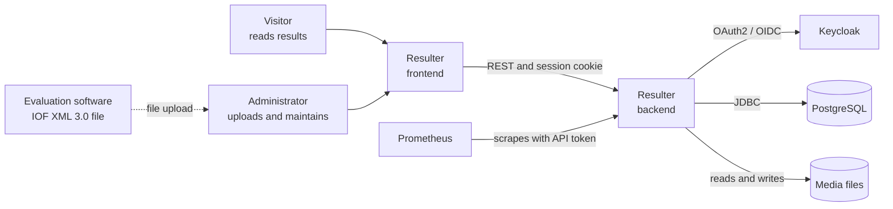
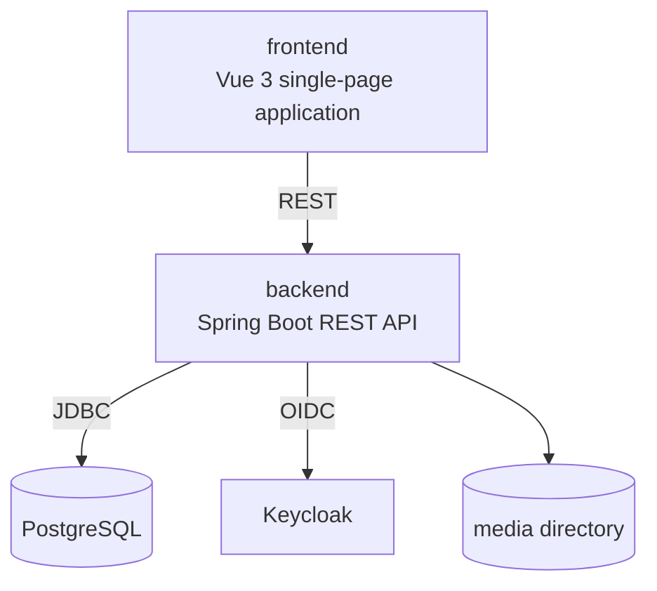
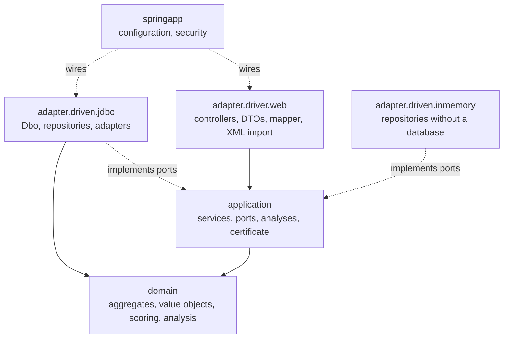
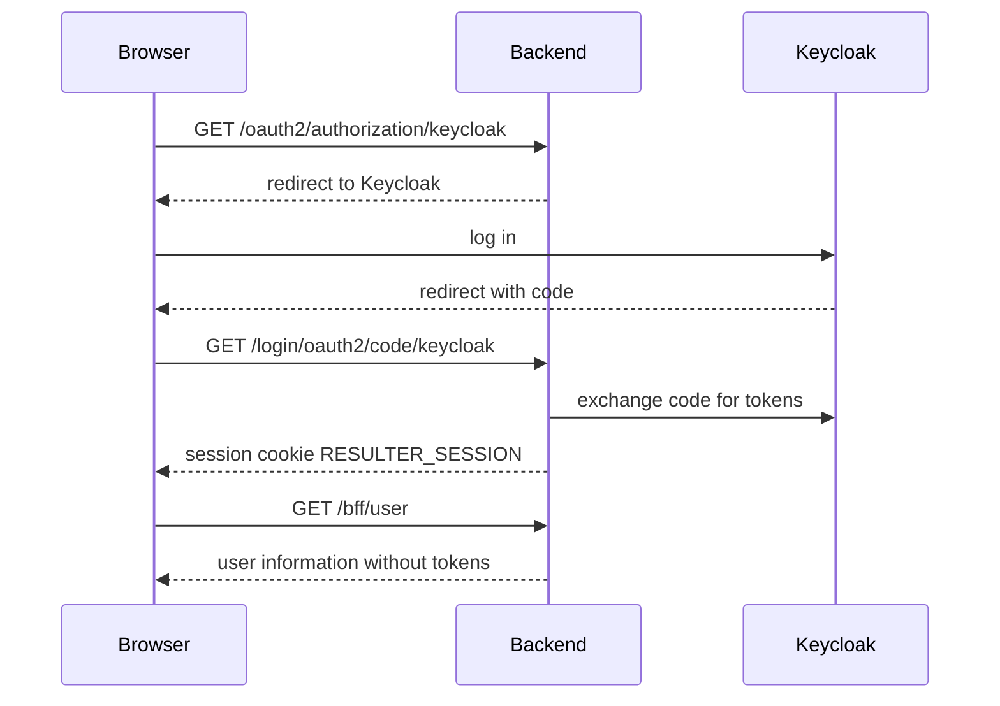
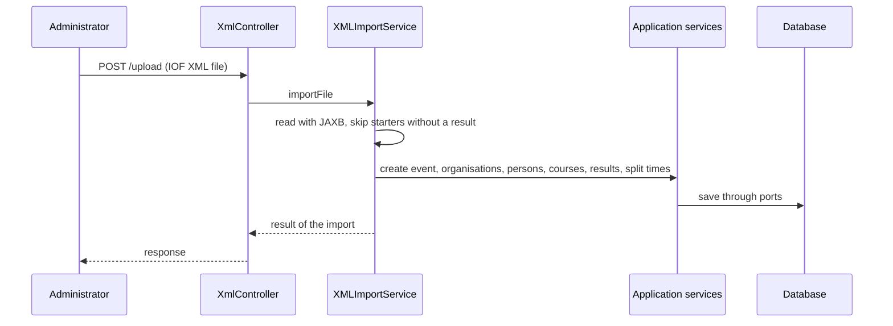
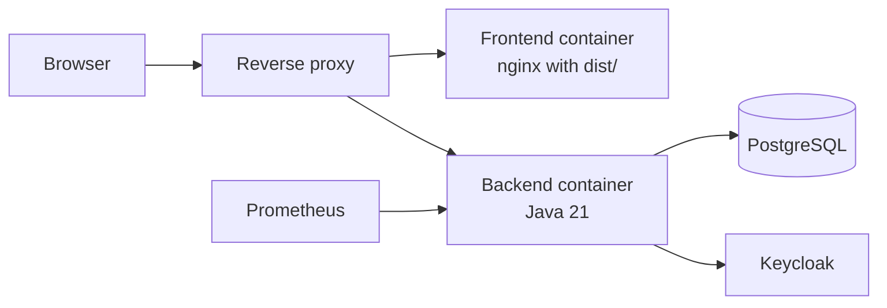
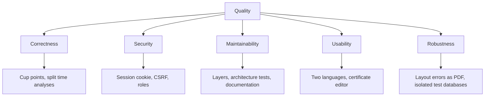

# Architecture (arc42)

> [Deutsch](architecture.de.md) · **English**

This page is the technical documentation of Resulter. It follows the structure of
[arc42](https://arc42.org/overview/) and stays close to what the code actually does. Decisions and
their rationale are kept in the [ADRs](adr/README.md); this page links to them instead of repeating
them. Every change to the architecture updates the affected chapter in both languages in the same
commit ([ADR 0021](adr/0021-bilingual-application-and-documentation.md)).

## 1. Introduction and Goals

Resulter is a web application for orienteering clubs and organisers. It imports result files,
publishes result lists, calculates cup and ranking points, analyses split times and creates
certificates for every participant of an event.

### Requirements

| Requirement | Realisation |
| --- | --- |
| Import results | Result files in the IOF XML standard 3.0 are uploaded by administrators and turned into events, races, courses, persons, organisations and result lists |
| Result lists | Result lists per event, class and race, including split times |
| Cups and rankings | Cup points for Nebel-Cup, Kristall-Cup and the North-East ranking, one calculation strategy per cup type |
| Split time analysis | Ranking, mental resilience, anomaly detection and hanging detection per result list |
| Certificates | A certificate layout per event as JSON, edited in the browser and rendered as PDF in the backend |
| Access control | Anonymous reading of the public lists, login through Keycloak, every other request restricted to the role `ADMIN` |
| Two languages | Interface and documentation in German and English |
| Operations | Health and metrics endpoints for Prometheus, container images from CI |

### Quality goals

| Rank | Goal | Evidence |
| --- | --- | --- |
| 1 | Correct results and cup points | Unit tests on the domain, one strategy per cup type |
| 2 | Secure access | Session cookie instead of tokens in the browser, CSRF protection, role checks in the security chains |
| 3 | Maintainable structure | Hexagonal layers checked by ArchUnit and jMolecules, feature folders in the frontend |
| 4 | Understandable in two languages | `vue-i18n`, bilingual documentation checked by `docs-parity` in CI |

### Stakeholders

| Role | Expectation |
| --- | --- |
| Visitor | Fast, readable result lists and analyses without login |
| Organiser or club | Easy upload of result files and certificates that look like the club's own |
| Administrator | Master data, media and certificates can be maintained in the browser |
| Developer | Clear layers, a reproducible build and documented decisions |
| Operator | Container images, health endpoint and metrics, configuration through environment variables |

## 2. Constraints

| Kind | Constraint | Consequence |
| --- | --- | --- |
| Technical | Java 21, Spring Boot 4.2, Maven | the build uses the Maven wrapper and the parent POM `resulter-parent` |
| Technical | Spring Boot 4 uses Jackson 3 (`tools.jackson.*`) | new JSON code must not import `com.fasterxml.jackson.*` |
| Technical | Vue 3, TypeScript, Vite, pnpm, Nx | frontend commands run through `pnpm` in `frontend/` |
| Technical | PostgreSQL in production, H2 for runs without a server | schema changes only through Liquibase, no database-specific SQL without a guard |
| Technical | Login only through Keycloak (OAuth2/OIDC) | the application manages no passwords |
| Technical | Input format IOF Data Standard 3.0 | `IOF.xsd` is part of the repository, classes are generated |
| Organisational | License CC BY-NC-ND 4.0 | [ADR 0020](adr/0020-license-cc-by-nc-nd-4-0.md) |
| Organisational | Documentation in English and German | `scripts/docs-parity.mjs` checks that both versions have the same shape |
| Organisational | The repository is public | no credentials and no deployment details in files, configuration comes from the environment |

## 3. Context and Scope

### Business context

The evaluation software that creates the result files is not part of the system. Resulter only reads
the exported XML file.

### Technical context

| Neighbour | Interface | Notes |
| --- | --- | --- |
| Browser | HTTPS, REST (JSON), cookie `RESULTER_SESSION`, header `X-XSRF-TOKEN` | the browser never holds an access token |
| Keycloak | OAuth2 authorization code flow, JWT validation through the issuer URI | users, realm roles and groups live there |
| PostgreSQL | JDBC, schema by Liquibase | also holds the table `spring_session` |
| File system | directories from `resulter.media-file-path` and `resulter.media-file-path-thumbnails` | uploaded images and PDFs with thumbnails |
| Prometheus | `/actuator/prometheus` with a static bearer token | [ADR 0019](adr/0019-observability-with-prometheus-and-grafana.md) |
| API clients | bearer JWT on the same REST API | [ADR 0004](adr/0004-bff-with-keycloak-and-session-cookie.md) |

The REST API is described by OpenAPI (`springdoc`, `/v3/api-docs` and `/swagger-ui`).

## 4. Solution Strategy

1. **Hexagonal architecture in the backend.** Layers `domain`, `application` and `adapter`;
   dependencies point inwards, the ports belong to the application
   ([ADR 0001](adr/0001-hexagonal-architecture-backend.md)).
2. **Backend-for-Frontend.** The backend runs the OAuth2 flow and gives the browser only a session
   cookie ([ADR 0004](adr/0004-bff-with-keycloak-and-session-cookie.md)).
3. **Lightweight persistence.** Spring Data JDBC with a persistence model separate from the domain
   model, Liquibase for the schema ([ADR 0002](adr/0002-spring-data-jdbc-instead-of-jpa.md),
   [ADR 0003](adr/0003-postgresql-and-liquibase.md)).
4. **Evaluations as strategies and services.** Cup rules are domain strategies, analyses are
   application services ([ADR 0015](adr/0015-evaluations-cup-strategies-and-split-time-analysis.md)).
5. **Certificates as data.** A JSON layout in a flowing-text model, validated against a schema and
   rendered with iText ([ADR 0009](adr/0009-certificate-layout-as-json-flowing-text-with-itext.md),
   [ADR 0010](adr/0010-certificate-json-schema-validation.md)).
6. **Feature folders in the frontend.** One folder per domain area, server data in TanStack Query,
   client state in Pinia ([ADR 0007](adr/0007-frontend-stack-and-structure.md)).
7. **Rules in tooling instead of conventions.** ArchUnit, jMolecules, type check, linting, secret
   scan and the documentation parity check run automatically.
8. **Documentation as part of the change.** arc42 gives every detail a place; diagrams are Mermaid
   blocks and therefore reviewable as text.

## 5. Building Block View

### Level 1: containers

| Container | Directory | Responsibility |
| --- | --- | --- |
| frontend | `frontend/` | user interface, routing, language switch, certificate editor |
| backend | `backend/` | REST API, import, calculations, certificate rendering, security |
| database | `compose.yml`, `backend/src/main/resources/db/` | persistence, sessions, schema versions |
| monitoring | `prometheus/`, `grafana/` | collection and display of operational metrics |
| documentation | `docs/`, `doc/` | manual, ADRs, plans and this page |

### Level 2: backend

| Package under `de.jobst.resulter` | Content |
| --- | --- |
| `domain` | Aggregates, value objects, `scoring` (cup strategies), `analysis` (split time models), `comparators`, `aggregations` |
| `application` | `*ServiceImpl` use cases, `port` (repository and service interfaces), `analysis` (ranking, table, mental resilience, anomalies, hanging), `certificate` (layout model and PDF rendering), `auth` |
| `adapter.driver.web` | REST controllers with `dto` and `mapper`, `XMLImportService`, generated JAXB classes |
| `adapter.driven.jdbc` | `*Dbo`, Spring Data repositories, `*RepositoryDataJdbcAdapter`, custom queries |
| `adapter.driven.inmemory` | repositories for tests and local runs, switched by `resulter.repository.inmemory=true` |
| `springapp` | Spring configuration: security chains, sessions, data source routing, OpenAPI |

The dependency rules are verified by
[`HexagonalArchitectureTest`](../backend/src/it/java/de/jobst/resulter/HexagonalArchitectureTest.java)
and
[`JMoleculesRulesUnitTests`](../backend/src/test/java/de/jobst/resulter/domain/JMoleculesRulesUnitTests.java):
the domain depends on nothing outside itself, the application does not depend on adapters, adapters
do not depend on each other.

### Level 2: domain

The root entities and their value objects are listed in
[`aggregates.md`](../backend/src/main/java/de/jobst/resulter/domain/aggregates.md). References between
aggregates run through IDs, not through object references.

| Aggregate | Meaning |
| --- | --- |
| `Event` | A competition with start and end, state, organisations and result lists |
| `Race` | One race of an event, identified by its number |
| `Course` | A course with length, climb and controls |
| `ResultList` | The results of an event with `ClassResult`, `PersonResult` and `PersonRaceResult` |
| `SplitTimeList` | The split times of one person in one race |
| `Person`, `Organisation`, `Country` | Master data |
| `Cup`, `CupScoreList` | A cup of a given `CupType` and its calculated scores |
| `EventCertificate`, `MediaFile` | Certificate layout per event and the uploaded media |

Cup points are calculated by `CupTypeCalculationStrategy` implementations in `domain/scoring`, one
for each of `ADD`, `NOR`, `KJ`, `NEBEL` and `KRISTALL`. The analysis models in `domain/analysis`
hold the results of the four split time evaluations.

### Level 3: certificate rendering

The package `application/certificate` is the most self-contained part of the backend.

| Class | Responsibility |
| --- | --- |
| `JsonSchemaValidator` | validates the layout JSON against the schema served at `/certificate_schema` |
| `DocumentDefinition`, `ParagraphDefinition`, `MarginsDefinition` | the layout model |
| `TextBlock`, `MediaBlock` and their deserializers | the two kinds of blocks inside a paragraph |
| `JsonToTextParagraph` | converts the layout model into iText paragraphs |
| `TextBlockProcessor` | replaces placeholders with the data of the participant |
| `CertificateServiceImpl` | orchestrates validation, background image and PDF output |

### Level 2: frontend

Each domain area has a folder under `frontend/src/features/<name>` with `model/`, `services/`,
`pages/` and `widgets/` and its own routes. The areas are `event`, `cup`, `person`, `organisation`,
`country`, `course`, `race`, `analysis`, `certificate`, `media`, `auth`, `start` and a few
static pages (`about`, `imprint`, `privacy`, `backend_version`). Shared parts live in
`src/components`, `features/common` and `features/generic`.

## 6. Runtime View

### Scenario: login through the BFF

The tokens stay on the server. Later requests carry the session cookie and the CSRF header.

### Scenario: importing a result file

The import runs in one transaction. Only the role `ADMIN` may call the endpoint.

### Scenario: downloading a certificate

1. The frontend requests the certificate of one person for an event.
2. `CertificateServiceImpl` loads the layout JSON and validates it against the schema.
3. If validation fails, the service returns the PDF `LayoutDescriptionErrors.pdf` with the errors.
4. Otherwise it draws the background image, replaces placeholders such as `{{FAMILY_NAME}}` and
   `{{RESULT_TIME}}` with the person's data and returns the PDF.

### Scenario: calculating a cup

1. `CupServiceImpl` loads the cup, its events and the result lists through the ports.
2. It selects the strategy for the `CupType` and lets it calculate the `CupScore` list.
3. The result is stored as `CupScoreList` and read from there by the query services.

### Scenario: an end-to-end test with its own database

1. The test calls `POST /createDatabase`; the backend starts a PostgreSQL container with
   Testcontainers, applies the Liquibase changelogs and returns a UUID.
2. Every further request carries the UUID as header or cookie `X-DB-Identifier`.
3. `DataSourceInterceptor` stores it in a `ThreadLocal`, and `DynamicRoutingDataSource` returns the
   matching data source.
4. `DataSourceCleanupScheduler` closes unused data sources and stops their containers.

See [ADR 0005](adr/0005-e2e-database-isolation.md).

## 7. Deployment View

### Infrastructure level 1

- CI builds two container images with Paketo Buildpacks and publishes them to `ghcr.io` under
  `<repository>/backend` and `<repository>/frontend`. Trivy scans them before publishing
  ([ADR 0016](adr/0016-container-images-with-paketo-buildpacks.md)).
- Configuration comes from environment variables at startup; the image contains no credentials. The
  variables are listed in
  [`application.properties`](../backend/src/main/resources/application.properties) and the profile
  files.
- The profiles are `dev` (local PostgreSQL), `prod`, `inmem` (H2 file), `nosecurity`,
  `e2e-frontend-tests` and `native`.
- For development, [`compose.yml`](../compose.yml) starts PostgreSQL 16; Spring Boot can start it
  itself (`spring-boot-docker-compose`).
- Prometheus and Grafana are started locally with `prometheus/startPrometheus.sh` and
  `grafana/startGrafana.sh`.
- How the images reach a server is outside this repository.

### Infrastructure level 2

| Node | Artefact | Needs |
| --- | --- | --- |
| Frontend container | image `<repository>/frontend`, static files from `dist/`, `default.conf` | the reverse proxy in front of it |
| Backend container | image `<repository>/backend`, Java 21 | PostgreSQL, Keycloak, a writable media directory, environment variables |
| Database | PostgreSQL 16, volume for the data | Liquibase runs at backend start |
| Developer machine | `compose.yml`, Maven wrapper, pnpm | Docker, Java 21, Node.js |
| Test run | backend with profile `e2e-frontend-tests`, Testcontainers | Docker |

## 8. Cross-cutting Concepts

### Security

- Four filter chains are evaluated in order: database creation for tests (`@Order(0)`), Prometheus
  (1), bearer JWT API (2), BFF login (3) and the session API for all other requests (4).
- The session lives in the table `spring_session` (timeout 3600 s). The cookie is `HttpOnly`,
  `Secure` and `SameSite=Lax`; one session per user is allowed.
- The CSRF token is read from the cookie `XSRF-TOKEN` and sent back as `X-XSRF-TOKEN`.
- Realm roles and groups from Keycloak become Spring authorities. A fixed list of `GET` endpoints
  (events, cups, results, analyses, persons, organisations, media, version) is public; every other
  request, including `/admin/**`, `/upload` and `/media/upload`, requires `ADMIN`. The actuator
  endpoints require `ADMIN` or `ENDPOINT_ADMIN`, except `health`.
- The frontend image sets a strict Content Security Policy and further security headers in
  [`default.conf`](../frontend/default.conf).

### Persistence

- Liquibase owns the schema; each change is a new file under `db/changelog/jdbc_migrations`.
  PostgreSQL-specific parts are guarded by `dbms: postgresql`.
- Each aggregate has a domain class, a `*Dbo`, a Spring Data repository and an adapter. Mapping
  between them is explicit.
- Evaluation results such as `CupScoreList` are stored and not recalculated for every request.

### Error handling

- `GlobalExceptionHandler` translates exceptions into HTTP responses with a `ProblemDetail` body.
- Unauthenticated requests get `401`, not a redirect. A certificate with an invalid layout becomes a
  PDF that lists the errors.
- The import skips starters that did not start; other malformed input is rejected.

### Internationalisation

- The frontend supports German (default) and English with `vue-i18n`; the language is the first
  part of every URL (`/:locale/...`). New interface texts must be added to `de.json` and `en.json`;
  `i18n.spec.ts` checks the files.
- Imprint and privacy texts come per language from environment variables at build time.
- Documentation exists in both languages and follows the naming rule from
  [ADR 0021](adr/0021-bilingual-application-and-documentation.md).

### Tests

| Level | Tool | Location |
| --- | --- | --- |
| Domain and application | JUnit 5, Mockito, EqualsVerifier | `backend/src/test` |
| Architecture | ArchUnit, jMolecules | `HexagonalArchitectureTest`, `JMoleculesRulesUnitTests` |
| Persistence and web | Spring tests, in-memory repositories, `NPlusOneReviewIT` | `backend/src/test`, `backend/src/it` |
| Frontend units | Vitest | `frontend/test` |
| End to end | Playwright with one database per test | `frontend/e2e`, see [TESTING.md](../frontend/TESTING.md) |

The strategy is described in [ADR 0006](adr/0006-test-strategy.md).

### Observability

- The actuator exposes `health` and `prometheus`; Micrometer provides the metrics.
- `/actuator/prometheus` is protected by its own filter chain and a static bearer token; creation and
  rotation of the token are described in [prometheus-token.md](../doc/prometheus-token.md).
- Logging is configured in `logback.xml`; the level comes from `RESULTER_LOG_LEVEL`.

### Domain model

The domain model is the one in [`aggregates.md`](../backend/src/main/java/de/jobst/resulter/domain/aggregates.md).
Identifiers and attributes are value objects (`EventId`, `EventName`, ...), which keeps invalid
values out of the domain. `EqualsVerifier` checks `equals` and `hashCode` of the domain classes.

### User interface

- Components come from OpenVue ([ADR 0008](adr/0008-openvue-instead-of-primevue.md)), styling from
  Tailwind CSS.
- Server data is fetched and cached with TanStack Query, client state such as the login lives in
  Pinia.
- The certificate editor has three modes: graphical, form and JSON
  ([ADR 0012](adr/0012-certificate-editor-with-three-modes.md)).

### Configuration

- Everything environment-specific (database, Keycloak, CORS, media paths, tokens, log level) comes
  from environment variables; a `.env` file serves local development.
- Profiles switch between database, security and test setups (see chapter 7).

### Transactions

- The import of a result file runs in one transaction; either the whole file is imported or
  nothing.

### Build and CI

- The CI workflow `build.yml` runs the backend compile and tests, `docs-parity`, a secret scan and
  the frontend build and unit tests; `build-paketo.yml` builds and scans the images on tags and release branches.

### Dependency and release management

- Renovate proposes updates, a workflow merges safe ones automatically
  ([ADR 0018](adr/0018-renovate-and-auto-merge.md)).
- Releases are cut on release branches; the version is raised only with `bump-version.sh`
  ([ADR 0017](adr/0017-release-branches-and-version-script.md)).

### Documentation and diagrams

- Diagrams are Mermaid blocks in Markdown files.
- `node scripts/docs-parity.mjs` checks that every document has both language versions with the same
  headings, tables, lists and links. The check runs in the CI job `docs-parity`.

### Extension points

- A new cup type: add a value to `CupType` and an implementation of `CupTypeCalculationStrategy`.
- A new evaluation: add a model in `domain/analysis`, a service in `application/analysis` and an
  endpoint in `SplitTimeAnalysisController`.
- A new placeholder in certificates: extend `TextBlockProcessor` and the reference in the manual.
- A new feature area in the frontend: a folder under `src/features` with its own routes.

## 9. Architecture Decisions

The decisions are recorded as ADRs in [`docs/adr`](adr/README.md).

| ADR | Decision |
| --- | --- |
| [0001](adr/0001-hexagonal-architecture-backend.md) | Hexagonal architecture in the backend |
| [0002](adr/0002-spring-data-jdbc-instead-of-jpa.md) | Spring Data JDBC instead of JPA |
| [0003](adr/0003-postgresql-and-liquibase.md) | PostgreSQL, Liquibase, H2 for local profiles |
| [0004](adr/0004-bff-with-keycloak-and-session-cookie.md) | Backend-for-Frontend with Keycloak and session cookie |
| [0005](adr/0005-e2e-database-isolation.md) | A separate database per end-to-end test |
| [0006](adr/0006-test-strategy.md) | Test strategy |
| [0007](adr/0007-frontend-stack-and-structure.md) | Frontend stack and feature-oriented structure |
| [0008](adr/0008-openvue-instead-of-primevue.md) | OpenVue instead of PrimeVue |
| [0009](adr/0009-certificate-layout-as-json-flowing-text-with-itext.md) | Certificate layout as JSON, rendered with iText |
| [0010](adr/0010-certificate-json-schema-validation.md) | JSON schema validation of the layout |
| [0011](adr/0011-certificate-fonts.md) | Embedded certificate fonts |
| [0012](adr/0012-certificate-editor-with-three-modes.md) | Certificate editor with three modes |
| [0013](adr/0013-certificate-geometry-from-pdf-measurements.md) | Geometry of the graphical view from PDF measurements |
| [0014](adr/0014-iof-xml-import-of-result-files.md) | IOF XML import through generated JAXB classes |
| [0015](adr/0015-evaluations-cup-strategies-and-split-time-analysis.md) | Cup strategies and split time analysis |
| [0016](adr/0016-container-images-with-paketo-buildpacks.md) | Container images with Paketo Buildpacks |
| [0017](adr/0017-release-branches-and-version-script.md) | Release branches and version script |
| [0018](adr/0018-renovate-and-auto-merge.md) | Renovate and controlled auto-merge |
| [0019](adr/0019-observability-with-prometheus-and-grafana.md) | Metrics with Micrometer, Prometheus and Grafana |
| [0020](adr/0020-license-cc-by-nc-nd-4-0.md) | License CC BY-NC-ND 4.0 |
| [0021](adr/0021-bilingual-application-and-documentation.md) | Bilingual application and documentation |
| [0022](adr/0022-unit-tests-in-ci.md) | Unit tests in CI |

## 10. Quality Requirements

### Quality tree

### Quality scenarios

| Quality | Scenario | Expected result |
| --- | --- | --- |
| Correctness | An event is imported and a cup is calculated from it | The scores follow the rules of the cup type, covered by domain tests |
| Security | A request without a session reaches a protected endpoint | The response is `401`, no redirect |
| Security | A user without the role `ADMIN` calls `POST /upload` | The request is rejected |
| Maintainability | A class in `domain` imports an adapter class | The architecture test fails |
| Usability | A user switches the language in the header | The page is shown in the other language at the same place |
| Robustness | A certificate layout violates the schema | The user gets a PDF that lists the errors |
| Isolation | Two end-to-end tests run in parallel | Each works on its own database |
| Documentation | A document exists in one language only | The CI job `docs-parity` fails |

## 11. Risks and Technical Debt

| Risk or debt | Effect | Note |
| --- | --- | --- |
| CI runs the backend and frontend unit tests but no end-to-end tests | Errors that only show in the browser are found only locally | The end-to-end tests need Keycloak and Testcontainers, see [ADR 0006](adr/0006-test-strategy.md) |
| `HexagonalArchitectureTest` lies under `src/it`, which the POM does not include as a source folder | The architecture rule may not run in the standard build | Not verified whether another configuration starts it, see [ADR 0001](adr/0001-hexagonal-architecture-backend.md) |
| UnoCSS configuration next to Tailwind | Possible leftover, two styling approaches | Not checked, see [ADR 0007](adr/0007-frontend-stack-and-structure.md) |
| Inactivity time of test databases differs between code (90 s) and guide (30 s) | Misleading documentation | See [ADR 0005](adr/0005-e2e-database-isolation.md) |
| The Prometheus token has no expiry | A leaked token stays valid until rotation | Manual rotation, see [ADR 0019](adr/0019-observability-with-prometheus-and-grafana.md) |
| Cup rules sit in strategy code | A rule change needs a code change and a release | Accepted for the few supported cups |
| Two versions of every document | They can drift apart | The parity check finds missing structure, not wrong meaning |

## 12. Glossary

| Term | Meaning |
| --- | --- |
| Orienteering | Sport in which participants find control points in terrain with a map |
| Event | A competition, possibly with several races |
| Race | One run of an event, for example one stage |
| Course | The route with start, controls and finish |
| Class | A group of participants by age and gender, for example `H21` |
| Result list | The results of all classes of an event or race |
| Split time | The time at which a participant punched a control |
| IOF XML | The data exchange standard of the International Orienteering Federation, version 3.0 |
| Cup | A series of events with a common points ranking |
| Nebel-Cup, Kristall-Cup | German cups with their own point rules |
| North-East ranking | Ranking over events in the north-east of Germany |
| Mental resilience | Analysis of how a runner performs after a mistake |
| Hanging | Running closely behind another runner through several controls |
| Certificate | A PDF for one participant, created from a layout and a background image |
| Layout | The JSON description of a certificate: paragraphs, text blocks, tab stops, images |
| BFF | Backend-for-Frontend: the backend runs the login and hides the tokens from the browser |
| Aggregate | A group of domain objects that is saved and changed as a unit |
| Port | An interface of the application that an adapter implements |
| Dbo | Database object, the persistence model of an aggregate |
