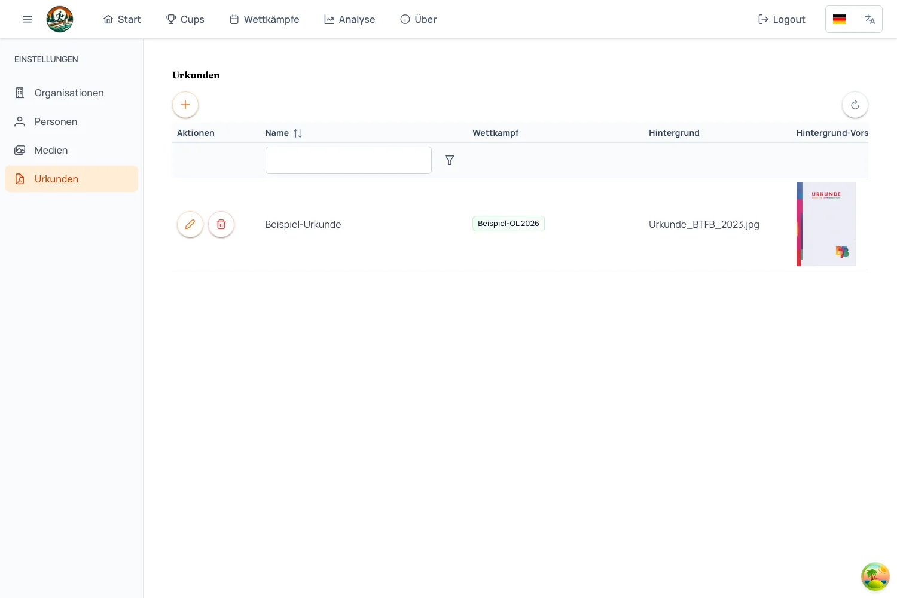

# 1 Einführung

> **Deutsch** · [English](01-introduction.md)

> Dieses Kapitel ist ein Gerüst. Es enthält, was aus dem Quelltext und den Aufnahmen belegt ist.
> Weitere Abschnitte folgen.

## Was Resulter ist

Resulter liest Ergebnisdateien von Orientierungsläufen ein und zeigt daraus Ergebnislisten. Dazu
kommen Cup- und Ranglistenpunkte (Nebel-Cup, Kristall-Cup, Nord-Ost-Rangliste), eine
Splitzeiten-Analyse und Urkunden, die für jeden Teilnehmer erzeugt werden können. Eine kurze
Übersicht steht in der [README](../../README.md) des Projekts.

## Aufbau der Oberfläche

Die Oberfläche hat vier Bereiche:

- **Kopfzeile:** das Menü **Start**, **Cups**, **Wettkämpfe**, **Analyse** und **Über**,
  rechts **Logout** (bei angemeldeten Benutzern) und die Sprachwahl Deutsch/Englisch.
- **Seitenleiste** (Abschnitt **Einstellungen**): **Organisationen**, **Personen**, **Medien** und
  **Urkunden**. Die Einträge sehen Benutzer mit entsprechender Berechtigung.
- **Arbeitsbereich:** die jeweilige Seite, hier die Liste der Urkunden.
- **Fußzeile:** die Version von Frontend und Backend, der angemeldete Benutzer sowie die Links
  **Datenschutz** und **Impressum**.

Der Menüknopf links in der Kopfzeile blendet die Seitenleiste ein und aus.

## Anmelden und Rollen

Die Anmeldung läuft über einen zentralen Anmeldedienst (Keycloak). Dorthin wird man beim Anmelden
weitergeleitet und danach zur gewünschten Seite zurückgebracht. Die technische Beschreibung steht in
[ADR 0004](../adr/0004-bff-with-keycloak-and-session-cookie.de.md).

Was ein Benutzer darf, hängt von seiner Rolle ab. Die Oberfläche kennt diese Berechtigungen:

| Berechtigung | Gilt für |
|---|---|
| Wettkämpfe verwalten | Wettkämpfe anlegen und ändern |
| Ergebnisse hochladen | Ergebnisdateien importieren |
| Cups verwalten | Cups und Wertungen pflegen |
| Berichte ansehen | Auswertungen ansehen (ohne weitere Angabe erlaubt) |
| Benutzer verwalten | Benutzerverwaltung |
| Administration | Einstellungen und Stammdaten |

Der Administrator (Rolle `admin`) hat standardmäßig alle diese Berechtigungen. Welche Rollen
außer `admin` es im Betrieb gibt, ist im Quelltext nicht festgelegt. Sie werden im
Anmeldedienst gepflegt.

## Die Urkunden-Seiten

Alle Urkunden-Funktionen sind in der Seitenleiste unter **Urkunden** erreichbar. Sie sind im
[Kapitel 2](02-certificates.de.md) beschrieben, der Editor in den Kapiteln 3 bis 5.

## Offene Abschnitte

- Navigation durch Wettkämpfe, Ergebnislisten und Cups (Kapitel 7 und 8)
- Sprachwahl und Darstellung auf kleinen Bildschirmen
- Rollen und Berechtigungen im Betrieb (Rücksprache mit dem Betreiber nötig)
