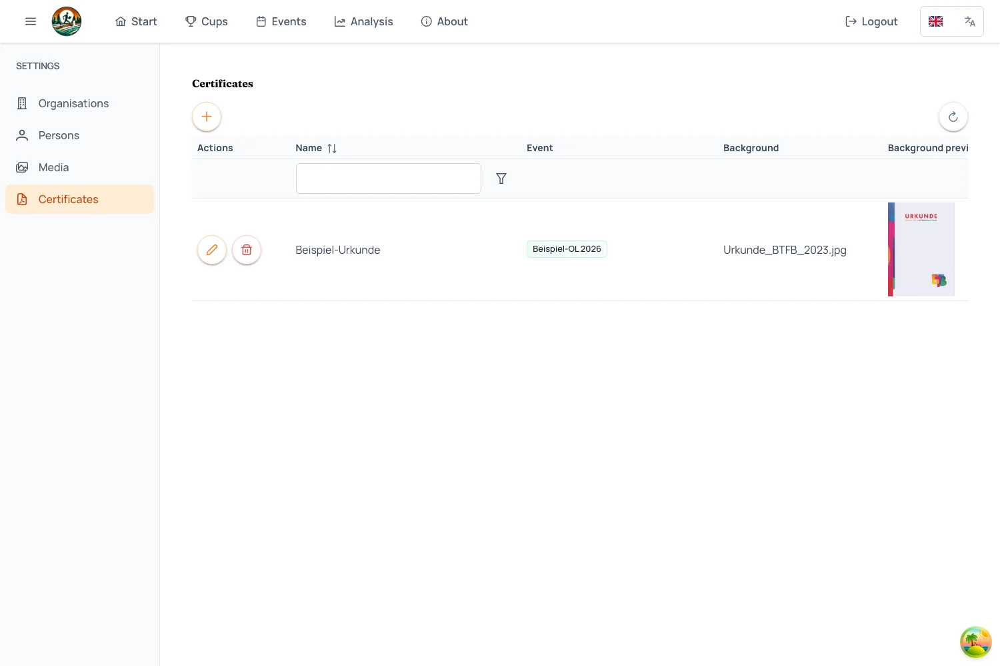

# 1 Introduction

> [Deutsch](01-introduction.de.md) · **English**

> This chapter is an outline. It contains what is verified by the source code and the
> screenshots. More sections will follow.

## What Resulter is

Resulter reads result files from orienteering events and shows result lists from them. It also
provides cup and ranking points (Nebel-Cup, Kristall-Cup, Nord-Ost ranking), a split time
analysis and certificates that can be generated for each participant. A short overview is in the
project [README](../../README.md).

## Layout of the interface

The interface has four areas:

- **Header:** the menu **Start**, **Cups**, **Events**, **Analysis** and **About**,
  on the right **Logout** (for logged-in users) and the language selection German/English.
- **Sidebar** (section **Settings**): **Organisations**, **Persons**, **Media** and
  **Certificates**. Users see the entries they have the permission for.
- **Work area:** the current page, here the list of certificates.
- **Footer:** the version of frontend and backend, the logged-in user and the links
  **Privacy Policy** and **Imprint**.

The menu button on the left of the header shows and hides the sidebar.

## Logging in and roles

Login runs through a central login service (Keycloak). You are redirected there when you log in
and brought back to the requested page afterwards. The technical description is in
[ADR 0004](../adr/0004-bff-with-keycloak-and-session-cookie.md).

What a user may do depends on their role. The interface knows these permissions:

| Permission | Applies to |
|---|---|
| Manage events | Creating and changing events |
| Upload results | Importing result files |
| Manage cups | Maintaining cups and scores |
| View reports | Viewing evaluations (allowed unless stated otherwise) |
| Manage users | User management |
| Administration | Settings and master data |

The administrator (role `admin`) has all of these permissions by default. Which roles besides
`admin` exist in operation is not defined in the source code. They are maintained in the login
service.

## The certificate pages

All certificate functions are available in the sidebar under **Certificates**. They are described
in [chapter 2](02-certificates.md), the editor in chapters 3 to 5.

## Open sections

- Navigation through events, result lists and cups (chapters 7 and 8)
- Language selection and display on small screens
- Roles and permissions in operation (needs confirmation from the operator)
