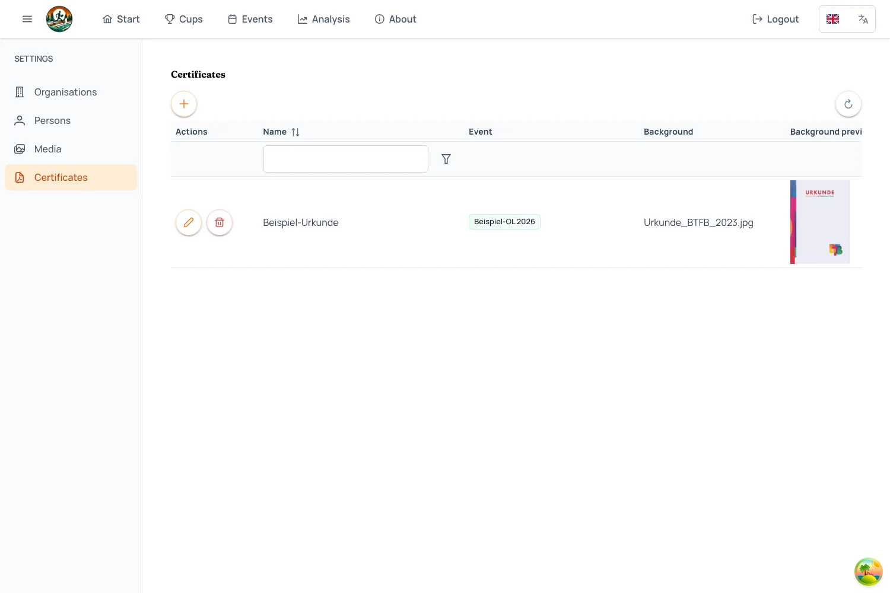
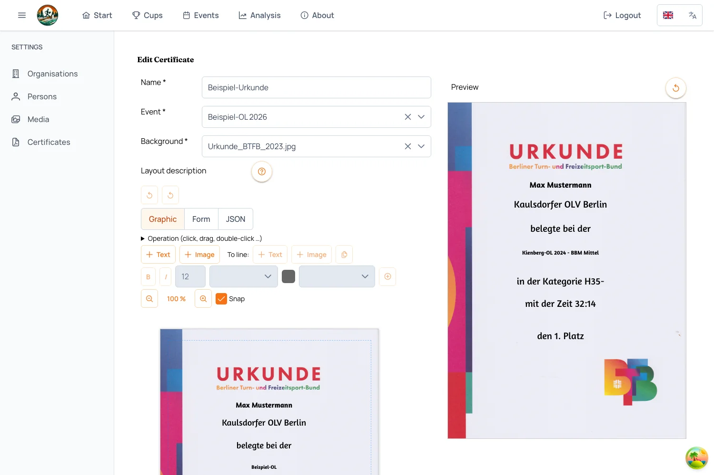
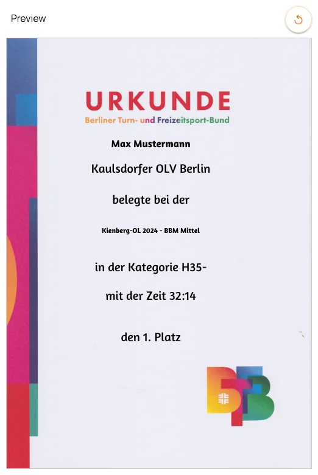
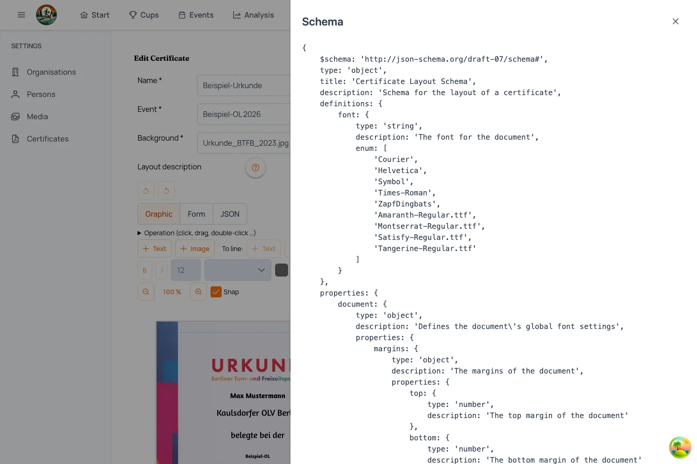

# 2 Certificates

> [Deutsch](02-certificates.de.md) · **English**

In Resulter, a **certificate** is a template. From it, the application generates a PDF for each
participant of an event with their name, position, time and club. This chapter describes how to
manage the templates and the principle of the layout. The three ways to edit a layout are
described in chapters 3 to 5.

## The list of certificates

The page **Certificates** (sidebar, section **Settings**) shows all templates.

Logged-in users see the list. Only administrators may **create, edit and delete**.

| Element | Meaning |
|---|---|
| Plus button above the table | Create a new certificate |
| Arrow button at the top right | Reload the list |
| Column **Actions** | Edit the certificate (pencil) or delete it (trash can) |
| Column **Name** | Name of the template, sortable, with a filter field below |
| Column **Event** | The event the template was created for |
| Column **Background** | File name of the background image |
| Column **Background preview** | Reduced view of the background |

The table shows 10 entries per page (adjustable from 5 to 500) and remembers sorting and filters
as long as the session is open in the browser.

## Creating or editing a certificate

The plus button or the pencil opens the page **Edit Certificate**. The fields and the editor are
on the left, the preview on the right.

### Fields

| Field | Meaning |
|---|---|
| **Name** \* | Freely chosen name of the template |
| **Event** \* | The event used to generate the preview |
| **Background** \* | The image the text is printed on (selection with search and preview) |
| **Layout description** | The layout of the text (see below and chapters 3 to 5) |
| **Primary** | Marks the main template |

An asterisk (\*) marks required fields. An empty required field has a red outline. Saving is done
with the disk button below the form, and the arrow next to it leads back to the list.

**Background:** The selection shows the images from the media management (sidebar **Media**).
Background images and logos are uploaded there. The background is fitted into the page as a whole
image, proportionally, and centred.

**Primary:** The checkmark is saved with the certificate. In the program code it is currently not
evaluated anywhere (as of 4.12.3). It therefore has no visible effect.

### The preview

On the right, the application generates the real PDF, as it is also produced for the
participants.

- The preview reloads automatically shortly after you change the layout. The round arrow at the
  top right reloads it immediately.
- It uses sample data for the person (Max Mustermann, Kaulsdorfer OLV Berlin, H35-,
  32:14, 1st place) and the name of the selected event. The graphic page view of the editor, in
  contrast, works with fixed sample values and shows "Beispiel-OL" as the event name. The
  difference is easy to see in the images of this manual.
- The preview is the authoritative display. The page view in the editor is an approximation (see
  [chapter 6](06-certificate-reference.md#limits-of-the-page-view)).
- If the layout is faulty, the preview shows a PDF with the error texts instead of the
  certificate. The editor itself also shows the errors (see
  [chapter 5](05-certificate-editor-json.md#error-messages)).

## The layout: flowing text in paragraphs

The layout does not describe text at fixed coordinates but **flowing text**. This determines how
everything works:

- A **page** consists of **paragraphs** that stand one below the other from top to bottom.
- A **paragraph** has spacing above and below, optionally an indent on the left and right, and
  contains one or more **blocks** that stand next to each other in one line.
- A **block** is either a **text** (with font size, font, bold, italic, colour) or an **image**
  (with width).
- Where a block stands in the line is determined by the **tab stops** of the paragraph:
  positions with an alignment (left, right, centred, anchor). The block stands on the first tab
  stop after the end of the previous block.
- A paragraph without its own tab stops has a centred tab stop at 261.5 pt, so the text
  stands in the middle of the page.
- The **page margins** belong to the document. If they are not specified, 36 pt applies on all
  sides. If there are document settings without margins, 30 pt applies at the top and bottom and
  20 pt on the left and right.

Because the text flows, everything below moves when you make a paragraph taller or write it
larger. By default, the page view of the editor compensates for this when moving and scaling (see
[chapter 3](03-certificate-editor-graphic.md)).

The reasoning behind this model is in
[ADR 0009](../adr/0009-certificate-layout-as-json-flowing-text-with-itext.md).

## Placeholders

Texts can contain placeholders that are replaced by the participant's data when the certificate
is generated, for example `{{GIVEN_NAME}} {{FAMILY_NAME}}`. The list is in
[chapter 6](06-certificate-reference.md#placeholders).

## The schema help

Next to the heading **Layout description**, the button with the question mark opens the
description of the layout format (JSON schema) in a sidebar. It lists all allowed fields, fonts
and value ranges.

## Assigning a certificate to an event

The certificate is selected in the event form (field **Certificate**). How participants then
download the certificate and what administrators see in the statistics of the generated
certificates is described in chapter 7 (in preparation).
