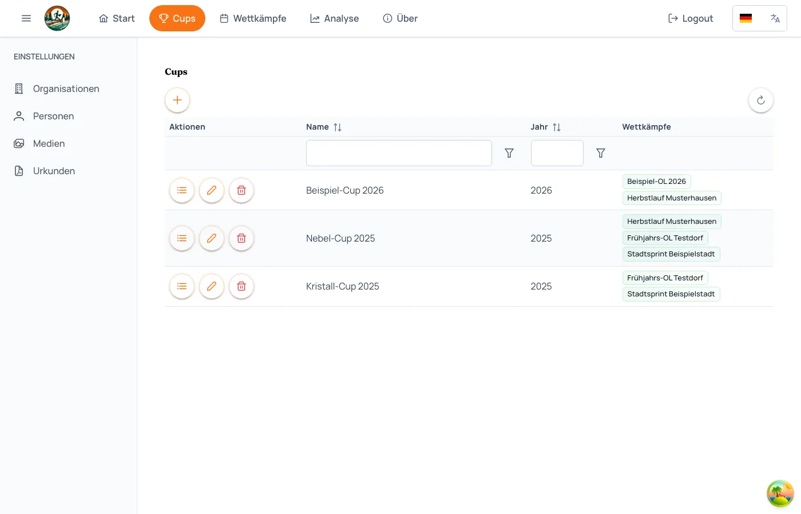
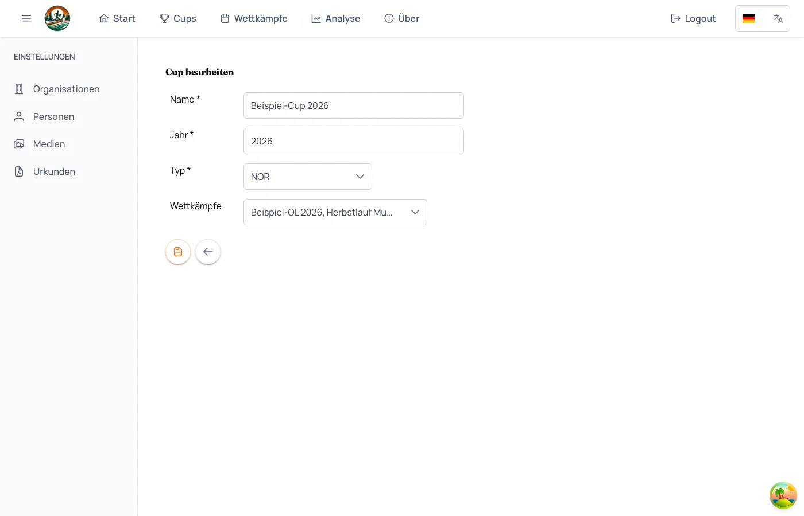
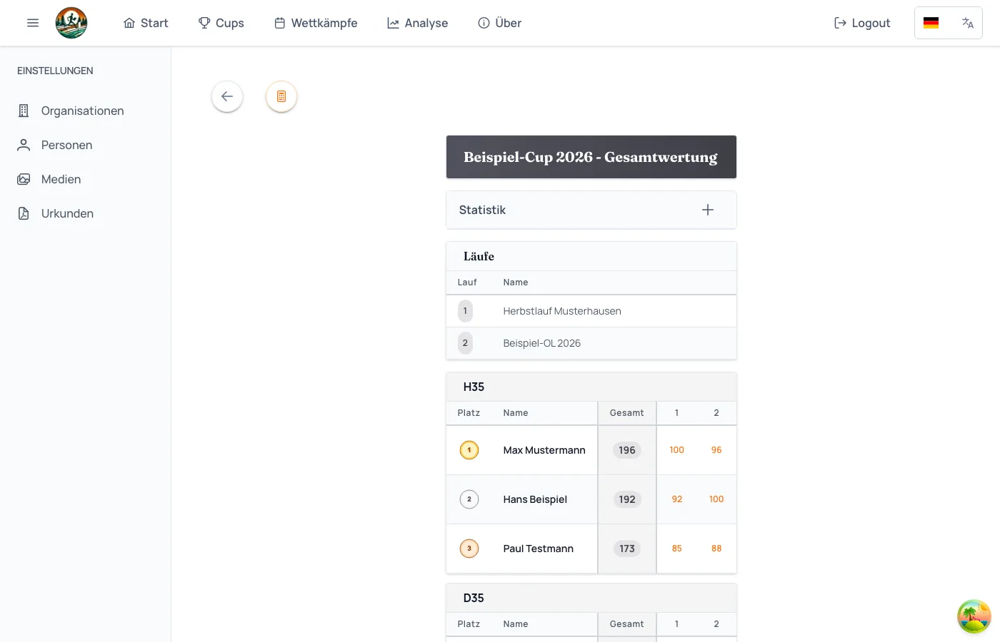
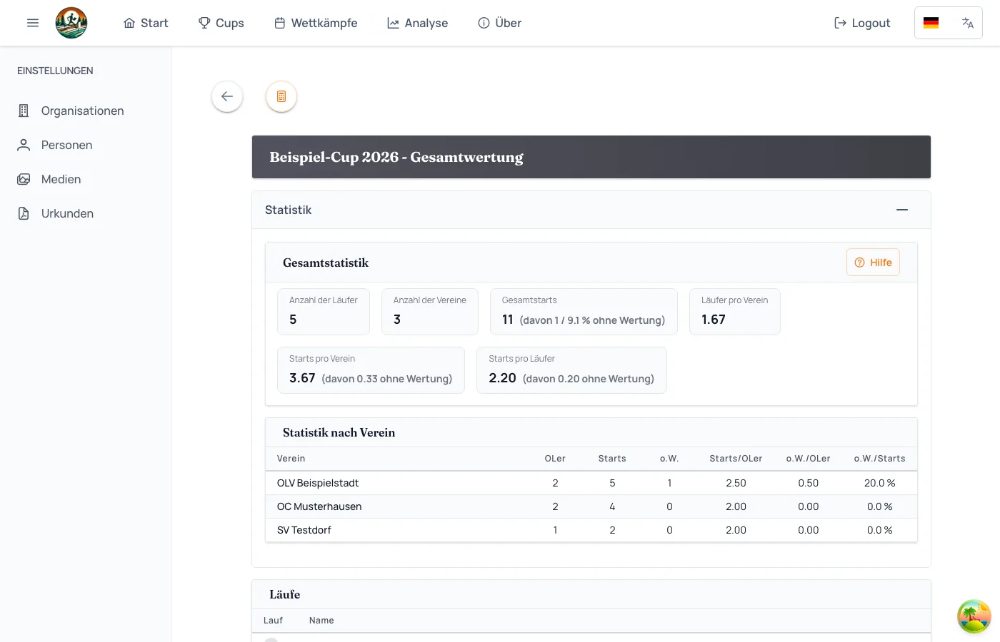

# 2 Cups und Ranglisten

> **Deutsch** · [English](02-cups-and-rankings.md)

Ein **Cup** fasst mehrere Wettkämpfe eines Jahres zu einer Wertung zusammen. Resulter berechnet
für jedes Ergebnis dieser Wettkämpfe Punkte und addiert sie. Welche Wettkämpfe zu einem Cup
gehören, legt der Administrator fest. Wie die Punkte berechnet werden, hängt vom **Typ** des Cups
ab. Dieses Kapitel beschreibt die Liste der Cups, das Anlegen und Bearbeiten eines Cups, die vier
Typen mit ihren Wertungsregeln, die Ergebnisseiten und die Statistik.

## Die Liste der Cups

Die Seite **Cups** (obere Navigation) zeigt alle Cups. Die Liste und die Ergebnisseiten lassen
sich ohne Anmeldung öffnen. Das folgt aus der Sicherheitskonfiguration des Backends, die allen
den lesenden Zugriff auf die Cup-Daten erlaubt.

| Element | Bedeutung |
|---|---|
| Plus-Knopf über der Tabelle | Neuen Cup anlegen (nur Administratoren) |
| Spalte **Name** | Name des Cups, sortierbar, mit Filterfeld darunter |
| Spalte **Jahr** | Jahr des Cups, sortierbar, mit Filterfeld darunter |
| Spalte **Wettkämpfe** | Die Wettkämpfe des Cups als Chips, ein Klick öffnet die Ergebnisse des Wettkampfs in einem neuen Tab |
| Knopf mit Listensymbol (Tooltip **Ergebnisse**) | Ergebnisseite des Cups öffnen |
| Stift- und Papierkorb-Knopf | Cup bearbeiten oder löschen (nur Administratoren) |

Die Tabelle zeigt 10 Einträge je Seite (einstellbar von 5 bis 100), ist absteigend nach Jahr
sortiert und merkt sich Sortierung und Filter, solange die Sitzung im Browser offen ist.

## Einen Cup anlegen oder bearbeiten

Der Plus-Knopf öffnet die Seite **Cup anlegen**, der Stift die Seite **Cup bearbeiten**. Beide
verwenden dasselbe Formular.

| Feld | Bedeutung |
|---|---|
| **Name** \* | Name des Cups, wird als Überschrift der Ergebnisseite angezeigt |
| **Jahr** \* | Jahr des Cups, eine ganze Zahl von 1970 bis 9999, voreingestellt ist das aktuelle Jahr |
| **Typ** \* | Typ des Cups, Auswahl aus einer Liste (siehe nächster Abschnitt) |
| **Wettkämpfe** | Die Wettkämpfe, die für den Cup zählen, Mehrfachauswahl mit Suchfeld |

Ein Stern (\*) kennzeichnet Pflichtfelder. Ein leeres Pflichtfeld ist rot umrandet. Cups anlegen,
ändern und löschen dürfen nur Administratoren. Das Backend erzwingt dies bei jeder Anfrage.

## Die Cup-Typen

Die Auswahl im Feld **Typ** zeigt die Kennungen der Typen so, wie sie gespeichert sind.

| Typ | Bedeutung | Wertung nach | Punkte je Lauf |
|---|---|---|---|
| `NEBEL` | Nebel-Cup (die Ergebnisseite heißt im Programmcode `FogCupResults`) | Verein | Bester Läufer jedes Vereins je Klasse, Punkte nach Zeitrückstand auf den Sieger |
| `KRISTALL` | Kristall-Cup | Verein | Bester Läufer jedes Vereins je Klasse, Punkte nach der Reihenfolge der Vereine |
| `KJ` | KJ-Pokal | Verein | Alle Läufer der Jugendklassen, Punkte nach Platz |
| `NOR` | Nord-Ost-Rangliste | Person je Klasse | Punkte nach Zeitrückstand auf den Sieger, die besten Ergebnisse zählen |
| `ADD` | Wählbar, aber ohne Wertung | keine | Die Berechnung liefert keine Punkte und es gibt keine Ergebnisseite |

Wofür die Abkürzungen FOG und KJ stehen, ist im Quelltext nicht belegt.

Die Wertungsregeln sind im Programmcode des Backends festgelegt. Sie lassen sich in der
Oberfläche nicht ändern.

### Was in den einzelnen Typen zählt

| Regel | NEBEL | KRISTALL | KJ | NOR |
|---|---|---|---|---|
| Berücksichtigte Ergebnisse | Status OK | Status OK | Alle außer außer Konkurrenz, nicht gestartet, nicht gemeldet | Status OK |
| Ausgeschlossene Klassen | BK, BL, Beg, Trim, Trimm, Beginner, OffK, OffL, D/H-12 Be, D/H -12b, Begleitung | BK, BL, Beg, Trim, Beginner, OffK, OffL, D/H-12 Be | Alle außer D10, D12, D14, D16, D18, H10, H12, H14, H16, H18 | BK, BL, Beg, Trim, Hasen, Beginner, OffK, OffL, Begleitung, KL und die Anfängerklassen D/H10B und D/H12B in mehreren Schreibweisen |
| Ausgeschlossene Vereine | Kurzname enthält "ohne" oder "Volkssport" | Kurzname enthält "ohne", "Volkssport" oder "Volkssport Berlin" | Nur Vereine unterhalb der Regionen der Organisation mit dem Kurznamen KJ zählen | Nur Vereine unterhalb der Organisation mit dem Kurznamen NOR zählen |

Bei `KJ` werden Klassennamen ohne Bindestriche und ohne Leerzeichen an den Enden verglichen, also
zählt "D-10" als "D10". Bei `NOR` gilt das Gleiche, und zusätzlich werden die Hauptklassen
zusammengefasst: D19, D19L, D19AL, D20, D21, D21L und D21AL werden zu **D19L**, D19K, D19AK, D21K
und D21B werden zu **D19K**. Bei den Herren gilt dasselbe mit H.

## So werden die Punkte berechnet

### Zeitpunkte (Nebel-Cup und Nord-Ost-Rangliste)

Beide Typen vergleichen die Laufzeit eines Läufers mit der Zeit des Ersten der Klasse. Die Punkte
hängen davon ab, wie weit die Zeit über der Siegerzeit liegt.

| Zeit im Vergleich zur Siegerzeit | Punkte |
|---|---|
| gleich der Siegerzeit | 12 |
| bis 105 % | 11 |
| bis 110 % | 10 |
| bis 115 % | 9 |
| bis 120 % | 8 |
| bis 125 % | 7 |
| bis 135 % | 6 |
| bis 150 % | 5 |
| bis 170 % | 4 |
| bis 200 % | 3 |
| bis 300 % | 2 |
| über 300 % | 1 |

Im Nebel-Cup erhält je Klasse und Lauf nur der beste Läufer jedes Vereins Punkte, die anderen
des Vereins erhalten keine. In der Nord-Ost-Rangliste erhält jeder Läufer Punkte.

### Kristall-Cup

Je Klasse und Lauf zählt nur der beste Läufer jedes Vereins, in der Reihenfolge der Ergebnisse.
Der beste Verein erhält 10 Punkte, der nächste 9 und so weiter, mindestens 1 Punkt. Vereine mit
genau derselben Laufzeit teilen sich die Punkte. Die nächste Gruppe erhält dann die Punkte der
vorherigen Gruppe minus die Anzahl der Vereine darin, aber nicht weniger als 1.

### KJ-Pokal

Je Klasse zählen alle Läufer, die gestartet sind. Läufer mit dem Status Fehlstempel, aufgegeben
oder disqualifiziert erhalten je 1 Punkt. Die übrigen werden nach Platz sortiert. Bei n Läufern in
der Klasse gelten diese Punkte:

| Platz | Punkte |
|---|---|
| 1 | n + 3 |
| 2 | n + 1 |
| 3 | n - 1 |
| 4 und weiter | n - 3, danach für jeden weiteren Läufer ein Punkt weniger |

Läufer mit demselben Platz erhalten dieselben Punkte. In n sind alle gestarteten Läufer der
Klasse gezählt, auch die mit 1 Punkt. Bei 10 Läufern ohne Besonderheiten ergibt das 13, 11, 9, 7,
6, 5, 4, 3, 2 und 1 Punkte. Wie andere Status eingeordnet werden, ist im Quelltext nicht belegt.

### Vereinssumme und Streichergebnisse

Bei den Typen mit Vereinswertung ist die Vereinspunktzahl eines Laufs die Summe der Punkte seiner
Läufer. Die Gesamtsumme eines Vereins ist die Summe über alle Läufe des Cups. Alle Läufe zählen.

Die Nord-Ost-Rangliste wird nach Person und Klasse gewertet. Die Summe einer Person besteht aus
ihren besten Ergebnissen. Bei n Wettkämpfen im Cup zählen die besten n / 2 + 1 Ergebnisse, mit
ganzzahliger Division.

| Wettkämpfe im Cup | Gezählte Ergebnisse |
|---|---|
| 1 | 1 |
| 2 | 2 |
| 3 | 2 |
| 4 | 3 |
| 5 | 3 |
| 6 | 4 |

### Wettkämpfe mit mehreren Läufen

Hat ein Wettkampf nur eine Ergebnisliste, wird sie immer gewertet. Hat er mehrere, entscheidet
die Einstellung `aggregatedScore` des Wettkampfs. Ist sie an, wird nur das Gesamtergebnis (Lauf 0)
gewertet. Ist sie aus, werden nur die einzelnen Läufe (Lauf 1, 2, 3 und so weiter) gewertet.

Personen mit der Markierung **Ignorieren** werden in Ergebnislisten und Cup-Punkten nicht
berücksichtigt.

## Punkte berechnen

Die Ergebnisseiten zeigen Punkte, die vorher berechnet und gespeichert wurden. Nach einer Änderung
der Wettkämpfe eines Cups oder nach einem Import von Ergebnissen müssen die Punkte neu berechnet
werden. Administratoren tun das mit dem Knopf mit dem Taschenrechner-Symbol (Tooltip **Berechne
Cup-Punkte**) auf der Ergebnisseite. Andere Benutzer sehen diesen Knopf nicht.

Ob sich die Seite nach der Berechnung selbst aktualisiert, ist im Quelltext nicht belegt.

## Die Ergebnisseiten

Die Seite eines Cups hat den Knopf **Zurück** (Pfeil), der zur Liste führt. Darunter erscheint die
Seite für den Typ des Cups. Plätze werden mit Gleichstand vergeben, Vereine oder Personen mit
gleichen Punkten teilen sich also einen Platz. Die Plätze 1 bis 3 sind mit einer Medaille
dargestellt, die übrigen mit einer Zahl. Auf den Seiten für Nebel-Cup, Kristall-Cup und KJ-Pokal
sind Überschriften und Spaltentitel feste deutsche Texte (zum Beispiel "Vereinswertung", "Platz",
"Punkte") und werden nicht übersetzt. Nur die Nord-Ost-Seite und die Statistik folgen der Sprache
der Oberfläche.

| Typ | Seite | Haupttabelle |
|---|---|---|
| `NEBEL` | `FogCupResults` | Vereine mit Platz, Verein und Punkten, danach Details je Verein |
| `KRISTALL` | `KristallCupResults` | Vereine mit Summe, einer Spalte je Klasse und einer je Lauf |
| `KJ` | `KjPokalResults` | Vereine mit Summe und einer Spalte je Lauf (L1, L2, ...) |
| `NOR` | `NorCupResults` | Eine Tabelle je Klasse mit Personen, Summe und einer Spalte je Wettkampf |

### Nebel-Cup

Die Seite trägt als Überschrift den Namen des Cups und "Gesamtwertung". Die Tabelle
"Vereinswertung" listet die Vereine mit mehr als 0 Punkten, sortiert nach Punkten. Darunter zeigt
der Abschnitt "Details" für jeden Verein seine Läufer mit Klasse und Punkten. Punkte derselben
Person und Klasse aus mehreren Läufen werden addiert.

### Kristall-Cup

Die Tabelle "Vereinswertung" listet die Vereine nach Gesamtpunkten, bei Gleichstand nach
Vereinsname sortiert. Der Verein "ohne Verein" wird nicht angezeigt. Zu jedem Verein zeigt die
Tabelle die Punkte je Klasse und die Punkte je Lauf.

### KJ-Pokal

Die Seite beginnt mit dem eingeklappten Bereich **Statistik** (siehe unten), danach folgt die
Liste "Läufe" mit den Wettkämpfen des Cups, jeweils mit Link zu den Ergebnissen. Die Tabelle
"Vereinswertung" zeigt die Vereine mit der Summe und den Punkten jedes Laufs (L1 bis Ln). Vereine
mit gleicher Summe teilen sich den Platz. Der Abschnitt "Details" listet je Verein und Lauf die
Läufer mit Klasse, Name und Punkten. Ein Klick auf die Punkte öffnet das Ergebnis der Person in
den Wettkampf-Ergebnissen in einem neuen Tab.

### Nord-Ost-Rangliste

Die Überschrift zeigt den Namen des Cups und **Gesamtwertung**. Nach dem eingeklappten Bereich
**Statistik** listet die Tabelle **Läufe** die Wettkämpfe des Cups in Datumsreihenfolge mit
Nummer und Name. Für jede Klasse gibt es eine Tabelle mit den Spalten **Platz**, **Name**,
**Gesamt** und einer Spalte je Wettkampf. Es erscheinen nur Personen mit mehr als 0 Punkten,
bei Gleichstand nach Name sortiert. Ein Klick auf die Punkte eines Wettkampfs öffnet das Ergebnis
der Person in einem neuen Tab. Ohne Punkte zeigt die Seite **Noch keine Punkte vorhanden.**

## Die Statistik

Der Bereich **Statistik** erscheint auf den Seiten für KJ-Pokal und Nord-Ost-Rangliste. Er ist
zunächst eingeklappt. Der Knopf **Hilfe** öffnet einen Dialog, der alle Kennzahlen erklärt.

Die Statistik zählt alle Starts von Personen und Klassen, die für den Typ des Cups gültig sind,
auch Starts ohne Wertung. Ein Start ist ohne Wertung, wenn der Status nicht OK ist, zum Beispiel
aufgegeben, disqualifiziert, Fehlstempel oder nicht gestartet. Die Kennzahlen sind auf zwei
Nachkommastellen gerundet.

| Kennzahl | Bedeutung |
|---|---|
| **Anzahl der Läufer** | Verschiedene Personen mit mindestens einem Start |
| **Anzahl der Vereine** | Verschiedene Vereine dieser Personen |
| **Gesamtstarts** | Alle Starts, in Klammern Anzahl und Anteil der Starts ohne Wertung |
| **Läufer pro Verein** | Anzahl der Läufer geteilt durch Anzahl der Vereine |
| **Starts pro Verein** | Anzahl der Starts geteilt durch Anzahl der Vereine |
| **Starts pro Läufer** | Anzahl der Starts geteilt durch Anzahl der Läufer |

Unter den Kennzahlen zeigt die Tabelle **Statistik nach Verein** eine Zeile je Verein, absteigend
nach der Zahl der Läufer sortiert.

| Spalte | Bedeutung |
|---|---|
| **Verein** | Name des Vereins |
| **OLer** | Anzahl der verschiedenen Personen des Vereins |
| **Starts** | Alle Starts des Vereins |
| **o.W.** | Starts ohne Wertung |
| **Starts/OLer** | Starts geteilt durch Läufer |
| **o.W./OLer** | Starts ohne Wertung geteilt durch Läufer |
| **o.W./Starts** | Anteil der Starts ohne Wertung an allen Starts |

## Wer darf was

| Aktion | Nicht angemeldet | Angemeldet | Administrator |
|---|---|---|---|
| Liste und Ergebnisseiten ansehen | ja | ja | ja |
| Bearbeiten-Seite eines Cups öffnen | nein | nein | ja |
| Cup anlegen, ändern, löschen | nein | nein | ja |
| Cup-Punkte berechnen | nein | nein | ja |

Das Backend verlangt für Anlegen, Ändern, Löschen und Berechnen die Rolle Administrator. Die
Knöpfe in der Oberfläche sehen nur Administratoren. Die Bearbeiten-Seite zeigt ihr Formular nur
Administratoren. Die Benutzerdaten enthalten eine Berechtigung `canManageCups`. Ob sie Rechte über
die Rolle Administrator hinaus gibt, ist im Quelltext nicht belegt, weil die Cup-Seiten nur die
Rolle Administrator prüfen.
