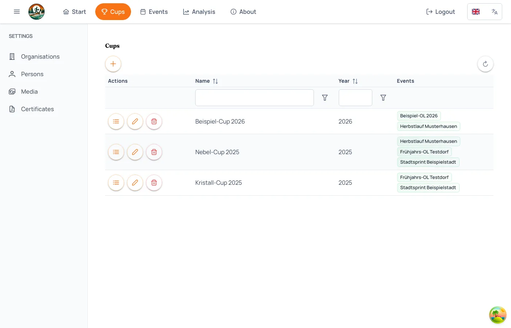
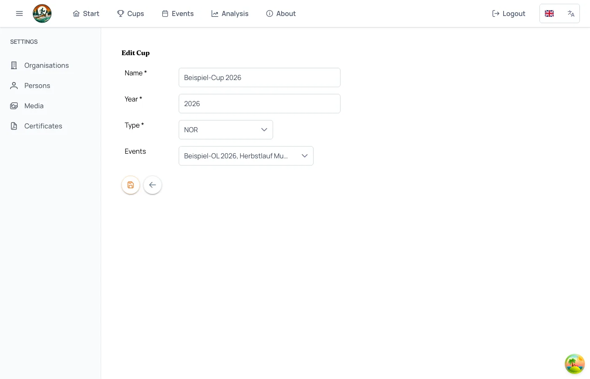
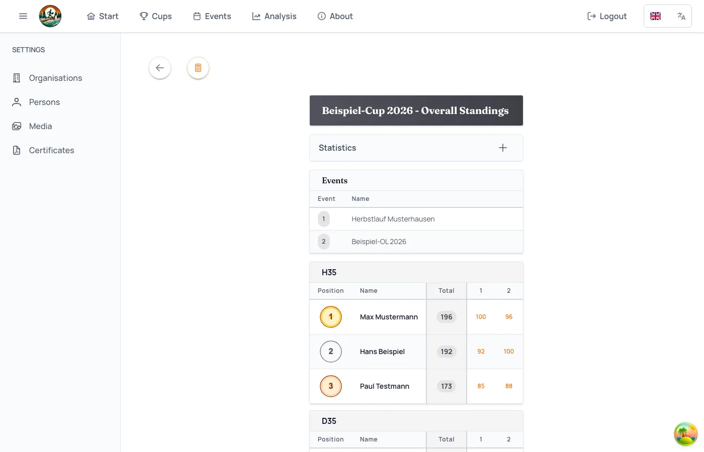
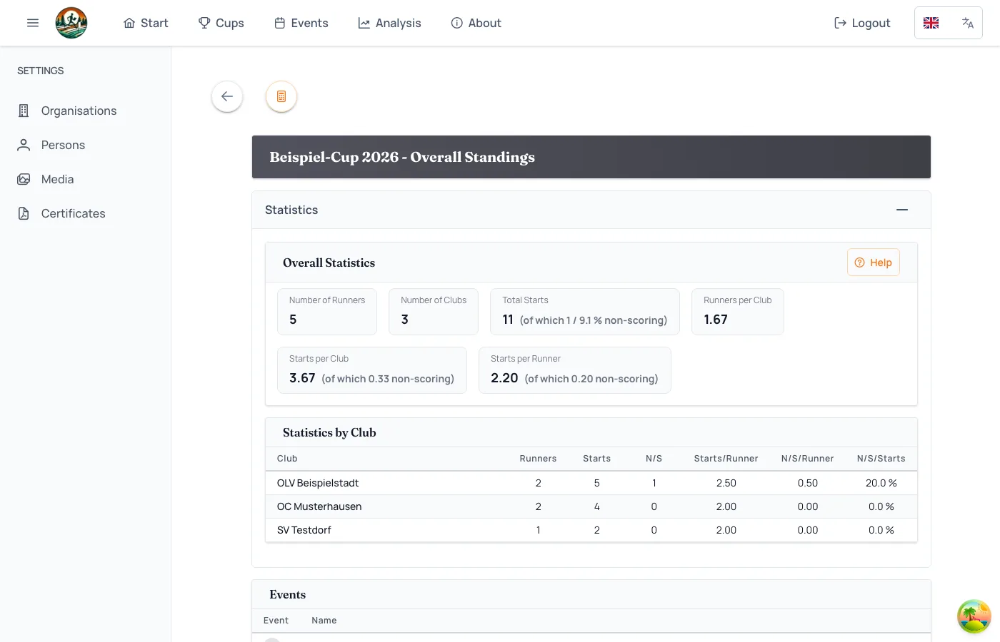

# 2 Cups and rankings

> [Deutsch](02-cups-and-rankings.de.md) · **English**

A **cup** combines several events of one year into one ranking. Resulter calculates points for
every result of these events and adds them up. Which events belong to a cup is set by the
administrator. How the points are calculated depends on the **type** of the cup. This chapter
describes the list of cups, creating and editing a cup, the four types with their scoring rules,
the result pages and the statistics.

## The list of cups

The page **Cups** (top navigation) shows all cups. The list and the result pages can be opened
without logging in. This follows from the security configuration of the backend, which allows
read access to the cup data to everyone.

| Element | Meaning |
|---|---|
| Plus button above the table | Create a new cup (administrators only) |
| Column **Name** | Name of the cup, sortable, with a filter field below |
| Column **Year** | Year of the cup, sortable, with a filter field below |
| Column **Events** | The events of the cup as chips, a click opens the event results in a new tab |
| Button with list icon (tooltip **Results**) | Open the result page of the cup |
| Pencil and trash can buttons | Edit or delete the cup (administrators only) |

The table shows 10 entries per page (adjustable from 5 to 100), is sorted by year in descending
order and remembers sorting and filters as long as the session is open in the browser.

## Creating and editing a cup

The plus button opens the page **New Cup**, the pencil opens **Edit Cup**. Both use the same form.

| Field | Meaning |
|---|---|
| **Name** \* | Name of the cup, shown as the heading of the result page |
| **Year** \* | Year of the cup, a whole number from 1970 to 9999, preset to the current year |
| **Type** \* | Type of the cup, selected from a list (see the next section) |
| **Events** | The events that count for the cup, multiple selection with a search field |

An asterisk (\*) marks required fields. An empty required field has a red border. Only
administrators can create, change and delete cups. The backend enforces this for every request.

## The cup types

The selection in the field **Type** shows the identifiers of the types as they are stored.

| Type | Meaning | Ranking by | Points per race |
|---|---|---|---|
| `NEBEL` | Nebel-Cup (the result page is called `FogCupResults` in the code) | Club | Best runner of each club per class, points by time behind the winner |
| `KRISTALL` | Kristall-Cup | Club | Best runner of each club per class, points by the order of the clubs |
| `KJ` | KJ-Pokal | Club | All runners of the youth classes, points by position |
| `NOR` | Nord-Ost ranking | Person per class | Points by time behind the winner, best results count |
| `ADD` | Selectable, but no scoring | none | The calculation returns no points and there is no result page |

What the abbreviations FOG and KJ stand for is not verified in the source.

The scoring rules are fixed in the program code of the backend. They cannot be changed in the
interface.

### What counts in each type

| Rule | NEBEL | KRISTALL | KJ | NOR |
|---|---|---|---|---|
| Results taken into account | Status OK | Status OK | All except not competing, did not start, did not enter | Status OK |
| Excluded classes | BK, BL, Beg, Trim, Trimm, Beginner, OffK, OffL, D/H-12 Be, D/H -12b, Begleitung | BK, BL, Beg, Trim, Beginner, OffK, OffL, D/H-12 Be | All except D10, D12, D14, D16, D18, H10, H12, H14, H16, H18 | BK, BL, Beg, Trim, Hasen, Beginner, OffK, OffL, Begleitung, KL and the beginner classes D/H10B and D/H12B in several spellings |
| Excluded clubs | Short name contains "ohne" or "Volkssport" | Short name contains "ohne", "Volkssport" or "Volkssport Berlin" | Only clubs below the regions of the organisation with the short name KJ count | Only clubs below the organisation with the short name NOR count |

For `KJ`, class names are compared without hyphens and spaces at the ends, so "D-10" counts as
"D10". For `NOR`, the same applies, and in addition the main classes are merged: D19, D19L,
D19AL, D20, D21, D21L and D21AL become **D19L**, D19K, D19AK, D21K and D21B become **D19K**.
For men the same applies with H.

## How the points are calculated

### Time points (Nebel-Cup and Nord-Ost ranking)

Both types compare the running time of a runner with the time of the first runner of the class.
The points depend on how far the time is above the winning time.

| Time compared with the winning time | Points |
|---|---|
| equal to the winning time | 12 |
| up to 105 % | 11 |
| up to 110 % | 10 |
| up to 115 % | 9 |
| up to 120 % | 8 |
| up to 125 % | 7 |
| up to 135 % | 6 |
| up to 150 % | 5 |
| up to 170 % | 4 |
| up to 200 % | 3 |
| up to 300 % | 2 |
| above 300 % | 1 |

In the Nebel-Cup only the best runner of each club per class and race receives points, the
others of the club receive none. In the Nord-Ost ranking every runner receives points.

### Kristall-Cup

Per class and race, only the best runner of each club counts, in the order of the results. The
best club receives 10 points, the next 9, and so on, at least 1 point. Clubs with exactly the
same running time share the points. The next group then receives the points of the previous group
minus the number of clubs in it, but not below 1.

### KJ-Pokal

Per class, all runners count who started. Runners with the status missing punch, did not finish
or disqualified receive 1 point each. The others are sorted by position. With n runners in the
class, the points are:

| Position | Points |
|---|---|
| 1 | n + 3 |
| 2 | n + 1 |
| 3 | n - 1 |
| 4 and further | n - 3, then one point less for each further runner |

Runners with the same position receive the same points. The number n counts all runners of the
class who started, including those with 1 point. For 10 runners without incidents this gives
13, 11, 9, 7, 6, 5, 4, 3, 2 and 1 points. How other statuses are ranked is not verified in the
source.

### Club total and best-of rule

For the types ranked by club, the club score of a race is the sum of the points of its runners.
The total of a club is the sum over all races of the cup. All races count.

The Nord-Ost ranking is ranked by person and class. The total of a person is the sum of the best
results. With n events in the cup, the best n / 2 + 1 results count, with whole-number division.

| Events in the cup | Counted results |
|---|---|
| 1 | 1 |
| 2 | 2 |
| 3 | 2 |
| 4 | 3 |
| 5 | 3 |
| 6 | 4 |

### Events with several races

If an event has only one result list, it is always scored. If it has several, the setting
`aggregatedScore` of the event decides. When it is on, only the overall result (race 0) is
scored. When it is off, only the single races (race 1, 2, 3 and so on) are scored.

Persons marked with **Ignore** are not considered in result lists and cup scores.

## Calculating points

The result pages show points that were calculated beforehand and stored. After changing the
events of a cup or importing results, the points must be calculated again. Administrators do this
with the button with the calculator icon (tooltip **Calculate cups scores**) on the result page.
Other users do not see this button.

Whether the page updates itself after the calculation is not verified in the source.

## The result pages

The page of a cup has the button **Back** (arrow) to return to the list. Below it, the page
for the type of the cup is shown. Ranks are given with ties, so clubs or persons with the same
points share a rank. Ranks 1 to 3 are shown with a medal, the others with a number.
In the pages for Nebel-Cup, Kristall-Cup and KJ-Pokal, the headings and column titles are fixed
German texts (for example "Vereinswertung", "Platz", "Punkte") and are not translated. Only the
Nord-Ost page and the statistics follow the language of the interface.

| Type | Page | Main table |
|---|---|---|
| `NEBEL` | `FogCupResults` | Clubs with rank, club and points, followed by details per club |
| `KRISTALL` | `KristallCupResults` | Clubs with total, one column per class and one per race |
| `KJ` | `KjPokalResults` | Clubs with total and one column per race (L1, L2, ...) |
| `NOR` | `NorCupResults` | One table per class with persons, total and one column per event |

### Nebel-Cup

The page is headed with the name of the cup and "Gesamtwertung". The table "Vereinswertung"
lists the clubs with points above 0, sorted by points. Below, the section "Details" shows for
each club its runners with class and points. Points of the same person and class from several
races are added together.

### Kristall-Cup

The table "Vereinswertung" lists the clubs by total points, ties sorted by club name. The club
"ohne Verein" is not shown. For each club the table shows the points per class and the points
per race.

### KJ-Pokal

The page starts with the collapsed panel **Statistics** (see below), then the list "Läufe" with
the events of the cup, each linking to the event results. The table "Vereinswertung" shows the
clubs with the total and the points of each race (L1 to Ln). Clubs with the same total share the
place. The section "Details" lists for each club and race the runners with class, name and
points. A click on the points opens the result of the person in the event results in a new tab.

### Nord-Ost ranking

The heading shows the name of the cup and **Overall Standings**. After the collapsed panel
**Statistics**, the table **Events** lists the events of the cup in date order with number and
name. For each class there is a table with the columns **Position**, **Name**, **Total** and one
column per event. Only persons with more than 0 points are shown, ties are sorted by name. A
click on the points of an event opens the person's result in a new tab. Without points, the page
shows **No points available yet.**

## The statistics

The panel **Statistics** is shown on the pages for KJ-Pokal and Nord-Ost ranking. It is
collapsed at first. The button **Help** opens a dialog that explains all figures.

The statistics count all starts of persons and classes that are valid for the type of the cup,
including starts that are not scored. A start is not scored when the status is not OK, for
example did not finish, disqualified, missing punch or not started. The figures are rounded to
two decimal places.

| Figure | Meaning |
|---|---|
| **Number of Runners** | Different persons with at least one start |
| **Number of Clubs** | Different clubs of these persons |
| **Total Starts** | All starts, with the number and share of non-scoring starts in brackets |
| **Runners per Club** | Number of runners divided by number of clubs |
| **Starts per Club** | Number of starts divided by number of clubs |
| **Starts per Runner** | Number of starts divided by number of runners |

Below the figures, the table **Statistics by Club** shows one line per club, sorted by the number
of runners in descending order.

| Column | Meaning |
|---|---|
| **Club** | Name of the club |
| **Runners** | Number of different persons of the club |
| **Starts** | All starts of the club |
| **N/S** | Starts that are not scored |
| **Starts/Runner** | Starts divided by runners |
| **N/S/Runner** | Non-scoring starts divided by runners |
| **N/S/Starts** | Share of non-scoring starts in all starts |

## Who may do what

| Action | Not logged in | Logged in | Administrator |
|---|---|---|---|
| View the list and the result pages | yes | yes | yes |
| Open the edit page of a cup | no | no | yes |
| Create, change, delete a cup | no | no | yes |
| Calculate cup points | no | no | yes |

The backend requires the administrator role for creating, changing, deleting and calculating.
The buttons in the interface are shown only to administrators. The edit page shows its form only to
administrators. The user data contain a permission `canManageCups`. Whether it gives rights beyond
the administrator role is not verified in the source, because the cup pages check only the
administrator role.
