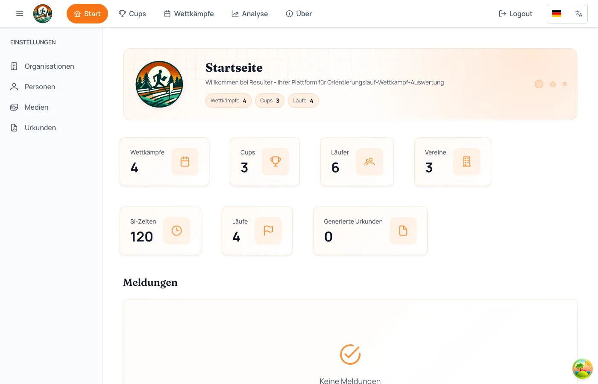
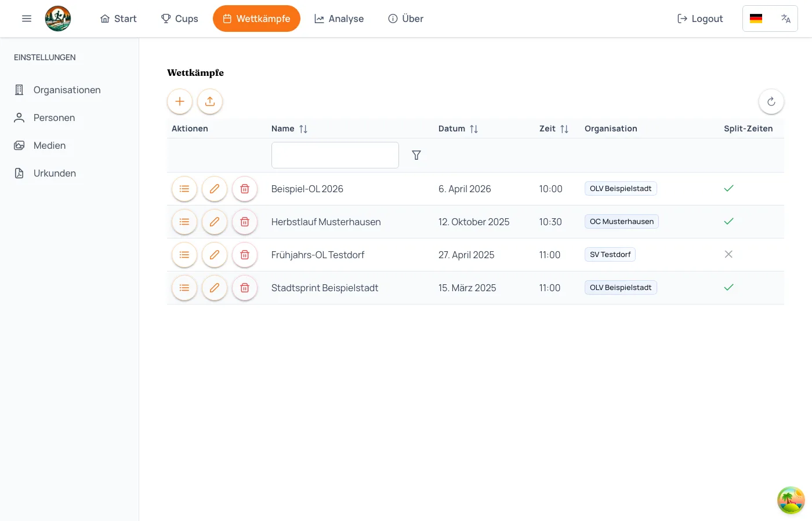
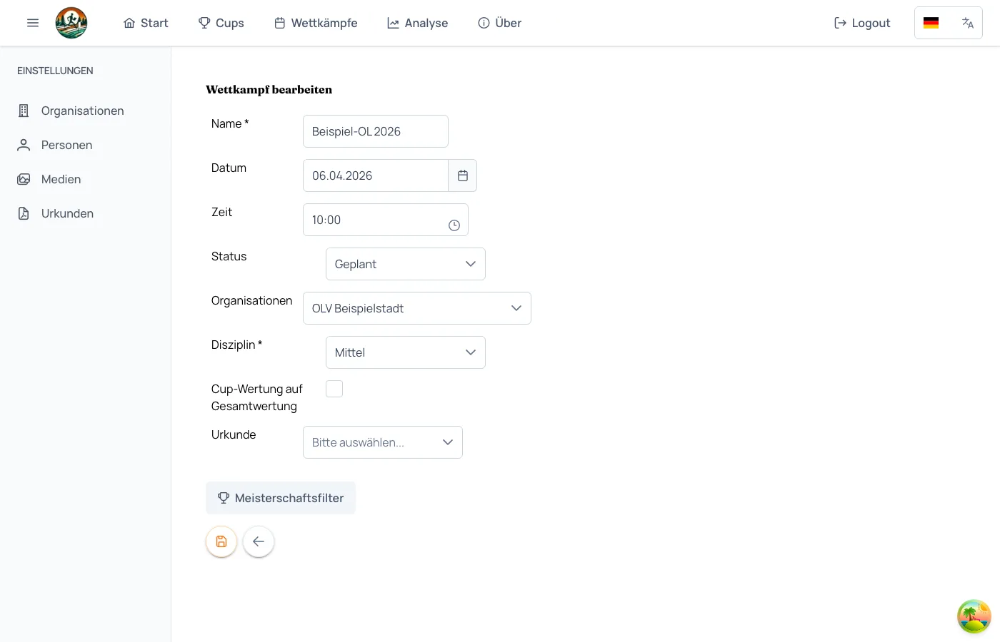
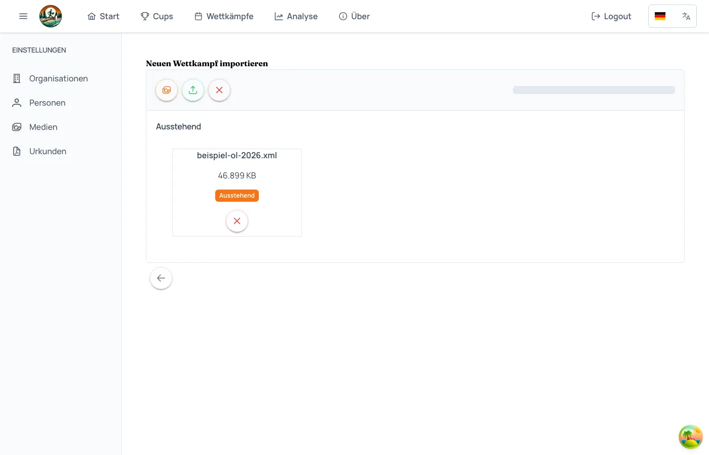
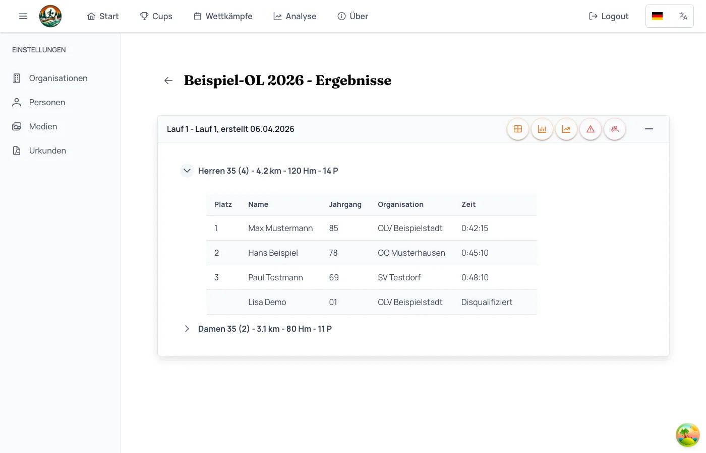

# 3 Wettkämpfe und Ergebnisse

> **Deutsch** · [English](03-events-and-results.md)

Ein **Wettkampf** ist in Resulter eine Veranstaltung mit Name, Startzeit, Disziplin und den
zugehörigen Ergebnislisten. Wettkämpfe entstehen normalerweise durch den Import einer
Ergebnisdatei, nicht von Hand. Dieses Kapitel beschreibt die Wettkampfliste, das Anlegen und
Bearbeiten eines Wettkampfs, den Import und die Ergebnisseiten.

## Die Startseite und die Wettkampfliste

Die Seite **Startseite** zeigt im Kopf Zähler für **Wettkämpfe**, **Cups** und **Läufe** und darunter
Karten mit den Systemstatistiken. Ein Klick auf den Zähler oder die Karte **Wettkämpfe** öffnet die
Wettkampfliste. Die Liste ist auch über den Knopf **Wettkämpfe** in der oberen Navigation erreichbar.

Die Liste trägt den Titel **Wettkämpfe** und hat diese Spalten:

| Spalte | Inhalt |
|---|---|
| **Aktion** | Ergebnisse (Listensymbol), Bearbeiten (Stift) und Löschen (Papierkorb) |
| **Name** | Name des Wettkampfs, sortierbar, mit Filterfeld unter der Überschrift |
| **Datum** | Datum der Startzeit, sortierbar |
| **Zeit** | Uhrzeit der Startzeit, sortierbar |
| **Organisation** | Organisationen des Wettkampfs, als kleine Marken |
| **Split-Zeiten** | Haken, wenn der Wettkampf Zwischenzeiten hat, sonst ein Kreuz |

Über der Tabelle legt der Plus-Knopf einen neuen Wettkampf an, der Upload-Knopf öffnet den Import
und der Pfeil-Knopf (**Neu laden**) lädt die Liste neu. Die Tabelle zeigt 10 Einträge je Seite (wählbar
sind 5, 10, 20, 50 oder 100) und ist zunächst nach der Startzeit sortiert. Sortierung und Filter
bleiben erhalten, solange die Sitzung im Browser offen ist.

## Einen Wettkampf anlegen oder bearbeiten

Der Plus-Knopf öffnet die Seite **Wettkampf anlegen**, der Stift in der Zeile die Seite
**Wettkampf bearbeiten**. Beide verwenden dasselbe Formular.

| Feld | Bedeutung |
|---|---|
| **Name** | Name des Wettkampfs, Pflichtfeld |
| **Datum** | Tag des Wettkampfs |
| **Zeit** | Startzeit |
| **Status** | Einer von **Geplant**, **Angemeldet**, **Vorgeschlagen**, **Genehmigt**, **Abgesagt**, **Verschoben** |
| **Organisationen** | Eine oder mehrere Organisationen, mit Suchfeld |
| **Disziplin** | Eine von **Sprint**, **Mittel**, **Lang**, **Ultralang**, **Andere**, Pflichtfeld |
| **Cup-Wertung auf Gesamtwertung** | Ankreuzfeld für die Cup-Wertung auf der Gesamtwertung |
| **Urkunde** | Die Urkundenvorlage für diesen Wettkampf (siehe Kapitel 6) |

Auf der Seite **Wettkampf anlegen** ist der Status mit **Geplant** vorbelegt. Die Wirkung des
Ankreuzfelds **Cup-Wertung auf Gesamtwertung** auf die Berechnung: Im Quelltext nicht belegt.

Auf der Bearbeiten-Seite gibt es zusätzlich den Knopf **Meisterschaftsfilter**. Er öffnet einen Dialog
mit den Feldern **Basisorganisation** und **Kategorien ausschließen** und zwei Knöpfen.

| Knopf | Wirkung |
|---|---|
| **Bereinigung** | Setzt alle Teilnehmer, deren Verein nicht zur gewählten Organisation gehört, auf "Außer Konkurrenz" |
| **Meisterschaftswertung ergänzen** | Erstellt eine Ergebnisliste für Lauf 0 mit der Meisterschaftswertung: berechtigte Teilnehmer zuerst, die übrigen dahinter |

## Eine Ergebnisdatei importieren

Der Import liest Ergebnislisten im Format IOF XML (Datenstandard 3.0, wie ihn gängige
Orientierungslauf-Software exportiert). Der Ordner `import_files/` im Repository enthält
Beispieldateien.

1. Die Wettkampfliste öffnen und den Upload-Knopf (Tooltip **Importieren**) anklicken. Die Seite **Neuen Wettkampf importieren** öffnet sich.
2. Den Knopf **Auswählen** anklicken und eine XML-Datei wählen oder die Datei in das Feld ziehen. Es wird jeweils nur eine Datei angenommen.
3. Die Datei erscheint unter **Ausstehend**. Mit dem Knopf **Leeren** (Kreuz) lässt sie sich wieder entfernen.
4. Den Upload-Knopf (Tooltip **Importieren**) anklicken, der erscheint, sobald eine Datei gewählt ist.
5. Nach erfolgreichem Upload erscheint die Meldung **Wettkampf importiert**. Die Seite bleibt offen, die Datei steht unter **Fertiggestellt**.
6. **Zurück** anklicken und die Wettkampfliste neu laden. Der importierte Wettkampf steht dort.

Die Seite akzeptiert nur Dateien vom Typ XML (`text/xml`), andere Dateien werden ohne Meldung
übersprungen. Der Fortschrittsbalken über dem Feld zeigt die Größe im Verhältnis zu 1 Mb, der Server
nimmt Dateien bis 20 MB an.

Beim Import legt das Backend die Länder, Organisationen, Personen, den Wettkampf, seine Läufe, die
Bahnen und je Lauf eine Ergebnisliste mit den Zwischenzeiten an. Der Name des Wettkampfs stammt aus
der Datei, die Startzeit aus der frühesten Startzeit in der Datei, abgerundet auf eine Viertelstunde.
Was passiert, wenn dieselbe Datei zweimal importiert wird: Im Quelltext nicht belegt.

## Ergebnislisten eines Wettkampfs

Das Listensymbol in der Zeile eines Wettkampfs öffnet die Seite **Ergebnisse** mit dem Titel
"Wettkampfname - Ergebnisse". Jede Ergebnisliste ist ein Panel mit einem Titel wie "Lauf 1, erstellt
12.05.2024". Eine Ergebnisliste für Lauf 0 heißt **Gesamtwertung**, wenn der Wettkampf mehrere Läufe hat,
sonst **Meisterschaftswertung**. Ein Klick auf ein Panel öffnet oder schließt es.

Unter dem Panel-Titel stehen die Kategorien als Baum. Eine Kategorie zeigt ihren Namen, die Zahl der
Läufer und, wenn eine Bahn zugeordnet ist, Länge (km), Steigung (Hm) und Zahl der Posten (P). Beim
Öffnen einer Kategorie erscheint ihre Tabelle:

| Spalte | Inhalt |
|---|---|
| **Platz** | Platz, nur bei Läufern mit Status OK |
| **Name** | Vor- und Nachname, "(AK)" hinter dem Namen, wenn der Läufer außer Konkurrenz startet |
| **Jahrgang** | Geburtsjahr des Läufers, zweistellig angezeigt (zum Beispiel 85) |
| **Organisation** | Organisation des Läufers |
| **Zeit** | Laufzeit; bei Läufern ohne Zeit der Status, zum Beispiel Disqualifiziert oder Fehlst |
| Cup-Spalten | Eine Spalte je Cup mit der Punktzahl, wenn für die Ergebnisliste Cup-Punkte vorhanden sind |
| Drucken-Knopf (Tooltip **Runterladen**) | Urkunde als PDF, nur bei Läufern mit Status OK und nur wenn dem Wettkampf eine Urkunde zugeordnet ist |

In der Titelzeile jedes Panels stehen Knöpfe für die Auswertung der Ergebnisliste. Sie erscheinen bei
Ergebnislisten eines einzelnen Laufs, nicht bei der Gesamtwertung:

| Knopf (Tooltip) | Öffnet |
|---|---|
| **Zwischenzeiten-Tabelle** | Tabelle der Zwischenzeiten |
| **Zwischenzeiten-Rangliste** | Rangliste der Zwischenzeiten mit Filtern nach Name und Kategorie sowie den Abschnittsdetails |
| **Mentale Widerstandsfähigkeit** | Auswertung der mentalen Widerstandsfähigkeit |
| **Anomalie-Erkennung** | Erkennung von Auffälligkeiten (nur Administratoren) |
| **Tram-Erkennung (Fahrer & Mitfahrer)** | Erkennung von Läufern, die anderen folgen (nur Administratoren) |

Administratoren sehen zusätzlich den Knopf **Berechne Cup-Punkte** im Panel-Titel, wenn für die
Ergebnisliste Cup-Punkte vorhanden sind, und unter den Ergebnislisten ein Panel **N Urkunden
erstellt**. Es listet Name und Datum jeder erzeugten Urkunde und kann Einträge löschen.

## Wer darf was

| Aktion | Nicht angemeldet | Angemeldet | Administrator |
|---|---|---|---|
| Wettkampfliste und Ergebnislisten ansehen | ja | ja | ja |
| Urkunde herunterladen (Drucken-Knopf) | ja | ja | ja |
| Zwischenzeiten-Tabelle, Zwischenzeiten-Rangliste, Mentale Widerstandsfähigkeit | ja | ja | ja |
| Anomalie-Erkennung, Tram-Erkennung | nein | nein | ja |
| Importieren-Knopf in der Wettkampfliste | nein | ja | ja |
| Upload-Formular auf der Import-Seite und der Import selbst | nein | nein | ja |
| Wettkampf anlegen, bearbeiten, löschen | nein | nein | ja |
| Meisterschaftsfilter, **Berechne Cup-Punkte** | nein | nein | ja |

Wettkämpfe, Ergebnisse, die ersten drei Auswertungen und das Herunterladen von Urkunden brauchen im
Backend keine Anmeldung. Importieren, Anlegen, Bearbeiten und Löschen eines Wettkampfs, der
Meisterschaftsfilter, die Berechnung der Cup-Punkte, die beiden Erkennungs-Auswertungen und die Liste
der erstellten Urkunden sind im Backend auf die Rolle ADMIN beschränkt. Die zugehörigen Knöpfe sind in
der Oberfläche für alle anderen ausgeblendet.
