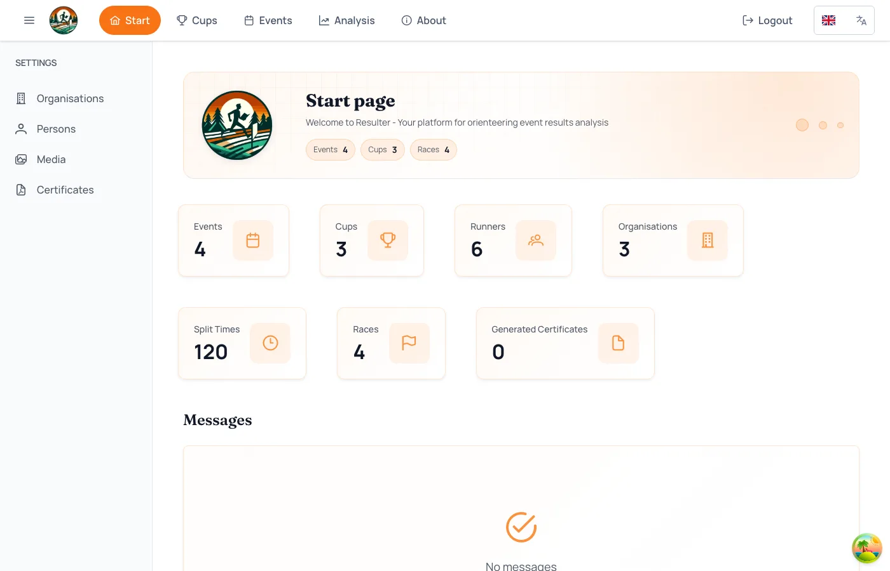
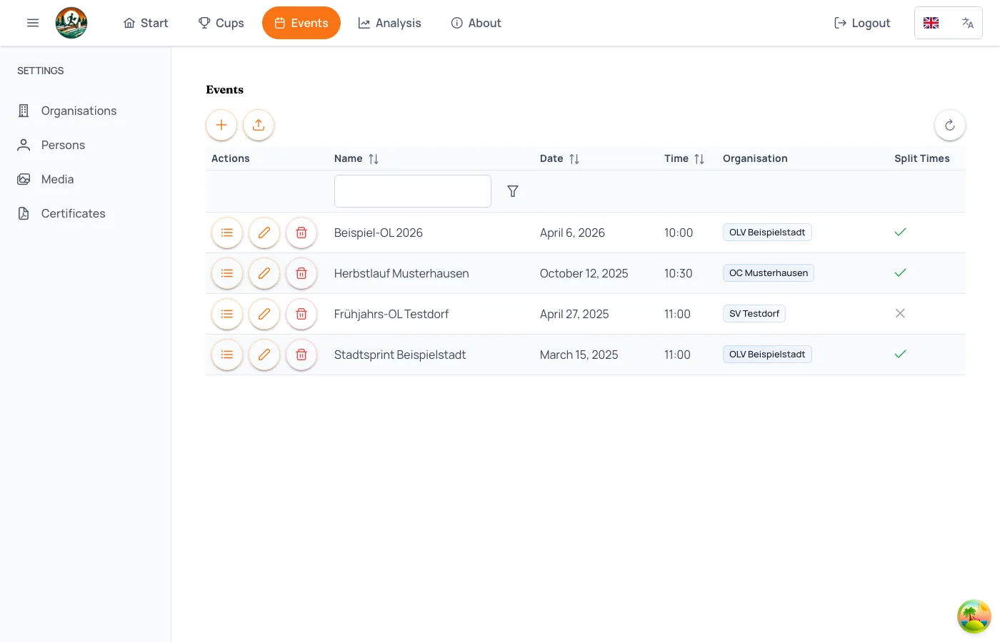
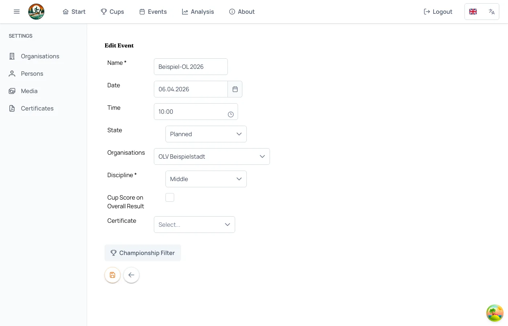
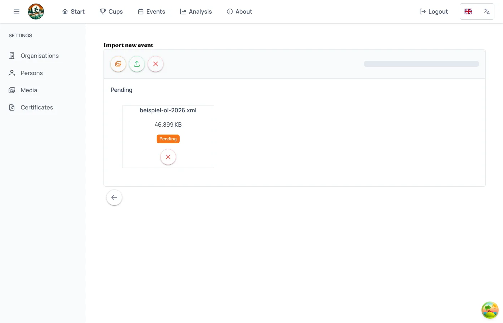
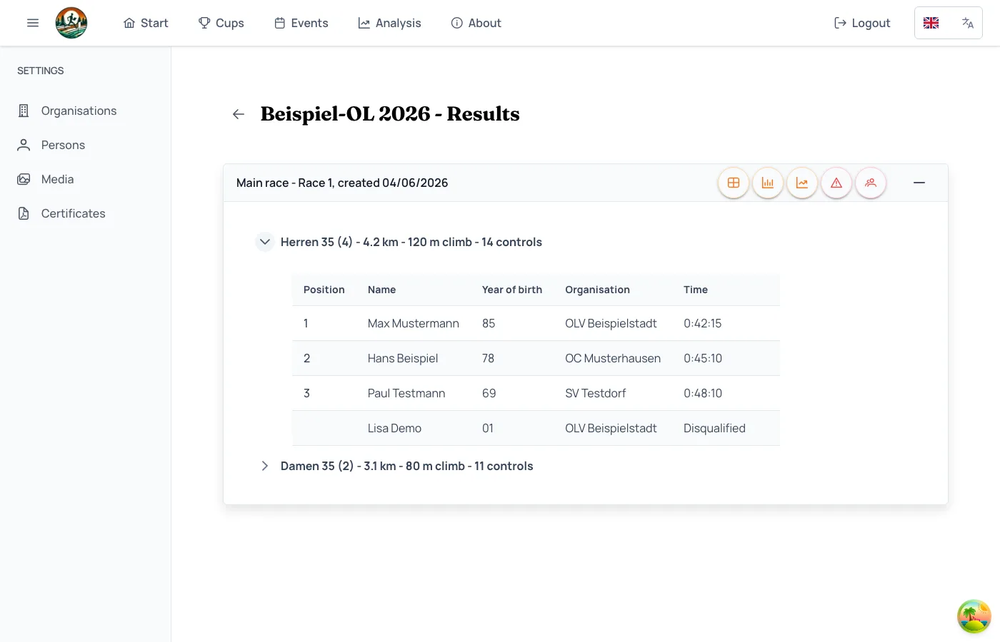

# 3 Events and results

> [Deutsch](03-events-and-results.de.md) · **English**

An **event** in Resulter is a competition with a name, a start time, a discipline and the result
lists that belong to it. Events are normally created by importing a result file, not by hand.
This chapter describes the event list, creating and editing an event, the import, and the result
pages.

## The start page and the event list

The **Start** page shows counters for **Events**, **Cups** and **Races** in the header and cards
for the system statistics. Clicking the **Events** counter or card opens the event list. The
event list is also reachable through the button **Events** in the top navigation.

The list has the title **Events** and the following columns:

| Column | Content |
|---|---|
| **Action** | Results (list symbol), edit (pencil) and delete (trash can) |
| **Name** | Name of the event, sortable, with a filter field below the heading |
| **Date** | Date of the start time, sortable |
| **Time** | Time of the start time, sortable |
| **Organisation** | Organisations of the event, shown as small labels |
| **Split Times** | Check mark if the event has split times, otherwise a cross |

Above the table the plus button creates a new event, the upload button opens the import, and the
arrow button (**Reload**) reloads the list. The table shows 10 entries per page (5, 10, 20, 50 or
100 can be chosen) and is sorted by start time at first. Sorting and filter are kept as long as
the browser session is open.

## Creating and editing an event

The plus button opens the page **New Event**, the pencil in the row opens **Edit Event**. Both
use the same form.

| Field | Meaning |
|---|---|
| **Name** | Name of the event, required |
| **Date** | Day of the event |
| **Time** | Start time |
| **State** | One of **Planned**, **Applied**, **Proposed**, **Sanctioned**, **Cancelled**, **Rescheduled** |
| **Organisations** | One or more organisations, with a search field |
| **Discipline** | One of **Sprint**, **Middle**, **Long**, **Ultralong**, **Other**, required |
| **Cup Score on Overall Result** | Check box for the cup score on the overall result |
| **Certificate** | The certificate template used for this event (see chapter 6) |

On the page **New Event** the state is preset to **Planned**. The effect of the check box
**Cup Score on Overall Result** on the calculation: Not verified in the source.

On the edit page there is also the button **Championship Filter**. It opens a dialog with the
fields **Base Organisation** and **Exclude classes** and two buttons.

| Button | Effect |
|---|---|
| **Cleanup (mark not eligible)** | Sets all participants whose club is not in the selected organisation tree to "Not Competing" |
| **Add Championship Ranking** | Creates a result list for race 0 with the championship ranking: eligible participants first, the others after them |

## Importing a result file

The import reads result lists in the IOF XML format (data standard 3.0, as exported by common
orienteering software). The folder `import_files/` in the repository contains example files.

1. Open the event list and click the upload button (tooltip **Import**). The page **Import new event** opens.
2. Click the button **Choose** and select an XML file, or drag the file into the field. Only one file at a time is accepted.
3. The file appears under **Pending**. With the button **Clear** (cross) it can be removed again.
4. Click the upload button (tooltip **Import**), which appears once a file is chosen.
5. After a successful upload the message **File uploaded** appears. The page stays open, the file is listed under **Completed**.
6. Click **Back** and reload the event list. The imported event appears there.

The page only accepts files of type XML (`text/xml`), other files are skipped without a
message. The progress bar above the field shows the size against 1 Mb, the server accepts files
up to 20 MB.

During the import the backend creates the countries, organisations, persons, the event, its
races, the courses and a result list per race with the split times. The event name comes from the
file, the start time from the earliest start time in the file, rounded down to a quarter hour.
What happens when the same file is imported twice: Not verified in the source.

## Result lists of an event

The list symbol in the row of an event opens the page **Results** with the title "event name -
Results". Each result list is a panel with a title such as "Race 1, created 12.05.2024". A result
list for race 0 is titled **Overall** if the event has several races, otherwise
**Championship Ranking**. Clicking a panel opens or closes it.

Below the panel title, the classes are listed as a tree. A class shows its name, the number of
runners and, if a course is assigned, length (km), climb (m) and number of controls. Opening a
class shows its table:

| Column | Content |
|---|---|
| **Position** | Place, only shown for runners with status OK |
| **Name** | Given name and family name, "(NC)" after the name if the runner is not competing |
| **Year of birth** | Year of birth of the runner, shown with two digits (for example 85) |
| **Organisation** | Organisation of the runner |
| **Time** | Running time; for runners without a time the status, for example Disqualified or MissingPunch |
| Cup columns | One column per cup, with the score, if cup scores exist for the result list |
| Print button (tooltip **Download**) | Certificate as PDF, only for runners with status OK and only if a certificate is assigned to the event |

In the title bar of each panel there are buttons for the analysis of the result list. They are
shown for result lists of a single race, not for the overall ranking:

| Button (tooltip) | Opens |
|---|---|
| **Split Time Table** | Table of the split times |
| **Split Times Ranking** | Ranking of the split times with filters by name and class, and the section details |
| **Mental Resilience Analysis** | Analysis of the mental resilience |
| **Cheat Detection** | Anomaly detection (administrators only) |
| **Hanging Detection (Bus Driver & Passenger)** | Detection of runners following others (administrators only) |

Administrators see in addition the button **Calculate cups scores** in the panel title, if cup
scores exist for the result list, and below the result lists a panel **N certificates created**.
It lists the name and date of every generated certificate and can delete entries.

## Who may do what

| Action | Not signed in | Signed in | Administrator |
|---|---|---|---|
| View the event list and the result lists | yes | yes | yes |
| Download a certificate (print button) | yes | yes | yes |
| Split Time Table, Split Times Ranking, Mental Resilience Analysis | yes | yes | yes |
| Cheat Detection, Hanging Detection | no | no | yes |
| Import button in the event list | no | yes | yes |
| Upload form on the import page and the import itself | no | no | yes |
| Create, edit, delete an event | no | no | yes |
| Championship filter, **Calculate cups scores** | no | no | yes |

Viewing events, results, the first three analyses and downloading certificates needs no sign-in in
the backend. Importing, creating, editing and deleting an event, the championship filter, the
calculation of cup scores, the two detection analyses and the list of created certificates are
restricted to the role ADMIN in the backend. The buttons for this are hidden in the interface for
everyone else.
