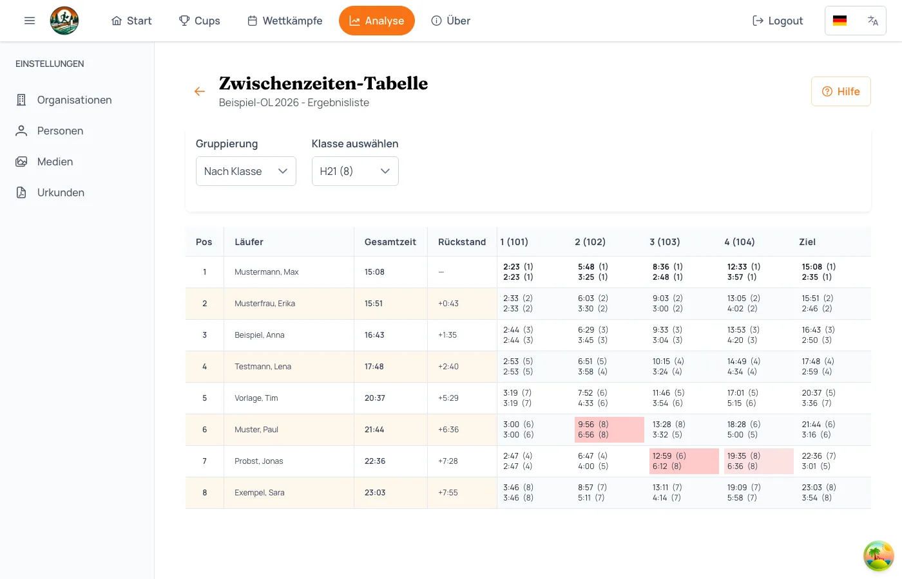
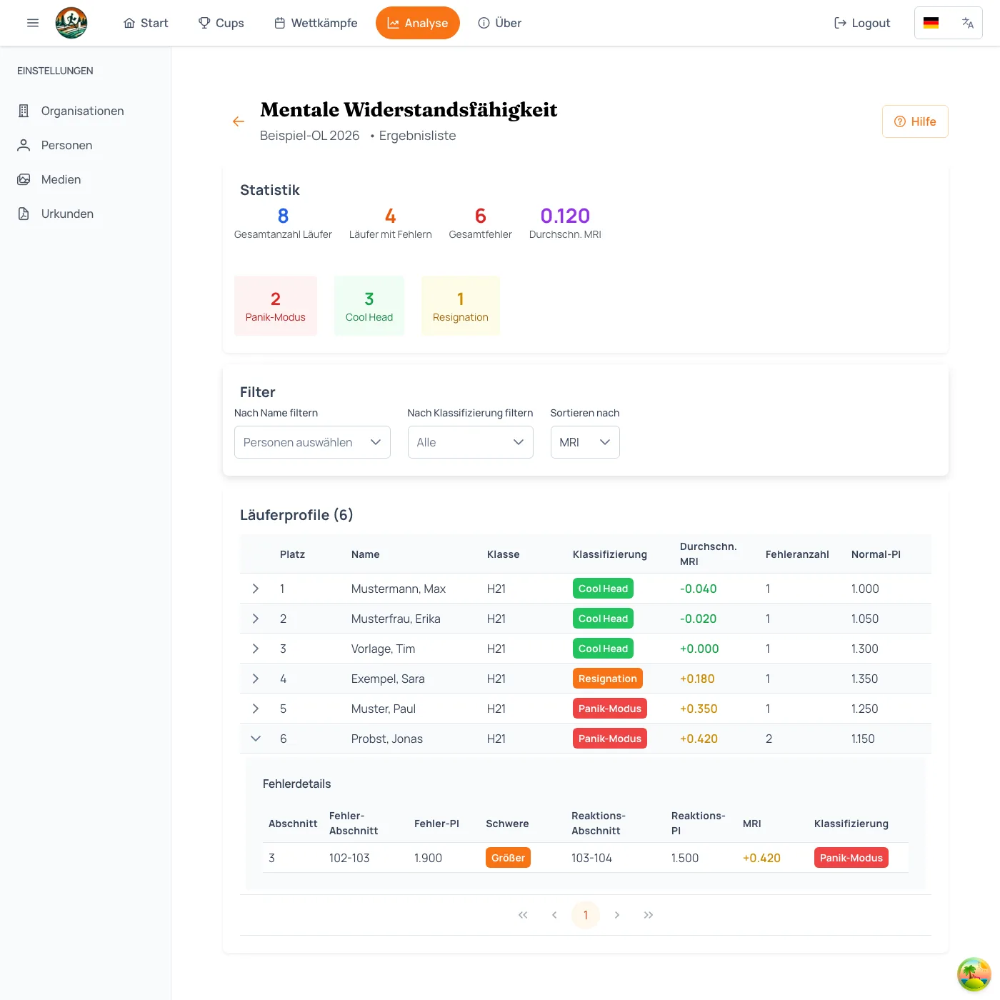
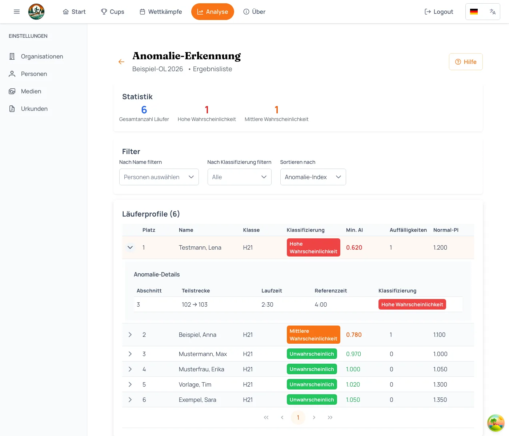

# 4 Analyse

> **Deutsch** · [English](04-analysis.md)

Die Analysen werten die Zwischenzeiten (Zeiten an den Posten) einer Ergebnisliste aus. Es gibt fünf: eine Zwischenzeiten-Tabelle, eine Zwischenzeiten-Rangliste, die Analyse der mentalen Widerstandsfähigkeit, die Anomalie-Erkennung und die Tram-Erkennung. Die ersten drei stehen jedem Besucher offen. Die letzten beiden sind Administratoren vorbehalten. Dieses Kapitel beschreibt, wie man jede Analyse öffnet, was ihre Tabellen zeigen und wie die Werte berechnet werden.

## Eine Analyse öffnen

Jede Analyse braucht einen Wettkampf mit Zwischenzeiten. Ergebnislisten ohne Zwischenzeiten lassen sich nicht auswerten.

| Analyse | Bezeichnung in der Anwendung | Wer sie öffnen darf |
|---|---|---|
| Zwischenzeiten-Tabelle | **Zwischenzeiten-Tabelle** (englisch: **Split Time Table**) | Alle |
| Zwischenzeiten-Rangliste | **Zwischenzeiten-Rangliste** (**Split Time Ranking**) | Alle |
| Mentale Widerstandsfähigkeit | **Mentale Widerstandsfähigkeit** (**Mental Resilience Analysis**) | Alle |
| Anomalie-Erkennung | **Anomalie-Erkennung** (**Cheat Detection**) | Administratoren |
| Tram-Erkennung | **Tram-Erkennung (Fahrer & Mitfahrer)** (**Hanging Detection (Bus Driver & Passenger)**) | Administratoren |

Es gibt zwei Wege.

- Der Knopf **Analyse** in der Kopfzeile öffnet die **Analyse-Zentrale**. Dort klickt man die Karte einer Analyse an. Die Karten der beiden Administrator-Analysen erscheinen nur für Administratoren.
- Auf der Ergebnisseite eines Wettkampfs hat jede Ergebnisliste einen Symbolknopf je Analyse (Tabelle, Balkendiagramm, Liniendiagramm und für Administratoren Warndreieck und Personengruppe). Der Tooltip nennt die Analyse. Die Knöpfe fehlen, wenn die Rennnummer der Ergebnisliste 0 ist. Im Quelltext nicht belegt, wofür eine Rennnummer 0 steht.

In der Analyse-Zentrale erscheint nach dem Klick auf eine Karte der Kasten **Analyse konfigurieren**.

1. Unter **Analysebereich** lässt sich nur **Event** wählen. **Cup** und **Jahr** werden Administratoren angezeigt, sind deaktiviert und tragen den Hinweis **Demnächst verfügbar**.
2. Den Wettkampf wählt man unter **Wettkampf** (**Event auswählen**). Angeboten werden nur Wettkämpfe mit Zwischenzeiten, der neueste zuerst.
3. Dann wählt man die **Ergebnisliste**. Hat ein Wettkampf mehrere, heißen sie **Ergebnisliste #1**, **Ergebnisliste #2** und so weiter, die älteste zuerst. Eine einzelne Ergebnisliste wird automatisch gewählt.
4. **Analyse starten** öffnet die Analyse.


Die Administrator-Analysen sind auch auf dem Server geschützt: Die Oberfläche leitet bei einem Aufruf durch Nicht-Administratoren nur zur Analyse-Zentrale um, und die Datenabfragen beider Analysen verlangen die Administrator-Rolle.

## Begriffe der Analysen

Die Analyse der mentalen Widerstandsfähigkeit, die Anomalie-Erkennung, die Tram-Erkennung und die Fehlermarkierung in der Zwischenzeiten-Tabelle beruhen auf denselben drei Begriffen.

### Referenzzeit und Performance Index

Ein Abschnitt ist die Strecke zwischen zwei aufeinanderfolgenden Posten, einschließlich der Strecke vom Start zum ersten Posten und vom letzten Posten ins Ziel. Die Abschnittszeit ist die Differenz der beiden Stempelzeiten. Die Zielzeit ist die Laufzeit aus der Ergebnisliste.

Die Referenzzeit eines Abschnitts ist der Durchschnitt der drei schnellsten Zeiten auf diesem Abschnitt innerhalb derselben Klasse. Haben weniger als drei Läufer eine Zeit, werden alle verwendet. Der Performance Index (PI) eines Läufers auf einem Abschnitt ist die eigene Zeit geteilt durch die Referenzzeit.

| PI | Bedeutung |
|---|---|
| Unter 1,0 | Schneller als die Referenzzeit |
| 1,0 | Gleich der Referenzzeit |
| Über 1,0 | Langsamer als die Referenzzeit, 1,30 heißt 30 Prozent langsamer |

### Normal-PI

Der Normal-PI ist das übliche Niveau eines Läufers in einem Rennen. Er wird in diesen Schritten berechnet.

1. Für jeden Abschnitt wird die Differenz zur Referenzzeit in Prozent berechnet: (PI - 1) x 100.
2. Der Median all dieser Differenzen ist das vorläufige Niveau.
3. Ein Abschnitt gilt als Fehler, wenn beide Bedingungen zutreffen. Seine Differenz liegt mehr als 25 Prozentpunkte über dem vorläufigen Niveau, und der Läufer hat gegenüber der Referenzzeit mehr als 30 Sekunden verloren.
4. Der Zielabschnitt und alle Fehler bleiben außen vor. Der Median der übrigen Differenzen ergibt den Normal-PI: 1 + Median / 100.

```
diff%    = (PI - 1) * 100
mistake  = diff% > median% + 25   and   (own time - reference time) > 30 s
normalPI = 1 + median(diff% of all other segments) / 100
```

Das ist das Verfahren des Programms Winsplits, wie der Hilfetext der Anwendung angibt. Nötig sind mindestens 3 Abschnitte insgesamt und mindestens 3 Abschnitte ohne Fehler. Wer weniger hat, wird von den drei Analysen, die den Normal-PI nutzen, übersprungen.

### Klassengröße und Verlässlichkeit

Läufer in einer Klasse mit weniger als 3 Läufern werden nicht ausgewertet. Klassen mit 3 oder 4 Läufern werden ausgewertet, aber die Anwendung warnt: Über der Tabelle erscheint der Hinweis **Einige Klassen haben weniger als 5 Läufer. Die Ergebnisse können für diese Klassen weniger zuverlässig sein.**, und die Klasse trägt eine kleine Warnmarke mit der Läuferzahl, die als Tooltip die Warnung zeigt. Die Referenzzeit ist ein Durchschnitt aus drei Zeiten, daher hat in kleinen Klassen ein einzelner Läufer großen Einfluss auf sie.

## Zwischenzeiten-Tabelle

Die Seite **Zwischenzeiten-Tabelle** zeigt alle Läufer einer Klasse oder Bahn in Zeilen und die Posten in Spalten, wie man es von Winsplits kennt.



### Eingaben

| Eingabe | Bedeutung |
|---|---|
| **Gruppierung** | **Nach Klasse** (Voreinstellung) oder **Nach Bahn** |
| **Klasse auswählen** oder **Bahn auswählen** | Die anzuzeigende Gruppe. Die Einträge nennen die Läuferzahl, eine Bahn führt zusätzlich ihre Klassen auf. Der erste Eintrag wird automatisch gewählt. |
| **Hilfe** | Öffnet die Erklärung der Tabelle |

Bei der Gruppierung nach Bahn stehen alle Klassen, die dieselbe Bahn laufen, in einer Tabelle, und es erscheint eine zusätzliche Spalte **Klasse**.

### Spalten

Die ersten vier Spalten bleiben beim seitlichen Blättern stehen (nicht auf kleinen Bildschirmen).

| Spalte | Bedeutung |
|---|---|
| **Pos** | Gesamtplatz nach Zielzeit. Läufer außer Konkurrenz zeigen **AK** (englisch **NC**), Läufer mit fehlendem Zwischenstempel zeigen **Fehlst** (**Misp**). |
| **Läufer** | Name, Läufer außer Konkurrenz sind gekennzeichnet |
| **Klasse** | Nur bei Gruppierung nach Bahn |
| **Gesamtzeit** | Zielzeit |
| **Rückstand** | Differenz zum Sieger, leer bei Läufern außer Konkurrenz |
| Eine Spalte je Posten | Zwei Zeilen je Zelle, siehe unten |

Jede Postenzelle hat zwei Zeilen. Die obere Zeile ist die Gesamtzeit vom Start bis zu diesem Posten mit dem Platz an diesem Posten. Die untere Zeile ist die Teilzeit vom vorherigen Posten mit dem Platz auf diesem Abschnitt. Die beste Zeit an einem Posten steht fett (im dunklen Modus fett und bernsteinfarben). Bei der Gesamtzeit zählen nur Läufer im Wettkampf, bei der Teilzeit alle Läufer einschließlich der außer Konkurrenz. Läufer außer Konkurrenz erhalten keinen Gesamtplatz und werden hinter die übrigen sortiert.

### Fehlermarkierung

Eine Zelle wird eingefärbt, wenn der Abschnitts-PI des Läufers mehr als 0,10 über seinem Normal-PI liegt. Start- und Zielabschnitt werden nie markiert. Die Farbe hängt von der Differenz zwischen Abschnitts-PI und Normal-PI ab.

| Farbstufe | Differenz zum Normal-PI |
|---|---|
| **Geringer Fehler** | 0,05 bis unter 0,15 (praktisch ab über 0,10) |
| **Mittlerer Fehler** | 0,15 bis unter 0,30 |
| **Hoher Fehler** | 0,30 bis unter 0,50 |
| **Schwerwiegender Fehler** | 0,50 und mehr |

Der Hilfetext der Anwendung beschreibt diese Stufen als „Prozent schlechter“. Im Programmcode sind es Differenzen von PI-Werten, wie in der Tabelle oben. Bei Läufern ohne Normal-PI wird nichts markiert.

### Ergebnis lesen

Mit der Tabelle findet man, wo ein Läufer Zeit verloren hat: eine eingefärbte Zelle mit schlechtem Abschnittsplatz. Ob der Verlust ein Navigationsfehler, ein Sturz oder ein bewusster Umweg war, sagt die Tabelle nicht. Sind weniger als 5 Läufer in der Gruppe, erscheint die Warnung **Warnung: Weniger als 5 Läufer - statistische Auswertung möglicherweise nicht aussagekräftig.**

## Zwischenzeiten-Rangliste

Die Seite **Zwischenzeiten-Rangliste** ordnet die Läufer auf jedem einzelnen Abschnitt, über alle Klassen der Ergebnisliste hinweg. Man erreicht sie über die Analyse-Zentrale (**Zwischenzeiten-Rangliste**) oder über die Ergebnisliste.

### Eingaben

| Eingabe | Bedeutung |
|---|---|
| **Bidirektional zusammenführen** | Fasst die Abschnitte A nach B und B nach A zu einem Abschnitt zusammen, ein Pfeil in der Tabelle zeigt die Richtung |
| **Nach Name filtern** | Wählt einen oder mehrere Läufer. Gezeigt werden nur Abschnitte, die sie gelaufen sind. |
| **Nur Abschnitte mit allen gefilterten Läufern** | Erscheint ab zwei gewählten Läufern. Behält nur Abschnitte, die alle gelaufen sind, und fügt das Gesamtranking hinzu. |
| **Nach Altersklasse filtern** | Zeigt nur Abschnitte, die die gewählte Klasse gelaufen ist. Die Läufer innerhalb eines Abschnitts werden dadurch nicht gefiltert. |

### Ergebnis

Zu jedem Abschnitt gibt es einen aufklappbaren Eintrag mit der Abschnittsbezeichnung (von und bis Posten), der Läuferzahl und den Klassen. Aufgeklappt zeigt er **Platz**, **Name**, **Klasse**, **Zwischenzeit** und **Rückstand** (Differenz zum Schnellsten). Je Abschnitt werden höchstens 100 Läufer aufgeführt, dann erscheint der Hinweis **Nur die Top 100 Läufer werden angezeigt (Segment aus Performance-Gründen begrenzt)**. Die Seite zeigt zunächst 50 Abschnitte, der Knopf **Mehr laden** fügt je 50 hinzu.

Unter den einzelnen Abschnitten zeigt die Liste **Abschnittsfolgen** Läufe über mindestens 3 aufeinanderfolgende Posten. Sie hat eine Spalte je Teilstück und die Spalte **Folgenzeit**. Eine Folge erscheint nur, wenn mindestens zwei verschiedene Postenfolgen (Bahnen) zu ihr beitragen. Ohne Namensfilter werden Folgen mit nur einem Läufer ausgeblendet. Es werden höchstens 100 Läufer je Folge und höchstens 500 Folgen geliefert, die längsten und am stärksten besetzten zuerst. Die Seite zeigt zunächst 30 und lädt je Klick 30 weitere.

Bei aktivem Schnittmengen-Filter ergänzt die Überschrift **Gesamtranking** eine Tabelle mit **Platz**, **Name**, **Gesamtzeit** und **Rückstand**. Sie summiert die Abschnittszeiten jedes gewählten Läufers über die gemeinsamen Abschnitte, die Zahl der Abschnitte steht über der Tabelle. Die Summe berechnet die Seite aus den Abschnitten, die sie erhalten hat.

### Ergebnis lesen

Die Rangliste vergleicht Läufer auf derselben Strecke, nicht das Gesamtergebnis. Sie eignet sich, um zwei oder drei Bekannte oder Vereinskollegen über die Abschnitte zu vergleichen, die alle gelaufen sind. Sie nutzt Rohzeiten ohne Normal-PI, ein Fehler wird also nicht markiert.

## Mentale Widerstandsfähigkeit

Die Seite **Mentale Widerstandsfähigkeit** zeigt, wie Läufer auf dem Abschnitt nach einem Navigationsfehler reagieren. Manche laufen dann zu schnell und riskieren den nächsten Fehler, andere werden langsamer, wieder andere behalten ihr Tempo.



### Eingaben

| Eingabe | Bedeutung |
|---|---|
| **Nach Name filtern** | Wählt Läufer. Die Analyse wird nur für sie neu abgefragt. |
| **Nach Klassifizierung filtern** | **Panik-Modus**, **Cool Head** oder **Resignation** |
| **Sortieren nach** | **MRI** (Voreinstellung, niedrigster zuerst), **Fehleranzahl** (höchste zuerst), **Normal-PI** (niedrigster zuerst), **Name** |
| **Hilfe** | Öffnet einen Dialog mit den Erklärungen |

Die Gesamtklassifizierung eines Läufers kennt nur diese drei Werte. **Kettenfehler** gibt es nur für einzelne Paare und wird nicht als Filter angeboten.

### So wird gerechnet

1. Der Normal-PI des Läufers wird wie oben beschrieben berechnet.
2. Jeder Abschnitt, der ein Fehler ist (Winsplits-Kriterien, 25 Prozentpunkte über dem vorläufigen Niveau und mehr als 30 Sekunden verloren), ist ein Auslöser. Der nächste Abschnitt ist der Reaktionsabschnitt.
3. Der Mental Resilience Index dieses Paars ist der Reaktions-PI minus dem Normal-PI.
4. Ein Auslöser auf dem letzten Abschnitt wird ignoriert, da kein Reaktionsabschnitt folgt. Ein Reaktionsabschnitt, der im Ziel endet, wird ebenfalls ignoriert, weil kurze Zielabschnitte meist mit voller Kraft gelaufen werden.
5. Ist der Reaktionsabschnitt selbst ein Fehler, wird das Paar als **Kettenfehler** klassifiziert.
6. Alle anderen Paare werden nach ihrem MRI klassifiziert.

```
MRI = reactionPI - normalPI
MRI < -0.05          Panic Mode
-0.05 <= MRI <= 0.05 Cool Head
MRI > 0.05           Resignation
```

Die Gesamtklassifizierung eines Läufers nutzt den Durchschnitt der MRI-Werte aller seiner Paare ohne die Kettenfehler. Hat ein Läufer nur Kettenfehler, wird dieser Durchschnitt auf 0 gesetzt, und der Läufer erscheint als **Cool Head**. Aufgeführt werden nur Läufer mit mindestens einem Paar. Die Toleranz von 0,05 ist fest.

Die Schwere eines Fehlers ist eine Bezeichnung aus dem Fehler-PI: unter 1,50 **Moderat**, ab 1,50 bis unter 2,00 **Größer**, ab 2,00 **Schwer**. Der Hilfetext nennt für **Moderat** den Bereich 1,30 bis 1,50. Die Erkennung selbst nutzt aber die Winsplits-Kriterien, daher kann der Fehler-PI bei einem Läufer mit gutem Normal-PI etwas unter 1,30 liegen.

### Statistik

Der Kasten **Statistik** hat diese Werte.

| Wert | Bedeutung |
|---|---|
| **Gesamtanzahl Läufer** | Alle Läufer der Ergebnisliste mit Zwischenzeiten, auch übersprungene und solche ohne Fehler |
| **Läufer mit Fehlern** | Läufer mit mindestens einem Paar (die Zeilen der Liste) |
| **Gesamtfehler** | Anzahl aller Paare |
| **Durchschn. MRI** | Mittelwert des MRI aller Paare, Kettenfehler eingeschlossen |
| **Panik-Modus**, **Cool Head**, **Resignation** | Anzahl der Läufer nach Gesamtklassifizierung |

### Die Läuferliste

Die Liste **Läuferprofile** hat eine Zeile je Läufer mit Fehler.

| Spalte | Bedeutung |
|---|---|
| **Platz** | Zeilennummer in der aktuellen Sortierung |
| **Name** | Läufer |
| **Klasse** | Klasse, bei kleinen Klassen mit der Läuferzahl in der Warnmarke |
| **Klassifizierung** | Gesamtklassifizierung |
| **Durchschn. MRI** | Durchschnittlicher MRI ohne Kettenfehler, mit Vorzeichen und drei Nachkommastellen |
| **Fehleranzahl** | Anzahl der Paare |
| **Normal-PI** | Normal-PI des Läufers |

Der Pfeil links in einer Zeile öffnet die **Fehlerdetails** mit einer Zeile je Paar.

| Spalte | Bedeutung |
|---|---|
| **Abschnitt** | Nummer des Fehler-Abschnitts, ab 1 gezählt |
| **Fehler-Abschnitt** | Von und bis Posten |
| **Fehler-PI** | PI auf dem Fehler-Abschnitt |
| **Schwere** | **Moderat**, **Größer** oder **Schwer** |
| **Reaktions-Abschnitt** | Von und bis Posten des folgenden Abschnitts |
| **Reaktions-PI** | PI auf dem Reaktions-Abschnitt |
| **MRI** | Reaktions-PI minus Normal-PI, rot unter -0,05, grün innerhalb von 0,05, gelb über 0,05 |
| **Klassifizierung** | Klassifizierung dieses Paars, auch **Kettenfehler** |

### Ergebnis lesen und Grenzen

- Ein einzelnes Paar sagt wenig. Die Klassifizierung ist bei mehreren Fehlern aussagekräftiger.
- Wer nach einem Fehler langsamer wird, kann auch die Orientierung verloren oder bewusst vorsichtig gewählt haben. Der Index kennt den Grund nicht.
- Normal-PI und Referenzzeit hängen von der Klasse ab. In kleinen Klassen sind beide weniger stabil.
- Die ältere Beschreibung in der Datei doc/si-metrics/mental-resilience-index-metric.de.md nutzt einen Mittelwert und die Grenze PI 1,30. Das Programm nutzt den Median und die hier beschriebenen Winsplits-Kriterien.

## Anomalie-Erkennung

Die Seite **Anomalie-Erkennung** (englisch **Cheat Detection**) sucht Abschnitte, auf denen ein Läufer weit schneller war als die anderen Läufer und als sein eigenes übliches Niveau. Das kann auf eine Abkürzung, einen falschen oder fehlenden Stempel, einen Zeitmessfehler oder einen Fehler beim Bahnlegen hindeuten. Es ist ein statistischer Hinweis, kein Beweis. Die Seite ist für Administratoren.



### Eingaben

| Eingabe | Bedeutung |
|---|---|
| **Nach Name filtern** | Wählt Läufer |
| **Nach Klassifizierung filtern** | **Hohe Wahrscheinlichkeit** oder **Mittlere Wahrscheinlichkeit** |
| **Sortieren nach** | **Anomalie-Index** (Voreinstellung, niedrigster zuerst), **Auffälligkeiten** (Anzahl, höchste zuerst), **Normal-PI** (niedrigster zuerst), **Name** |
| **Hilfe** | Öffnet einen Dialog mit den Erklärungen |

In der Liste erscheinen nur Läufer mit mindestens einem auffälligen Abschnitt.

### So wird gerechnet

Jeder Abschnitt eines Läufers wird geprüft, außer dem ersten Abschnitt (vom Start) und dem letzten (ins Ziel). Der Normal-PI des Läufers wird wie oben beschrieben berechnet. Ein Läufer ohne Normal-PI wird übersprungen.

1. Es wird eine bereinigte Referenzzeit bestimmt. Dafür dienen die Zeiten aller anderen Läufer derselben Klasse auf diesem Abschnitt. Hat die Klasse weniger als 5 Zeiten, dienen die Zeiten aller Klassen auf diesem Abschnitt. Die eigene Zeit des Läufers wird aus der Liste entfernt.
2. Bei nur einer oder zwei Vergleichszeiten ist die schnellste die Referenz. Bei mehr Zeiten dient der Median der drei schnellsten. Es gibt zwei Korrekturen. Sind die schnellsten zwei Zeiten weit schneller als der Median und streuen die langsameren Zeiten stark (ab 6 Zeiten), dient der Mittelwert der zwei schnellsten, weil dann vermutlich viele Läufer einen Fehler gemacht haben. Liegt die viertschnellste Zeit innerhalb von 10 Prozent der schnellsten und ist die achtschnellste mehr als 25 Prozent langsamer als die vierte (ab 8 Zeiten), wird eine Gruppenabkürzung angenommen und der Mittelwert der Plätze 5 bis 8 verwendet (oder 5 bis 7, wenn Platz 8 selbst ein Ausreißer ist).
3. Der echte PI ist die eigene Zeit geteilt durch die bereinigte Referenzzeit. Der Anomalie-Index (AI) ist der echte PI geteilt durch den Normal-PI. Die Zeitersparnis ist die Referenzzeit minus die eigene Zeit.
4. Liegt der AI zwischen 0,85 und etwa 1,18, wird der Abschnitt nicht markiert, auch wenn die Referenzzeit schlecht ist.
5. Ein Abschnitt wird markiert, wenn alle drei Bedingungen einer Stufe zutreffen.

```
moderate time limit = max(40 s, min(150 s, 0.20 * reference time))
high time limit     = 1.8 * moderate time limit
```

| Stufe | Echter PI | AI | Zeitersparnis |
|---|---|---|---|
| **Hohe Wahrscheinlichkeit** | unter 0,30 | unter 0,30 | mindestens die hohe Zeitgrenze |
| **Mittlere Wahrscheinlichkeit** | unter 0,45 | unter 0,45 | mindestens die mittlere Zeitgrenze |

Bei kurzen Abschnitten (Referenzzeit unter 50 Sekunden) werden die beiden PI-Grenzen mit 0,70 multipliziert und damit strenger. Die Gesamtklassifizierung eines Läufers ist die Stufe des Abschnitts mit dem niedrigsten AI.

### Statistik und Läuferliste

Der Kasten **Statistik** zeigt **Gesamtanzahl Läufer** (Läufer in der Liste), die Zahl mit **Hohe Wahrscheinlichkeit** und die Zahl mit **Mittlere Wahrscheinlichkeit**.

| Spalte | Bedeutung |
|---|---|
| **Platz** | Zeilennummer in der aktuellen Sortierung |
| **Name** und **Klasse** | Läufer und Klasse, bei kleinen Klassen mit der Warnmarke |
| **Klassifizierung** | Stufe des Abschnitts mit dem niedrigsten AI |
| **Min. AI** | Niedrigster AI des Läufers |
| **Auffälligkeiten** | Anzahl der markierten Abschnitte |
| **Normal-PI** | Normal-PI des Läufers |

Der Pfeil links in einer Zeile öffnet die **Anomalie-Details** mit einer Zeile je markiertem Abschnitt.

| Spalte | Bedeutung |
|---|---|
| **Abschnitt** | Nummer des Abschnitts, ab 1 gezählt |
| **Teilstrecke** | Von und bis Posten |
| **Laufzeit** | Zeit des Läufers |
| **Referenzzeit** | Die verwendete bereinigte Referenzzeit |
| **Klassifizierung** | Stufe dieses Abschnitts |

### Ergebnis lesen und Grenzen

- Ein PI von 0,30 heißt, der Läufer brauchte weniger als ein Drittel der Referenzzeit. Ehrliche Läufe erreichen das fast nie. Mehrere markierte Abschnitte desselben Läufers wiegen mehr als ein einzelner.
- Harmlose Ursachen können ein Fehler im Bahnverlauf (zum Beispiel ein verkürzter Abschnitt), ein fehlender Posten in den Daten, die Zeiten weniger Läufer in kleinen Klassen und ein sehr guter Lauf eines starken Läufers gegen eine schwache Klasse sein.
- Haben viele Läufer einer Klasse auf einem Abschnitt einen Fehler gemacht, ist die Referenzzeit zu hoch. Die Konsistenzregel mit dem AI zwischen 0,85 und 1,18 mildert diesen Fehler, beseitigt ihn aber nicht.
- Die Projektdokumentation gibt an, dass die Statistik bei weniger als 10 Teilnehmern weniger verlässlich ist. Sie nennt dieselben Grenzen in doc/si-metrics/anomaly-detection-algorithm.de.md und doc/si-metrics/anomaly-detection-thresholds.de.md. Ihre Beschreibung der Referenzzeit (Median von 5 bis 7 Läufern) weicht vom Programmcode ab, der den Median der drei schnellsten Zeiten nutzt.
- Wie oft die Grenzen bei echten Wettkämpfen Fehlalarme auslösen. Im Quelltext nicht belegt.

## Tram-Erkennung

Die Seite **Tram-Erkennung (Fahrer & Mitfahrer)** (englisch **Hanging Detection (Bus Driver & Passenger)**) sucht Läufer, die einem schnelleren Läufer nachlaufen. Der Nachläufer ist der Mitfahrer, der vorn Laufende der Fahrer. Ein Mitfahrer profitiert von der Navigation des Fahrers und läuft besser als sonst. Die Seite ist für Administratoren.

### Eingaben

| Eingabe | Bedeutung |
|---|---|
| **Nach Name filtern** | Wählt Läufer |
| **Nach Klassifizierung filtern** | **Starkes Nachlaufen** oder **Mäßiges Nachlaufen** (englisch **High Hanging**, **Moderate Hanging**) |
| **Sortieren nach** | **Tram-Index (HI)** (Voreinstellung, niedrigster zuerst), **Tram-Anzahl** (höchste zuerst), **Normal-PI**, **Name** |
| **Hilfe** | Öffnet einen Dialog mit den Erklärungen |

Die Liste enthält nur Läufer mit mindestens einem Tram-Abschnitt.

### So wird gerechnet

Jeder Abschnitt des Mitfahrers wird geprüft, außer dem ersten und dem letzten. Der Normal-PI wird wie oben beschrieben berechnet. Ein Abschnitt gilt für einen Fahrer als Tram-Abschnitt, wenn alle drei Kriterien zutreffen.

1. Zeitliche Nähe: Der Fahrer hat den Posten am Ende des Abschnitts vor dem Mitfahrer gestempelt, höchstens 30 Sekunden davor. Läufer aller Klassen zählen.
2. Leistungshierarchie: Der Fahrer hatte auf diesem Abschnitt einen niedrigeren PI als der Mitfahrer.
3. Leistungsverbesserung: Der Tram-Index ist höchstens 0,85, also mindestens 15 Prozent besser als der Normal-PI des Mitfahrers.

```
HI = segment PI / Normal PI
hanging if HI <= 0.85
```

Hat ein Mitfahrer Tram-Abschnitte, wird sein Normal-PI ohne sie neu berechnet und die Prüfung läuft erneut. Das wiederholt sich bis zu 5-mal, bis sich der Normal-PI um weniger als 0,01 ändert.

Die Klassifizierung setzt die Zahl der Tram-Paare (ein Abschnitt mit zwei Fahrern zählt doppelt) ins Verhältnis zur Zahl der Abschnitte ohne den ersten und den letzten.

| Klassifizierung | Bedingung |
|---|---|
| **Starkes Nachlaufen** | 3 oder mehr Paare oder 30 Prozent oder mehr der Abschnitte |
| **Mäßiges Nachlaufen** | Mindestens ein Paar, unterhalb dieser Grenzen |
| **Kein Nachlaufen** | Kein Paar |
| **Unzureichende Daten** | Kein Abschnitt für die Prüfung vorhanden |

### Statistik und Läuferliste

Der Kasten **Statistik** zeigt **Gesamtanzahl Läufer** (alle ausgewerteten Läufer, auch ohne Nachlaufen), die Zahl mit **Starkes Nachlaufen** und die Zahl mit **Mäßiges Nachlaufen**.

| Spalte | Bedeutung |
|---|---|
| **Platz** | Zeilennummer in der aktuellen Sortierung |
| **Name** | Läufer |
| **Klasse** | Klasse mit der Startzeit in Klammern (aus der Ergebnisliste) und der Warnmarke bei kleinen Klassen |
| **Klassifizierung** | **Starkes Nachlaufen** oder **Mäßiges Nachlaufen** |
| **Ø HI** | Mittlerer HI aller Paare, rot unter 0,75, orange ab 0,75 bis unter 0,85 |
| **Tram-Anzahl** | Anzahl verschiedener Tram-Abschnitte (mehrere Fahrer auf einem Abschnitt zählen einmal) |
| **Tram %** | Tram-Abschnitte als Anteil der Abschnitte ohne ersten und letzten |
| **Normal-PI** | Normal-PI des Läufers, nach Entfernen der Tram-Abschnitte |

Der Pfeil links in einer Zeile öffnet die **Tram-Details** mit einer Zeile je Paar.

| Spalte | Bedeutung |
|---|---|
| **Abschnitt** | Nummer des Abschnitts, ab 1 gezählt |
| **Teilstrecke** | Von und bis Posten |
| **Fahrer** | Name, Klasse und Startzeit des Fahrers |
| **Zeitdifferenz** | Sekunden zwischen den Stempelzeiten von Fahrer und Mitfahrer am Zielposten des Abschnitts |
| **Tram-Index (HI)** | HI des Mitfahrers auf diesem Abschnitt |
| **Verbesserung** | Prozent besser als der Normal-PI, berechnet als (1 - HI) x 100 |
| **Mitfahrer-Zeit** | Abschnittszeit des Mitfahrers |
| **Fahrer-Zeit** | Abschnittszeit des Fahrers |

### Ergebnis lesen und Grenzen

- Das Verfahren sieht nur, dass zwei Läufer denselben Posten innerhalb von 30 Sekunden erreichten und der spätere besser war als sonst. Ob sie zusammen liefen, weiß es nicht. Zwei gleich starke Läufer, die dicht hintereinander starten und gleich schnell laufen, können sich zufällig treffen.
- Nachlaufen ist bei vielen Wettkämpfen erlaubt und für sich kein Verstoß. Ob es ein Verstoß ist, hängt von den Regeln des Wettkampfs ab.
- Die Daten mehrerer Abschnitte sind aussagekräftiger als ein einzelnes Paar.
- Kleine Klassen schwächen Normal-PI und Referenzzeit (siehe oben).
- Wie oft die Grenzen bei echten Wettkämpfen Fehlalarme auslösen. Im Quelltext nicht belegt.

## Grenzen aller Analysen

- Die Analysen nutzen nur die Stempelzeiten der Ergebnisliste. Ohne Zwischenzeiten ist keine Analyse möglich, und Läufer ohne Laufzeit in der Ergebnisliste haben keinen Zielabschnitt.
- Alle Werte hängen von den anderen Läufern der Klasse ab. Wenige Läufer, viele Fehler in der Klasse oder eine ungewöhnliche Bahn machen sie weniger verlässlich.
- Die Grenzwerte (25 Prozentpunkte, 30 Sekunden, 0,05, 0,30, 0,45, 0,85, 30 Sekunden zeitliche Nähe) sind im Programm fest eingestellt. In der Oberfläche lassen sie sich nicht ändern.
- Ein Ergebnis ist ein Hinweis für einen Menschen, der ihn prüft. Keine der Analysen entscheidet über eine Disqualifikation.
