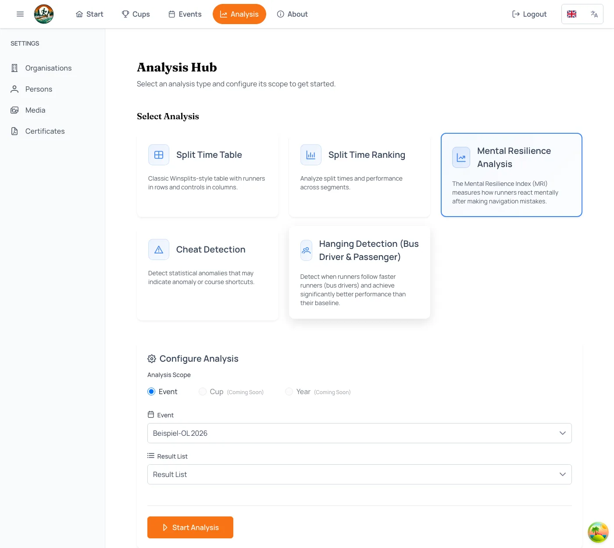
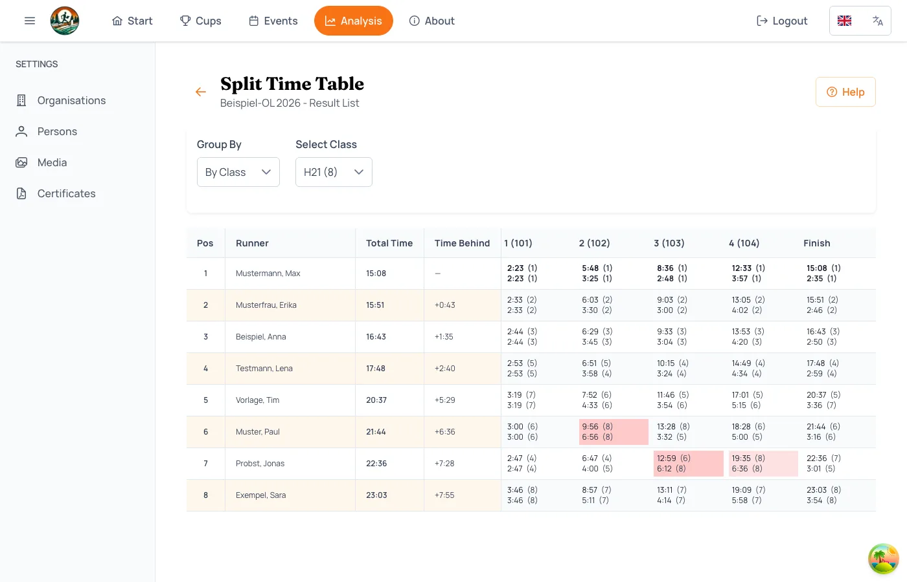
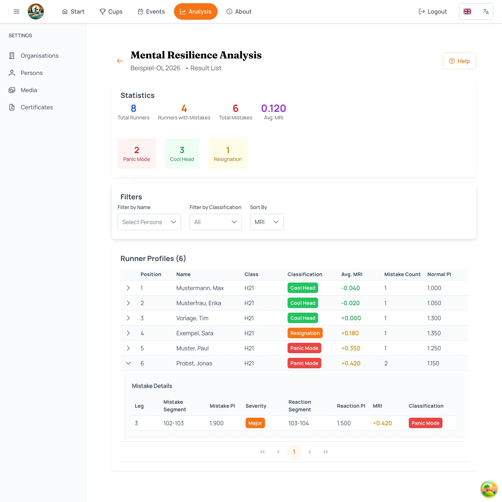
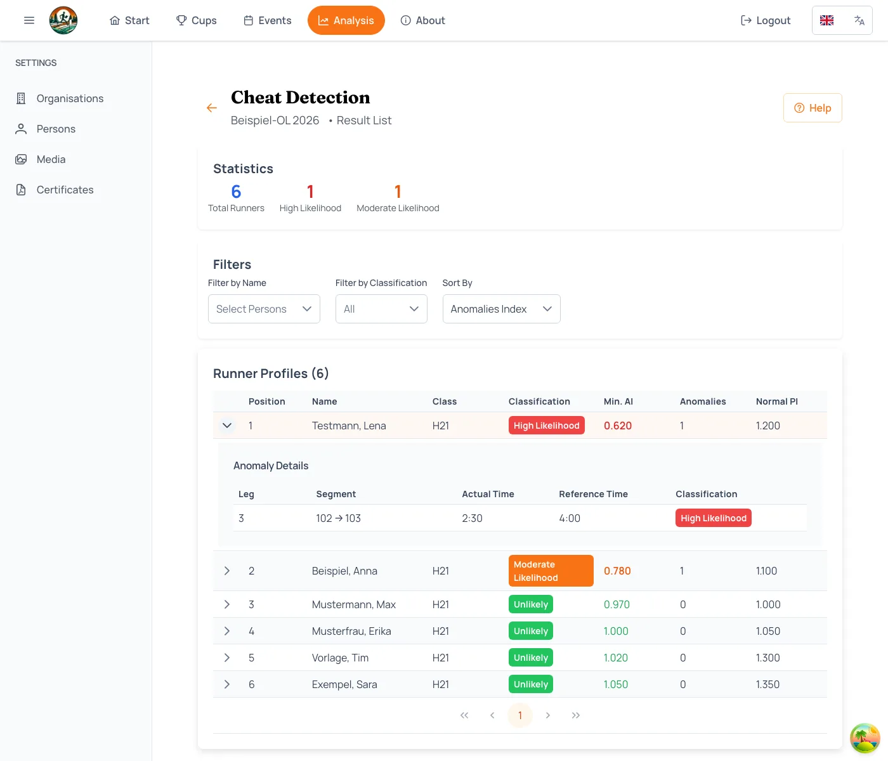

# 4 Analysis

> [Deutsch](04-analysis.de.md) · **English**

The analyses evaluate the split times (intermediate times at the controls) of one result list. There are five of them: a split time table, a split time ranking, the mental resilience analysis, the anomaly detection and the hanging detection. The first three are open to every visitor. The last two are for administrators only. This chapter describes how to open each analysis, what its tables show and how the figures are calculated.

## Opening an analysis

Every analysis needs an event that has split times. Result lists without split times cannot be analysed.

| Analysis | Label in the application | Who can open it |
|---|---|---|
| Split time table | **Split Time Table** (German: **Zwischenzeiten-Tabelle**) | Everyone |
| Split time ranking | **Split Time Ranking** (**Zwischenzeiten-Rangliste**) | Everyone |
| Mental resilience | **Mental Resilience Analysis** (**Mentale Widerstandsfähigkeit**) | Everyone |
| Anomaly detection | **Cheat Detection** (**Anomalie-Erkennung**) | Administrators |
| Hanging detection | **Hanging Detection (Bus Driver & Passenger)** (**Tram-Erkennung (Fahrer & Mitfahrer)**) | Administrators |

There are two ways in.

- The button **Analysis** in the header opens the **Analysis Hub**. Click the card of an analysis. The cards of the two administrator analyses appear only for administrators.
- On the result page of an event, each result list has one icon button per analysis (table, bar chart, line chart and, for administrators, warning triangle and group of people). The tooltip shows the name of the analysis. The buttons are not shown when the race number of the result list is 0. Not verified in the source what a race number of 0 stands for.

In the hub, after clicking a card, the box **Configure Analysis** appears.

1. Under **Analysis Scope** only **Event** can be chosen. **Cup** and **Year** are shown to administrators, are disabled and are marked **Coming Soon**.
2. Select the event under **Event** (**Select Event**). Only events with split times are offered, the newest first.
3. Select the **Result List**. If an event has several, they are called **Result List #1**, **Result List #2** and so on, oldest first. A single result list is selected automatically.
4. **Start Analysis** opens the analysis.



The administrator analyses are also protected on the server: the interface only redirects to the hub when a non-administrator opens their address, and the data requests of both analyses require the administrator role.

## Terms used by the analyses

The mental resilience analysis, the anomaly detection, the hanging detection and the error marking in the split time table all rest on the same three terms.

### Reference time and Performance Index

A segment is the stretch between two consecutive controls, including the stretch from the start to the first control and from the last control to the finish. The segment time is the difference of the two punch times. The finish time is the run time from the result list.

The reference time of a segment is the average of the three fastest times on this segment within the same class. If fewer than three runners have a time, all of them are used. The Performance Index (PI) of a runner on a segment is the own time divided by the reference time.

| PI | Meaning |
|---|---|
| Below 1.0 | Faster than the reference time |
| 1.0 | Equal to the reference time |
| Above 1.0 | Slower than the reference time, 1.30 means 30 percent slower |

### Normal PI

The Normal PI is the usual level of one runner on one race. It is calculated in these steps.

1. For each segment the difference in percent to the reference time is calculated: (PI - 1) x 100.
2. The median of all these differences is the preliminary level.
3. A segment counts as a mistake if both conditions hold. Its difference is more than 25 percentage points above the preliminary level, and the runner lost more than 30 seconds against the reference time.
4. The finish segment and all mistakes are left out. The median of the remaining differences gives the Normal PI: 1 + median / 100.

```
diff%    = (PI - 1) * 100
mistake  = diff% > median% + 25   and   (own time - reference time) > 30 s
normalPI = 1 + median(diff% of all other segments) / 100
```

This is the method of the program Winsplits, as the help text of the application states. At least 3 segments in total and at least 3 segments without mistakes are needed. A runner with fewer is skipped by the three analyses that use the Normal PI.

### Class size and reliability

Runners in a class with fewer than 3 runners are not analysed. Classes with 3 or 4 runners are analysed, but the application warns: the message **Some classes have fewer than 5 runners. Results may be less reliable for these classes.** appears above the table, and the class carries a small warning mark with the runner count that shows the warning as a tooltip. The reference time is an average of three times, so in small classes one runner has a large influence on it.

## Split time table

The page **Split Time Table** shows all runners of a class or course in rows and the controls in columns, as known from Winsplits.



### Inputs

| Input | Meaning |
|---|---|
| **Group By** | **By Class** (default) or **By Course** |
| **Select Class** or **Select Course** | The group to show. The entries show the runner count, a course also lists its classes. The first entry is selected automatically. |
| **Help** | Opens the explanation of the table |

When grouped by course, all classes that run the same course appear in one table, and an additional column **Class** is shown.

### Columns

The first four columns stay in place when scrolling sideways (not on small screens).

| Column | Meaning |
|---|---|
| **Pos** | Overall position by finish time. Runners not competing show **NC** (German **AK**), runners with a missing intermediate punch show **Misp** (**Fehlst**). |
| **Runner** | Name, not competing runners are marked |
| **Class** | Only when grouped by course |
| **Total Time** | Finish time |
| **Time Behind** | Difference to the winner, empty for runners not competing |
| One column per control | Two lines per cell, see below |

Each control cell has two lines. The upper line is the cumulative time from the start to this control with the position at this control. The lower line is the segment time from the previous control with the position on this segment. The best time at a control is shown in bold (in dark mode bold and amber). For cumulative times only competing runners count, for segment times all runners count, including those not competing. Runners not competing get no overall position and are sorted after the others.

### Error marking

A cell is coloured when the segment PI of the runner is more than 0.10 above their Normal PI. The start segment and the finish segment are never marked. The colour depends on the difference between segment PI and Normal PI.

| Colour level | Difference to the Normal PI |
|---|---|
| **Low Error** | 0.05 to below 0.15 (in practice from above 0.10) |
| **Medium Error** | 0.15 to below 0.30 |
| **High Error** | 0.30 to below 0.50 |
| **Severe Error** | 0.50 and more |

The help text of the application describes these levels as "percent worse". In the code the figures are differences of PI values, as in the table above. For runners without a Normal PI nothing is marked.

### Reading the result

Use the table to find where a runner lost time: a coloured cell with a poor segment position. The table does not tell whether the loss was a navigation error, a fall or a detour on purpose. If fewer than 5 runners are in the group, the warning **Warning: Less than 5 runners - statistical analysis may not be reliable.** is shown.

## Split time ranking

The page **Split Times Ranking** ranks the runners on each single segment, across all classes of the result list. It is reached from the hub (**Split Time Ranking**) or from the result list.

### Inputs

| Input | Meaning |
|---|---|
| **Merge Bidirectional** | Combines the segments A to B and B to A into one segment, an arrow in the table shows the direction |
| **Filter by Name** | Selects one or more runners. Only segments in which they ran are shown. |
| **Show only segments with all filtered runners** | Appears with two or more selected runners. Keeps only segments that all of them ran and adds the overall ranking. |
| **Filter by Age Class** | Shows only segments that the chosen class ran. It does not filter the runners within a segment. |

### Result

For each segment an expandable entry shows the segment label (from and to control), the number of runners and the classes. Opened, it lists **Position**, **Name**, **Class**, **Split Time** and **Time Behind** (difference to the fastest). At most 100 runners are listed per segment, then the message **Showing top 100 runners only (segment limited for performance)** appears. The page first shows 50 segments, the button **Load More** adds 50 each.

Below the single segments the list **Sequence Segments** shows runs of at least 3 consecutive controls. It has one column per leg and the column **Sequence Time**. A sequence only appears if at least two different control sequences (courses) contribute to it. Without a name filter, sequences with a single runner are hidden. At most 100 runners per sequence and at most 500 sequences are returned, the longest and best occupied sequences first. The page shows 30 at first and loads 30 more per click.

With the intersection filter active, the heading **Overall Ranking** adds a table with **Position**, **Name**, **Total Time** and **Time Behind**. It sums the segment times of each selected runner over the common segments, and the number of segments is stated above the table. The sum is calculated by the page from the segments it received.

### Reading the result

The ranking compares runners on the same stretch, not the total result. It suits the comparison of two or three friends or club mates over the segments they all ran. It uses raw times without the Normal PI, so a mistake is not marked.

## Mental resilience

The page **Mental Resilience Analysis** shows how runners react in the segment that follows a navigation mistake. Some runners then run too fast and risk the next mistake, others slow down, others keep their pace.



### Inputs

| Input | Meaning |
|---|---|
| **Filter by Name** | Selects runners. The analysis is requested again for them only. |
| **Filter by Classification** | **Panic Mode**, **Cool Head** or **Resignation** |
| **Sort By** | **MRI** (default, lowest first), **Mistake Count** (highest first), **Normal PI** (lowest first), **Name** |
| **Help** | Opens a dialog with the explanations |

The overall classification of a runner has only these three values. **Chain Error** exists only for single pairs and is not offered as a filter.

### How it is calculated

1. The Normal PI of the runner is calculated as described above.
2. Each segment that is a mistake (Winsplits criteria, 25 percentage points above the preliminary level and more than 30 seconds lost) is a trigger. The next segment is the reaction segment.
3. The Mental Resilience Index of this pair is the reaction PI minus the Normal PI.
4. A trigger on the last segment is ignored, as no reaction segment follows. A reaction segment that ends at the finish is also ignored, because short finish segments are usually run at full speed.
5. If the reaction segment is itself a mistake, the pair is classified as **Chain Error**.
6. All other pairs are classified by their MRI.

```
MRI = reactionPI - normalPI
MRI < -0.05          Panic Mode
-0.05 <= MRI <= 0.05 Cool Head
MRI > 0.05           Resignation
```

The overall classification of a runner uses the average of the MRI values of all their pairs without the chain errors. If a runner has only chain errors, this average is set to 0 and the runner is shown as **Cool Head**. Only runners with at least one pair are listed. The tolerance of 0.05 is fixed.

The severity of a mistake is a label from the Mistake PI: below 1.50 **Moderate**, from 1.50 below 2.00 **Major** (German **Größer**), from 2.00 **Severe**. The help text names the range of **Moderate** as 1.30 to 1.50. The detection itself, however, uses the Winsplits criteria, so the Mistake PI of a runner with a good Normal PI can lie slightly below 1.30.

### Statistics

The box **Statistics** has these figures.

| Figure | Meaning |
|---|---|
| **Total Runners** | All runners of the result list with split times, also those who were skipped or who made no mistake |
| **Runners with Mistakes** | Runners with at least one pair (the rows of the list) |
| **Total Mistakes** | Number of all pairs |
| **Avg. MRI** | Mean of the MRI of all pairs, chain errors included |
| **Panic Mode**, **Cool Head**, **Resignation** | Number of runners by overall classification |

### The runner list

The list **Runner Profiles** has one row per runner with a mistake.

| Column | Meaning |
|---|---|
| **Position** | Row number in the current sorting |
| **Name** | Runner |
| **Class** | Class, with the runner count in the warning mark for small classes |
| **Classification** | Overall classification |
| **Avg. MRI** | Average MRI without chain errors, with sign and three decimals |
| **Mistake Count** | Number of pairs |
| **Normal PI** | Normal PI of the runner |

The arrow at the left of a row opens **Mistake Details** with one line per pair.

| Column | Meaning |
|---|---|
| **Leg** | Number of the mistake segment, counted from 1 |
| **Mistake Segment** | From and to control |
| **Mistake PI** | PI on the mistake segment |
| **Severity** | **Moderate**, **Major** or **Severe** |
| **Reaction Segment** | From and to control of the following segment |
| **Reaction PI** | PI on the reaction segment |
| **MRI** | Reaction PI minus Normal PI, red below -0.05, green within 0.05, yellow above 0.05 |
| **Classification** | Classification of this pair, including **Chain Error** |

### Reading the result and limits

- A single pair says little. The classification is more telling with several mistakes.
- A runner who slows down after a mistake can also have lost orientation or taken a deliberately careful route. The index does not know the reason.
- The Normal PI and the reference time depend on the class. In small classes both are less stable.
- The older description in the file doc/si-metrics/mental-resilience-index-metric.md uses a mean and the limit PI 1.30. The program uses the median and the Winsplits criteria described here.

## Anomaly detection

The page **Cheat Detection** (German **Anomalie-Erkennung**) looks for segments on which a runner was far faster than the other runners and than their own usual level. This can point to a shortcut, a wrong or missing punch, a timing error or a mistake in the course setting. It is a statistical hint, not proof. The page is for administrators.



### Inputs

| Input | Meaning |
|---|---|
| **Filter by Name** | Selects runners |
| **Filter by Classification** | **High Likelihood** or **Moderate Likelihood** |
| **Sort By** | **Anomalies Index** (default, lowest first), **Anomalies** (count, highest first), **Normal PI** (lowest first), **Name** |
| **Help** | Opens a dialog with the explanations |

Only runners with at least one flagged segment appear in the list.

### How it is calculated

Each segment of a runner is tested, except the first segment (from the start) and the last segment (to the finish). The Normal PI of the runner is calculated as described above. A runner without a Normal PI is skipped.

1. A cleaned reference time is determined. For this, the times of all other runners on this segment of the same class are used. If the class has fewer than 5 times, the times of all classes on this segment are used. The own time of the runner is removed from the list.
2. With only one or two comparison times, the fastest one is the reference. With more times, the median of the three fastest is used. Two corrections exist. If the fastest two times are far faster than the median and the slower times vary strongly (at least 6 times), the mean of the two fastest is used, because then probably many runners made a mistake. If the fourth fastest time lies within 10 percent of the fastest and the eighth fastest is more than 25 percent slower than the fourth (at least 8 times), a group shortcut is assumed and the mean of positions 5 to 8 is used (or 5 to 7 if position 8 is itself an outlier).
3. The real PI is the own time divided by the cleaned reference time. The Anomalies Index (AI) is the real PI divided by the Normal PI. The time saving is the reference time minus the own time.
4. If the AI lies between 0.85 and about 1.18, the segment is not flagged, even when the reference time is poor.
5. A segment is flagged if all three conditions of a level hold.

```
moderate time limit = max(40 s, min(150 s, 0.20 * reference time))
high time limit     = 1.8 * moderate time limit
```

| Level | Real PI | AI | Time saving |
|---|---|---|---|
| **High Likelihood** | below 0.30 | below 0.30 | at least the high time limit |
| **Moderate Likelihood** | below 0.45 | below 0.45 | at least the moderate time limit |

For short segments (reference time below 50 seconds) the two PI limits are multiplied by 0.70 and become stricter. The overall classification of a runner is the level of the segment with the lowest AI.

### Statistics and the runner list

The box **Statistics** shows **Total Runners** (runners in the list), the number with **High Likelihood** and the number with **Moderate Likelihood**.

| Column | Meaning |
|---|---|
| **Position** | Row number in the current sorting |
| **Name** and **Class** | Runner and class, with the warning mark for small classes |
| **Classification** | Level of the segment with the lowest AI |
| **Min. AI** | Lowest AI of the runner |
| **Anomalies** | Number of flagged segments |
| **Normal PI** | Normal PI of the runner |

The arrow at the left of a row opens **Anomaly Details** with one line per flagged segment.

| Column | Meaning |
|---|---|
| **Leg** | Number of the segment, counted from 1 |
| **Segment** | From and to control |
| **Actual Time** | Time of the runner |
| **Reference Time** | The cleaned reference time used |
| **Classification** | Level of this segment |

### Reading the result and limits

- A PI of 0.30 means the runner needed less than a third of the reference time. Honest runs almost never reach this. Several flagged segments of one runner weigh more than a single one.
- Possible harmless causes are a course error (for example a shortened leg), a missing control in the data, the times of a few runners in small classes, and a very good run of a strong runner against a weak class.
- If many runners of a class made a mistake on a segment, the reference time is too high. The consistency rule with the AI between 0.85 and 1.18 reduces this error but does not remove it.
- The project documentation states that the statistics are less reliable with fewer than 10 participants. It lists the same limits in doc/si-metrics/anomaly-detection-algorithm.md and doc/si-metrics/anomaly-detection-thresholds.md. Its description of the reference time (median of 5 to 7 runners) differs from the code, which uses the median of the three fastest times.
- How often the limits produce false alarms on real events. Not verified in the source.

## Hanging detection

The page **Hanging Detection (Bus Driver & Passenger)** (German **Tram-Erkennung (Fahrer & Mitfahrer)**) looks for runners who follow a faster runner. The follower is the passenger, the leader the bus driver. A passenger benefits from the bus driver's navigation and runs better than usual. The page is for administrators.

### Inputs

| Input | Meaning |
|---|---|
| **Filter by Name** | Selects runners |
| **Filter by Classification** | **High Hanging** or **Moderate Hanging** (**Starkes Nachlaufen**, **Mäßiges Nachlaufen**) |
| **Sort By** | **Hanging Index (HI)** (default, lowest first), **Hanging Count** (highest first), **Normal PI**, **Name** |
| **Help** | Opens a dialog with the explanations |

The list contains only runners with at least one hanging segment.

### How it is calculated

Each segment of the passenger is tested, except the first and the last. The Normal PI is calculated as described above. A segment counts as hanging for a bus driver if all three criteria hold.

1. Temporal proximity: the bus driver punched the control at the end of the segment before the passenger, and at most 30 seconds before. Runners of all classes count.
2. Performance hierarchy: the bus driver had a lower PI on this segment than the passenger.
3. Performance improvement: the Hanging Index is at most 0.85, that is at least 15 percent better than the Normal PI of the passenger.

```
HI = segment PI / Normal PI
hanging if HI <= 0.85
```

If a passenger has hanging segments, the Normal PI is calculated again without them, and the test runs again. This is repeated up to 5 times, until the Normal PI changes by less than 0.01.

The classification counts the hanging pairs (a segment with two bus drivers counts twice) against the number of segments without the first and the last one.

| Classification | Condition |
|---|---|
| **High Hanging** | 3 or more pairs, or 30 percent or more of the segments |
| **Moderate Hanging** | At least one pair, below those limits |
| **No Hanging** | No pair |
| **Insufficient Data** | No segment available for the test |

### Statistics and the runner list

The box **Statistics** shows **Total Runners** (all analysed runners, also those without hanging), the number with **High Hanging** and the number with **Moderate Hanging**.

| Column | Meaning |
|---|---|
| **Position** | Row number in the current sorting |
| **Name** | Runner |
| **Class** | Class with the start time in brackets (from the result list) and the warning mark for small classes |
| **Classification** | **High Hanging** or **Moderate Hanging** |
| **Avg. HI** | Mean HI of all pairs, red below 0.75, orange from 0.75 to below 0.85 |
| **Hanging Count** | Number of different hanging segments (several bus drivers on one segment count once) |
| **Hanging %** | Hanging segments as a share of the segments without first and last |
| **Normal PI** | Normal PI of the runner, after removing the hanging segments |

The arrow at the left of a row opens **Hanging Details** with one line per pair.

| Column | Meaning |
|---|---|
| **Leg** | Number of the segment, counted from 1 |
| **Segment** | From and to control |
| **Bus Driver** | Name, class and start time of the bus driver |
| **Time Delta** | Seconds between the punches of the bus driver and the passenger at the end control |
| **Hanging Index (HI)** | HI of the passenger on this segment |
| **Improvement** | Percent better than the Normal PI, calculated as (1 - HI) x 100 |
| **Passenger Time** | Segment time of the passenger |
| **Bus Driver Time** | Segment time of the bus driver |

### Reading the result and limits

- The method only sees that two runners reached the same control within 30 seconds and that the later one was better than usual. It does not know whether they ran together. Two runners of equal strength who start close together and run at the same speed can meet by chance.
- Hanging is allowed in many events and is no violation in itself. Whether it is a violation depends on the rules of the event.
- The data of several segments are more telling than a single pair.
- Small classes weaken the Normal PI and the reference time (see above).
- How often the limits produce false alarms on real events. Not verified in the source.

## Limits of all analyses

- The analyses use only the punch times of the result list. Without split times no analysis is possible, and runners without a run time in the result list have no finish segment.
- All figures depend on the other runners of the class. Few runners, many mistakes in the class or an unusual course make them less reliable.
- The thresholds (25 percentage points, 30 seconds, 0.05, 0.30, 0.45, 0.85, 30 seconds of temporal proximity) are fixed in the program. They cannot be changed in the interface.
- A result is a hint for a human who checks it. None of the analyses decides on a disqualification.
