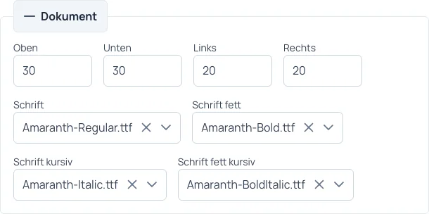
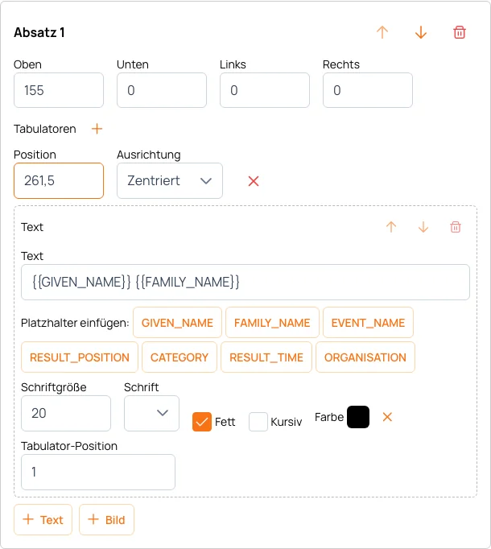

# 4 Urkunden-Editor: Formular

> **Deutsch** · [English](04-certificate-editor-form.md)

Der Reiter **Formular** zeigt das Layout als Eingabefelder. Er eignet sich für genaue Zahlen, für
Einstellungen, die die Seitenansicht nicht hat (Dokumentschriften, Abstände unten, links und
rechts), und zum Umsortieren. Im Reiter **Grafisch** steht dieselbe Liste unter der Seite. Eine
Änderung hier erscheint sofort in der Seitenansicht und umgekehrt.

Das Formular ist von oben nach unten aufgebaut: **Dokument**, dann die **Absätze** in der
Reihenfolge, in der sie auf der Seite stehen, und zuletzt **Absatz hinzufügen**.

## Dokument

Die Gruppe **Dokument** ist zugeklappt. Ein Klick auf die Überschrift öffnet sie.

| Feld | Bedeutung |
|---|---|
| **Oben**, **Unten**, **Links**, **Rechts** | Seitenränder in Punkt |
| **Schrift** | Schrift für normalen Text |
| **Schrift fett** | Schrift, die für fetten Text verwendet wird |
| **Schrift kursiv** | Schrift für kursiven Text |
| **Schrift fett kursiv** | Schrift für fetten und kursiven Text |

- Die vier Ränder gehören zusammen. Das Backend braucht alle vier. Der Editor schreibt deshalb
  beim ersten Ändern eines Rands alle vier und behält dabei das Aussehen der Seite. Ein
  geleertes Feld fällt auf 36 pt zurück.
- Die Dokumentschriften gelten für alle Texte, die keine eigene Schrift haben. Das Kreuz in
  einem Feld entfernt die Einstellung. Welche Schriften es gibt, steht in
  [Kapitel 6](06-certificate-reference.de.md#schriften).
- Ohne Eintrag bei **Schrift fett** und **Schrift kursiv** wird fetter und kursiver Text
  vorgetäuscht (siehe [Kapitel 3](03-certificate-editor-graphic.de.md#die-format-leiste)).

## Absätze

Jeder Absatz hat eine eigene Gruppe mit der Überschrift **Absatz 1**, **Absatz 2** und so
weiter. In der grafischen Ansicht ist der Absatz des ausgewählten Blocks orange umrandet.

Rechts in der Überschrift stehen drei Knöpfe: **Nach oben**, **Nach unten** (Absatz umsortieren)
und **Entfernen** (Papierkorb).

### Abstände

| Feld | Bedeutung | Wert ohne Eintrag |
|---|---|---|
| **Oben** | Abstand oberhalb des Absatzes | 4 pt |
| **Unten** | Abstand unterhalb des Absatzes | 4 pt |
| **Links** | Einzug vom linken Rand | 0 pt |
| **Rechts** | Einzug vom rechten Rand | 0 pt |

Ein Wert, den man einträgt, **ersetzt** den Standardabstand, er kommt nicht dazu. Negative Werte
sind erlaubt. Das ist nützlich, um einen Absatz dichter an den vorigen zu rücken oder ein
Bild nach links aus der Seite zu schieben. Ein leeres Feld zeigt den Standardwert als blassen
Platzhaltertext an und entfernt den Eintrag aus dem Layout.

### Tabulatoren

Unter **Tabulatoren** legt das Plus einen neuen Tabulator an (Position 100, links). Jeder
Tabulator hat eine **Position** in Punkt (vom linken Rand aus) und eine **Ausrichtung**:

| Ausrichtung | Der Block … |
|---|---|
| **Links** | beginnt an der Position |
| **Rechts** | endet an der Position |
| **Zentriert** | ist um die Position herum zentriert |
| **Anker** | richtet sich an einem Zeichen aus (nach der Spezifikation der PDF-Bibliothek) |

Das Kreuz entfernt einen Tabulator. Hat ein Absatz keinen, gilt der Standard-Tabulator, zentriert
bei 261,5 pt.

### Blöcke

Jeder Block hat eine Kopfzeile mit seinem Typ (**Text** oder **Bild**) und den Knöpfen
**Nach oben**, **Nach unten** und **Entfernen**. Die Reihenfolge der Blöcke im Formular ist
nicht die Reihenfolge in der Zeile. Maßgeblich ist die **Tabulator-Position** (siehe unten).

**Textblock**

| Feld | Bedeutung |
|---|---|
| **Text** | Der Text, mit Platzhaltern |
| **Platzhalter einfügen** | Knöpfe, die `{{…}}` an der Cursor-Stelle einfügen |
| **Schriftgröße** | in Punkt, ohne Eintrag 12 |
| **Schrift** | Schrift des Blocks, leer = Dokumentschrift |
| **Fett**, **Kursiv** | Stil |
| **Farbe** | Schriftfarbe. **Farbe setzen** legt eine fest, das Kreuz entfernt sie (dann schwarz). |
| **Tabulator-Position** | Nummer des Tabulators, auf dem der Block steht (siehe unten) |

**Bildblock**

| Feld | Bedeutung |
|---|---|
| **Bild** | Bild aus der Medienverwaltung |
| **Breite** | Breite in Punkt, ohne Eintrag 100. Die Höhe folgt dem Seitenverhältnis. |

Ein Bild steht mit seinem unteren Rand auf der Grundlinie der Zeile, bei Text und Bild in einer
Zeile also auf derselben Linie wie der Text.

### Die Tabulator-Position eines Blocks

Die **Tabulator-Position** ist keine Koordinate. Es ist die **Reihenfolge der Blöcke** in der Zeile.
Blöcke mit kleinerer Nummer stehen zuerst, ohne Eintrag gilt 1. Jeder Block kommt auf den ersten
Tabulator hinter dem Ende des vorigen Blocks. Mit **Zur Zeile** im grafischen Editor wird die
Nummer automatisch um eins höher gesetzt als die größte im Absatz.

### Blöcke und Absätze hinzufügen

Unter den Blöcken eines Absatzes fügen **Text** und **Bild** einen Block an. **Absatz
hinzufügen** am Ende des Formulars legt einen neuen Absatz mit einem leeren Textblock
(Schriftgröße 20) an. Ein Layout ohne Absätze zeigt „Noch kein Absatz vorhanden.“

## Fehler im Layout

Ist der JSON-Text im Hintergrund nicht lesbar, zeigt das Formular statt der Felder die
Meldung, das Layout sei kein gültiges Layout-JSON, mit der Ursache. Zum Korrigieren wechselt man
zum Reiter **JSON** ([Kapitel 5](05-certificate-editor-json.de.md)). Verstöße gegen das Schema listet
das Formular über den Eingabefeldern in roter Schrift auf.
