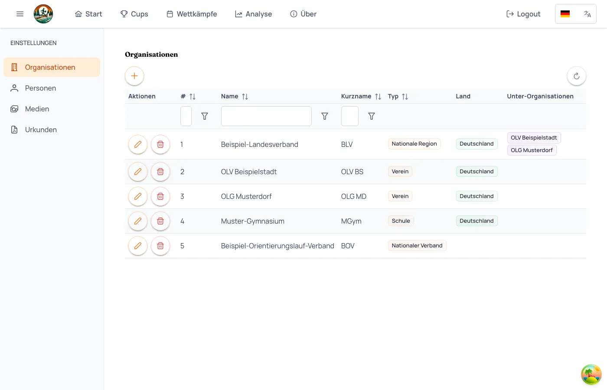
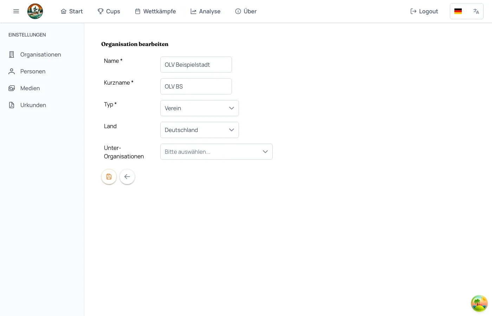
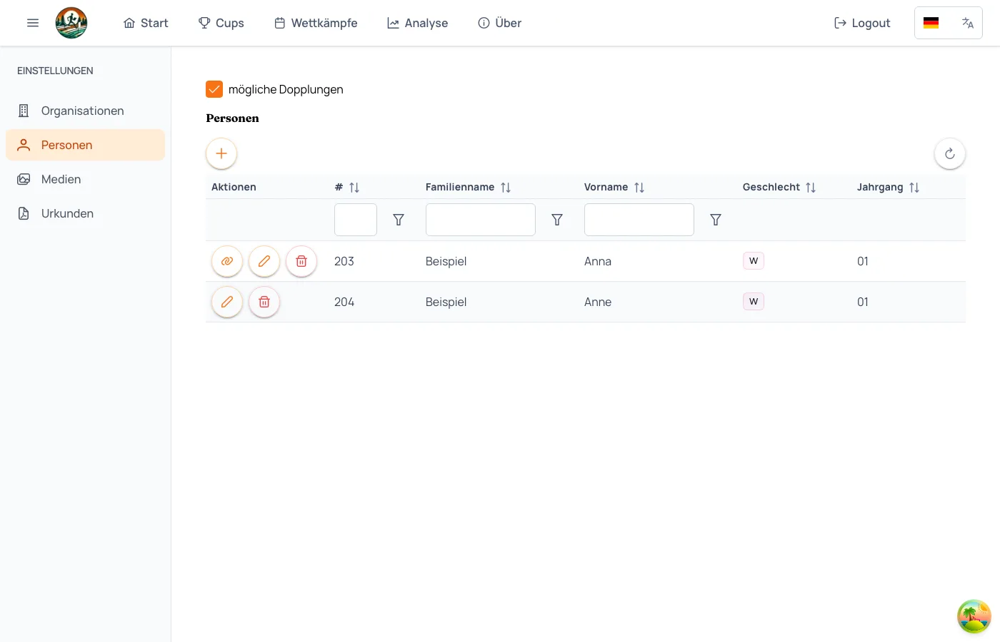
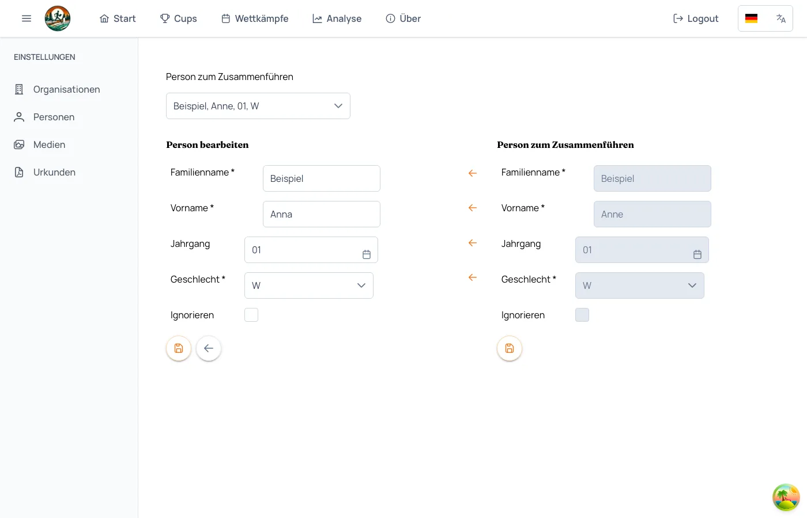
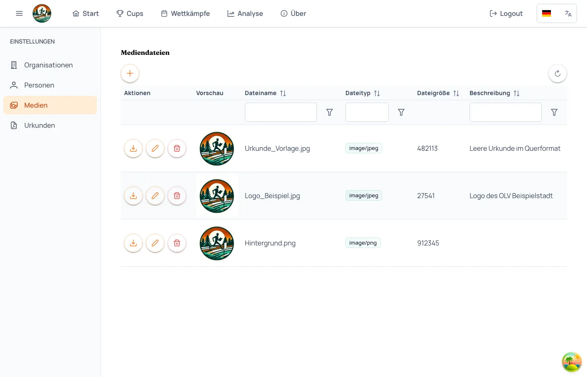

# 5 Stammdaten

> **Deutsch** · [English](05-master-data.md)

Stammdaten sind die Datensätze, auf die Wettkämpfe, Ergebnisse und Urkunden verweisen:
Organisationen (Vereine, Verbände), Personen und Mediendateien. Dieses Kapitel beschreibt die drei
Seiten dafür, das Suchen, Anlegen, Bearbeiten und Löschen von Datensätzen und das Zusammenführen
von zwei Personen, die doppelt erfasst wurden.

## Überblick

Die drei Seiten stehen in der Seitenleiste unter der Überschrift **Einstellungen**. Die
Seitenleiste wird nur Administratoren angezeigt.

| Seite | Eintrag in der Seitenleiste | Adresse | Inhalt |
|---|---|---|---|
| Organisationen | **Organisationen** | `/{locale}/organisation` | Vereine, Verbände, Schulen und Ähnliches, mit Land und Unter-Organisationen |
| Personen | **Personen** | `/{locale}/person` | Sportler mit Name, Jahrgang und Geschlecht |
| Medien | **Medien** | `/{locale}/media` | Hochgeladene Bilder, zum Beispiel Urkunden-Hintergründe |

## Listen

Alle drei Seiten verwenden dieselbe Tabellenart wie die Liste der Urkunden (siehe
[Kapitel 6](06-certificates.de.md)).

| Element | Bedeutung |
|---|---|
| Plus-Knopf über der Tabelle | Neuen Datensatz anlegen (nur Administratoren) |
| Pfeil-Knopf rechts oben | Liste **Neu laden** |
| Spalte **Aktionen** | **Bearbeiten** (Stift) und **Löschen** (Papierkorb) |
| Filterfeld unter einem Spaltentitel | Zeigt nur Zeilen, deren Wert den eingegebenen Text enthält |
| Klick auf einen Spaltentitel | Nach dieser Spalte sortieren, ein weiterer Klick kehrt die Reihenfolge um |
| Seitenwahl über und unter der Tabelle | Seite und Zeilenzahl wählen |

Die Tabellen zeigen 10 Zeilen je Seite. Die Zeilenzahl ist auf den Seiten Organisationen und
Personen von 5 bis 500 einstellbar, auf der Seite Medien bis 1000. Mehrere Sortierspalten sind
möglich. Sortierung und Filter bleiben erhalten, solange die Sitzung im Browser offen ist. Ein
Filter ohne Treffer zeigt die Meldung **Keine Daten** und einen Knopf **Filter zurücksetzen**.

## Organisationen

### Die Liste

Die Seite **Organisationen** ist zunächst nach Name sortiert.

| Spalte | Inhalt | Sortierung | Filter |
|---|---|---|---|
| **#** | Nummer des Datensatzes | ja | ja |
| **Name** | Vollständiger Name | ja | ja |
| **Kurzname** | Abkürzung | ja | ja |
| **Typ** | Art der Organisation | ja | nein |
| **Land** | Land | nein | nein |
| **Unter-Organisationen** | Organisationen unterhalb dieser | nein | nein |

### Anlegen und bearbeiten

Der Plus-Knopf öffnet die Seite **Organisation anlegen**, der Stift öffnet **Organisation
bearbeiten**. Beide verwenden dasselbe Formular.

| Feld | Bedeutung |
|---|---|
| **Name** \* | Vollständiger Name |
| **Kurzname** \* | Abkürzung |
| **Typ** \* | Einer der unten aufgeführten Typen |
| **Land** | Auswahl aus den gespeicherten Ländern, darf leer bleiben |
| **Unter-Organisationen** | Mehrfachauswahl mit Suche, zum Beispiel die Vereine eines Landesverbands |

Ein Stern (\*) kennzeichnet Pflichtfelder. Ein leeres Pflichtfeld ist rot umrandet. Eine neue
Organisation beginnt mit dem Typ **Andere** und dem Land **GER**.

Der Typ ist einer dieser Werte:

- **IOF**
- **IOF Region**
- **Nationaler Verband**
- **Nationale Region**
- **Verein**
- **Schule**
- **Firma**
- **Militär**
- **Andere**

Die Hierarchie wird beim übergeordneten Eintrag gehalten: Die Unter-Organisationen werden im
Formular der Organisation darüber gewählt, und die Liste zeigt sie in der Spalte
**Unter-Organisationen**. Schleifen in der Hierarchie: Im Quelltext nicht belegt.

### Löschen

Der Papierkorb in der Zeile fragt nach und löscht dann die Organisation. Er zeigt die Meldung
**organisation gelöscht**. Was mit Wettkämpfen und Ergebnissen geschieht, die noch auf die
Organisation verweisen: Im Quelltext nicht belegt.

## Personen

### Die Liste und mögliche Dopplungen

Die Seite **Personen** ist zunächst nach Familienname sortiert.

| Spalte | Inhalt | Sortierung | Filter |
|---|---|---|---|
| **#** | Nummer des Datensatzes | ja | ja |
| **Familienname** | Familienname | ja | ja |
| **Vorname** | Vorname | ja | ja |
| **Geschlecht** | Geschlecht | ja | nein |
| **Jahrgang** | Das Jahr, zweistellig angezeigt (zum Beispiel 85) | ja | nein |

Das Kontrollkästchen **mögliche Dopplungen** über der Tabelle schränkt die Liste auf Personen ein,
die möglicherweise doppelt vorhanden sind. Zwei Personen gelten als mögliche Dopplung, wenn ihre
Familiennamen gleich sind (ohne Beachtung von Groß- und Kleinschreibung und Leerzeichen) und
entweder die Vornamen gleich sind oder die ersten drei Buchstaben der Vornamen gleich sind und die
Jahrgänge übereinstimmen oder einer fehlt. Der Zustand des Kontrollkästchens steht in der Adresse
der Seite.

In dieser Ansicht erscheint in der Spalte **Aktionen** ein Verknüpfungs-Knopf (Hinweis
**Zusammenführen**). Er wird für eine Zeile je Gruppe nahezu gleicher Personen angezeigt und
öffnet die Seite zum Zusammenführen.

### Felder

Der Stift öffnet **Person bearbeiten**, der Plus-Knopf öffnet **Person anlegen**.

| Feld | Bedeutung |
|---|---|
| **Familienname** \* | Familienname |
| **Vorname** \* | Vorname |
| **Jahrgang** | Jahr, gewählt in einer Jahresauswahl, darf leer bleiben |
| **Geschlecht** \* | **M**, **W**, **D** oder **U** |
| **Ignorieren** | Ein Haken. Hinweis: "Person wird in Ergebnislisten und Cup-Wertungen nicht berücksichtigt" |

Der Wert **U** gilt, wenn das Geschlecht fehlt oder unbekannt ist. Die Bedeutung von **D** ist im
Quelltext nicht belegt.

### Zwei Personen zusammenführen

Das braucht man, wenn dieselbe Person doppelt existiert, zum Beispiel wegen einer anderen
Schreibweise in zwei importierten Ergebnisdateien. Die Person links bleibt erhalten, die Person
rechts verschwindet.

1. Auf der Seite **Personen** **mögliche Dopplungen** ankreuzen.
2. Den Verknüpfungs-Knopf (**Zusammenführen**) in der Zeile der Person anklicken, die bleiben soll.
   Die Seite zum Zusammenführen öffnet sich mit dieser Person links.
3. Die Auswahl **Person zum Zusammenführen** über den Formularen prüfen. Sie listet die ähnlichen
   Personen mit Familienname, Vorname, Jahrgang und Geschlecht, die ähnlichste zuerst, und die
   erste ist schon gewählt. Bei Bedarf eine andere wählen. Die gewählte Person steht rechts und
   kann dort nicht bearbeitet werden.
4. Ist ein Wert der rechten Person besser, den Pfeil-Knopf (**Wert übernehmen**) neben dem Feld
   anklicken. Der Wert wird in das linke Formular kopiert. Es gibt je einen Pfeil für
   Familienname, Vorname, Jahrgang und Geschlecht.
5. Änderungen links mit dem Diskettenknopf (**Speichern**) sichern. Dieser Schritt ist getrennt:
   Das Zusammenführen speichert das linke Formular nicht mit.
6. Den Knopf **Zusammenführen** unter dem rechten Formular anklicken. Die Seite zeigt die Meldung
   **person geändert**.

Das Zusammenführen ändert Folgendes:

- Die Ergebnisse, Zwischenzeiten, Cup-Wertungen und Urkunden-Statistiken der rechten Person werden
  der linken Person zugeordnet.
- Die rechte Person wird gelöscht.
- Die Daten der linken Person bleiben wie sie sind, abgesehen von dem, was in Schritt 5 gespeichert
  wurde.

Vor dem Zusammenführen gibt es keine Rückfrage.

### Löschen

Der Papierkorb in der Zeile fragt nach und löscht dann die Person. Was mit Ergebnissen geschieht, die
noch auf die Person verweisen: Im Quelltext nicht belegt.

## Mediendateien

### Die Liste

Die Seite **Medien** steht allen angemeldeten Benutzern offen. Anlegen, Bearbeiten, Herunterladen
und Löschen dürfen nur Administratoren.

| Spalte | Inhalt | Sortierung | Filter |
|---|---|---|---|
| **Vorschau** | Verkleinerte Ansicht des Bildes | nein | nein |
| **Dateiname** | Name der gespeicherten Datei | ja | ja |
| **Dateityp** | Zum Beispiel `image/png` | ja | ja |
| **Dateigröße** | Größe in Byte | ja | nein |
| **Beschreibung** | Freier Text | ja | ja |

In der Spalte **Aktionen** finden Administratoren zusätzlich den Knopf **Runterladen** (Pfeil in
eine Ablage) neben dem Stift und dem Papierkorb.

### Hochladen

Der Plus-Knopf öffnet die Seite **Neue Mediendatei importieren**.

1. **Auswählen** (Bild-Knopf) anklicken oder die Datei in das Feld ziehen. Es ist immer nur eine
   Datei möglich.
2. **Importieren** (Hochlade-Knopf) anklicken. Die Meldung **Mediendatei importiert** bestätigt es.
3. **Zurück** anklicken, um zur Liste zu gelangen. Der Knopf **Leeren** verwirft die Auswahl.

Erlaubte Dateitypen:

| Prüfung | Typen |
|---|---|
| Browser, beim Auswählen und Hochladen | JPEG, PNG, GIF, WebP, SVG, PDF |
| Server, nach dem Inhalt der Datei | JPEG, PNG, GIF, WebP, SVG, PDF |

Der Server entscheidet nach dem Inhalt, nicht nach dem Dateinamen oder dem Typ, den der Browser
meldet. Eine Datei, die der Server nicht akzeptiert, wird abgewiesen. Eine Datei, die die Prüfung im
Browser nicht besteht, wird ohne Meldung auf der Seite übersprungen. Die Größengrenze für eine
Datei beträgt 20 MB in den Einstellungen der Anwendung. Für JPEG, PNG, GIF und WebP wird ein
verkleinertes Vorschaubild erzeugt.

### Bearbeiten

Der Stift öffnet **Mediendatei bearbeiten**. **Dateiname**, **Dateityp** und **Dateigröße** werden
schreibgeschützt angezeigt. Nur die **Beschreibung** lässt sich ändern.

### Verwendung in Urkunden

Der Urkunden-Editor bietet die Bilder dieser Seite als **Hintergrund** an (siehe
[Kapitel 6](06-certificates.de.md)). Hintergrundbilder und Logos werden zuerst hier hochgeladen.

### Löschen

Der Papierkorb in der Zeile fragt nach und löscht dann die Mediendatei. In der Datenbank verweist eine
Urkunde auf ihr Hintergrundbild. Was geschieht, wenn eine Datei gelöscht wird, die noch als
Hintergrund dient: Im Quelltext nicht belegt.

## Länder

Für Länder gibt es keine Seite. Die Länderliste wird nur in der Auswahl **Land** des
Organisationsformulars verwendet. Woher die Länder stammen: Im Quelltext nicht belegt.

## Wer was darf

| Aufgabe | Administrator | Anderer angemeldeter Benutzer |
|---|---|---|
| Organisationen: ansehen, anlegen, bearbeiten, löschen | ja | nein, die Seite zeigt nichts |
| Personen: ansehen, anlegen, bearbeiten, zusammenführen, löschen | ja | nein, die Seite zeigt nichts |
| Medien: Liste ansehen | ja | ja |
| Medien: hochladen, bearbeiten, herunterladen, löschen | ja | nein |
| Seitenleiste mit den drei Seiten | ja | wird nicht angezeigt |
