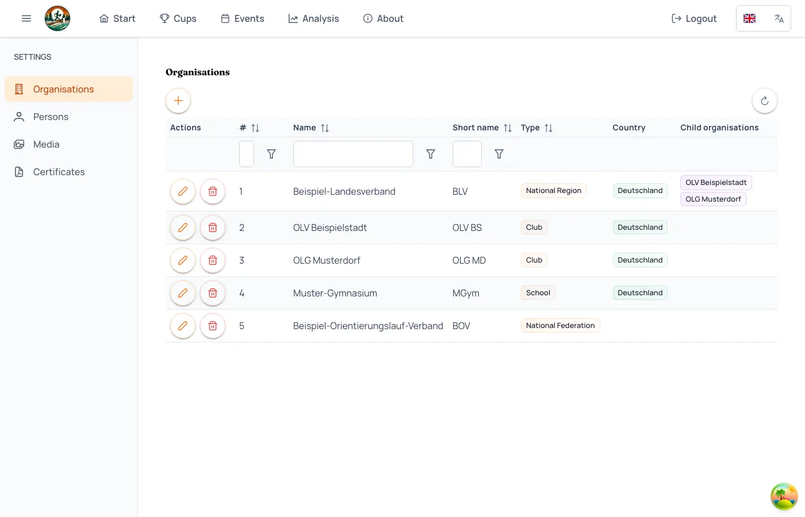
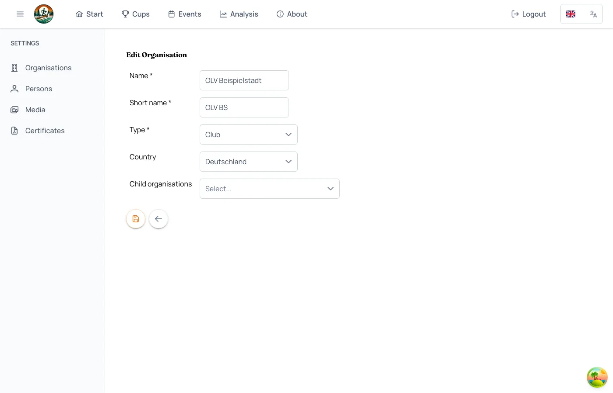
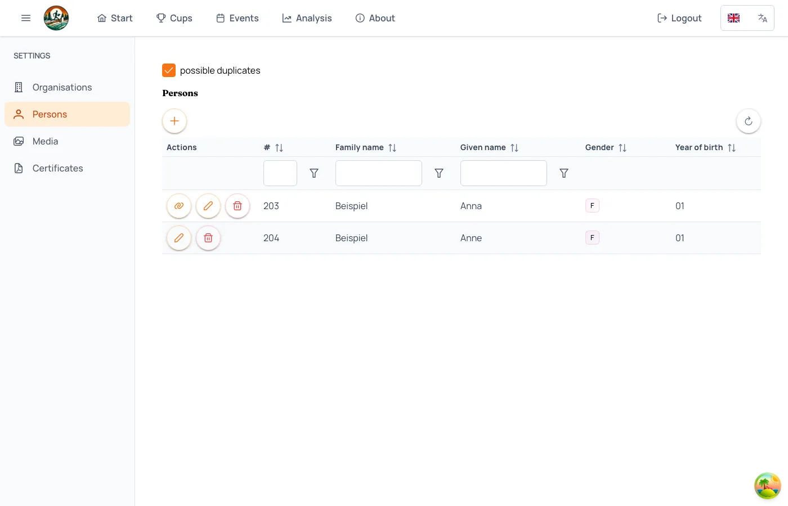
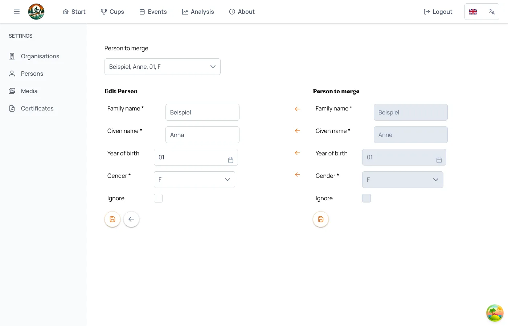
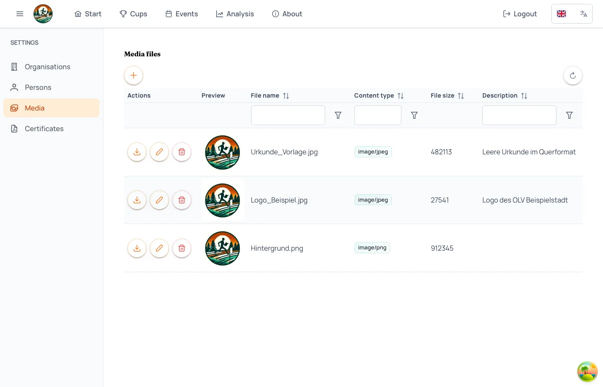

# 5 Master data

> [Deutsch](05-master-data.de.md) · **English**

Master data are the records that events, results and certificates refer to: organisations (clubs,
federations), persons and media files. This chapter describes the three pages for them, how to
find, create, edit and delete records, and how to merge two persons who were entered twice.

## Overview

The three pages are in the sidebar under the heading **Settings**. The sidebar is shown to
administrators only.

| Page | Sidebar entry | Address | What it holds |
|---|---|---|---|
| Organisations | **Organisations** | `/{locale}/organisation` | Clubs, federations, schools and similar, with country and child organisations |
| Persons | **Persons** | `/{locale}/person` | Athletes with name, year of birth and gender |
| Media | **Media** | `/{locale}/media` | Uploaded images, for example certificate backgrounds |

## Lists

All three pages use the same kind of table as the certificate list (see
[chapter 6](06-certificates.md)).

| Element | Meaning |
|---|---|
| Plus button above the table | Create a new record (administrators only) |
| Arrow button at the top right | **Reload** the list |
| Column **Action** | **Edit** (pencil) and **Delete** (trash can) |
| Filter field below a column title | Shows only rows whose value contains the typed text |
| Click on a column title | Sort by this column, a further click reverses the order |
| Paging above and below the table | Choose the page and the number of rows |

The tables show 10 rows per page. The number of rows can be set from 5 to 500 on the organisation
and person pages and up to 1000 on the media page. Several sort columns are possible. Sorting and
filters are remembered as long as the session is open in the browser. A filter that matches
nothing shows the message **No Data** and a button **Clear filters**.

## Organisations

### The list

The page **Organisations** is sorted by name at first.

| Column | Content | Sort | Filter |
|---|---|---|---|
| **#** | Number of the record | yes | yes |
| **Name** | Full name | yes | yes |
| **Short name** | Abbreviation | yes | yes |
| **Type** | Type of the organisation | yes | no |
| **Country** | Country | no | no |
| **Child organisations** | Organisations below this one | no | no |

### Creating and editing

The plus button opens the page **New Organisation**, the pencil opens **Edit Organisation**.
Both use the same form.

| Field | Meaning |
|---|---|
| **Name** \* | Full name |
| **Short name** \* | Abbreviation |
| **Type** \* | One of the types listed below |
| **Country** | Selection from the stored countries, may stay empty |
| **Child organisations** | Multiple selection with search, for example the clubs of a regional federation |

An asterisk (\*) marks required fields. An empty required field has a red outline. A new
organisation starts with the type **Other** and the country **GER**.

The type is one of these values:

- **IOF**
- **IOF Region**
- **National Federation**
- **National Region**
- **Club**
- **School**
- **Company**
- **Military**
- **Other**

The hierarchy is kept at the parent: the child organisations are chosen in the form of the
organisation above them, and the list shows them in the column **Child organisations**.
Loops in the hierarchy: Not verified in the source.

### Deleting

The trash can in the row asks for confirmation and then deletes the organisation. It shows the
message **organisation deleted**. What happens to events and results that still refer to the
organisation: Not verified in the source.

## Persons

### The list and possible duplicates

The page **Persons** is sorted by family name at first.

| Column | Content | Sort | Filter |
|---|---|---|---|
| **#** | Number of the record | yes | yes |
| **Family name** | Family name | yes | yes |
| **Given name** | Given name | yes | yes |
| **Gender** | Gender | yes | no |
| **Year of birth** | Year, shown with two digits (for example 85) | yes | no |

The checkbox **possible duplicates** above the table narrows the list to persons who might exist
twice. Two persons count as possible duplicates if their family names are equal (ignoring case and
spaces) and either their given names are equal or the first three letters of the given names are
equal and the years of birth match or one of them is missing. The state of the checkbox is kept in
the address of the page.

In this view, a link button (tooltip **Merge**) appears in the column **Action**. It is shown for
one row per group of nearly identical persons and opens the merge page.

### Fields

The pencil opens **Edit Person**, the plus button opens **New Person**.

| Field | Meaning |
|---|---|
| **Family name** \* | Family name |
| **Given name** \* | Given name |
| **Year of birth** | Year, chosen in a year picker, may stay empty |
| **Gender** \* | **M**, **F**, **B** or **U** |
| **Ignore** | A checkmark. Tooltip: "Person is not considered in result lists and cup scores" |

The value **U** is used when the gender is missing or unknown. The meaning of **B** is not
verified in the source.

### Merging two persons

Use this when the same person exists twice, for example because of a different spelling in two
imported result files. The person on the left is kept, the person on the right disappears.

1. Tick **possible duplicates** on the page **Persons**.
2. Click the link button (**Merge**) in the row of the person to keep. The merge page opens with
   this person on the left.
3. Check the selection **Person to merge** above the forms. It lists the similar persons with
   family name, given name, year of birth and gender, the most similar first, and the first one is
   already chosen. Choose another one if needed. The chosen person is shown on the right and
   cannot be edited there.
4. If a value of the right person is better, click the arrow button (**Transfer value**) next to
   the field. The value is copied to the left form. There is one arrow each for family name, given
   name, year of birth and gender.
5. Save changes on the left with the disk button (**Save**). This step is separate: the merge
   itself does not save the left form.
6. Click the button **Merge** below the right form. The page shows the message **person changed**.

The merge changes the following:

- The results, split times, cup scores and certificate statistics of the right person are assigned
  to the left person.
- The right person is deleted.
- The data of the left person stay as they are, apart from what was saved in step 5.

There is no confirmation prompt before the merge.

### Deleting

The trash can in the row asks for confirmation and then deletes the person. What happens to results
that still refer to the person: Not verified in the source.

## Media files

### The list

The page **Media** is open to all logged-in users. Only administrators can create, edit,
download and delete.

| Column | Content | Sort | Filter |
|---|---|---|---|
| **Preview** | Reduced view of the image | no | no |
| **File name** | Name of the stored file | yes | yes |
| **Content type** | For example `image/png` | yes | yes |
| **File size** | Size in bytes | yes | no |
| **Description** | Free text | yes | yes |

In the column **Action**, administrators also find the button **Download** (arrow into a tray)
next to the pencil and the trash can.

### Uploading

The plus button opens the page **Import new media file**.

1. Click **Choose** (image button) or drag the file into the field. Only one file at a time is
   possible.
2. Click **Import** (upload button). The message **Media file uploaded** confirms it.
3. Click **Back** to return to the list. The button **Clear** discards the selection.

Allowed file types:

| Check | Types |
|---|---|
| Browser, when choosing and uploading | JPEG, PNG, GIF, WebP |
| Server, by the content of the file | JPEG, PNG, GIF, WebP, SVG, PDF |

The server decides by the content, not by the file name or the type the browser reports. A file
that the server does not accept is rejected. SVG and PDF are accepted by the server, but the browser check skips them, so they
cannot be uploaded through this page. A file that fails the check in the browser is skipped without a message on the
page. The size limit of one file is 20 MB in the application settings. For JPEG, PNG, GIF and WebP
a reduced preview image is created.

### Editing

The pencil opens **Edit Media file**. **File name**, **Content type** and **File size** are shown
read-only. Only the **Description** can be changed.

### Use in certificates

The certificate editor offers the images of this page as **Background** (see
[chapter 6](06-certificates.md)). Backgrounds and logos are uploaded here first.

### Deleting

The trash can in the row asks for confirmation and then deletes the media file. In the database
a certificate refers to its background image. What happens when a file that is still used as a
background is deleted: Not verified in the source.

## Countries

There is no page for countries. The country list is only used in the selection **Country** of
the organisation form. Where the countries come from: Not verified in the source.

## Who may do what

| Task | Administrator | Other logged-in user |
|---|---|---|
| Organisations: view, create, edit, delete | yes | no, the page shows nothing |
| Persons: view, create, edit, merge, delete | yes | no, the page shows nothing |
| Media: view the list | yes | yes |
| Media: upload, edit, download, delete | yes | no |
| Sidebar with the three pages | yes | not shown |
