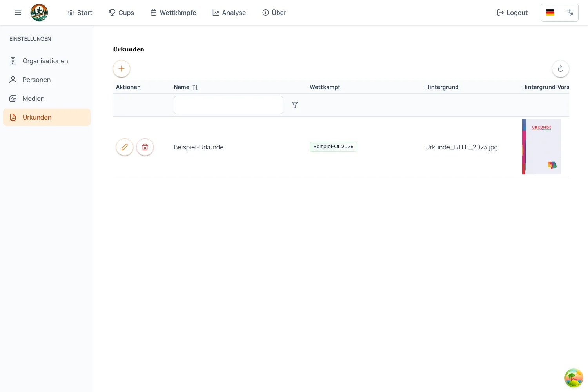
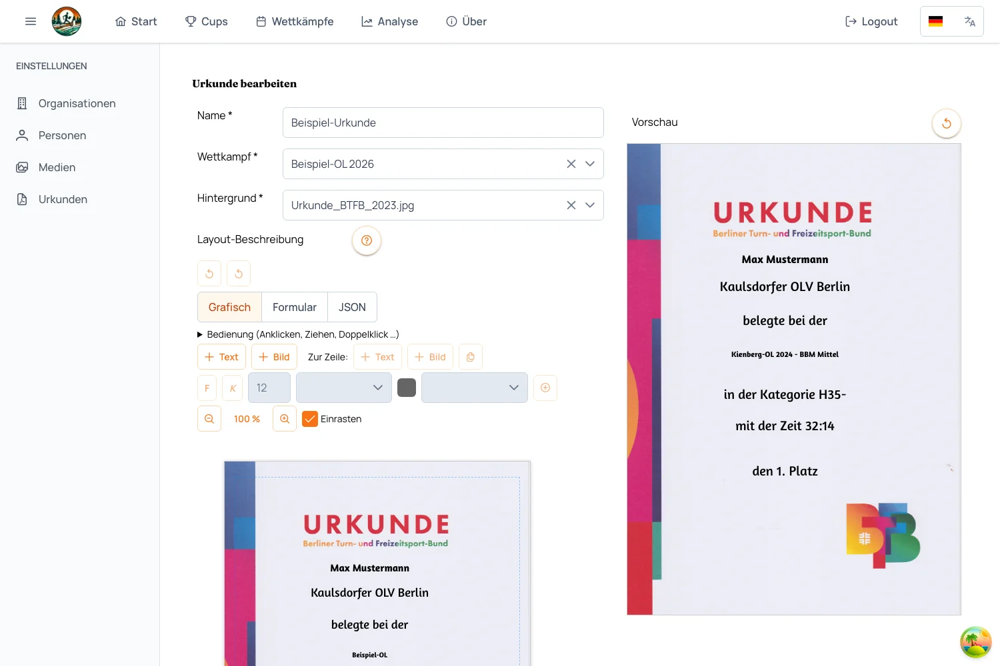
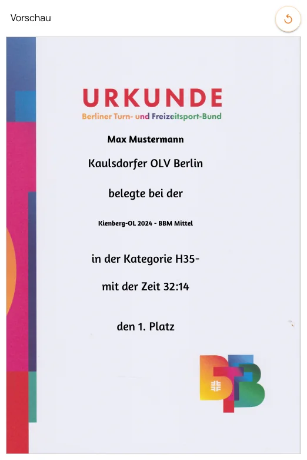
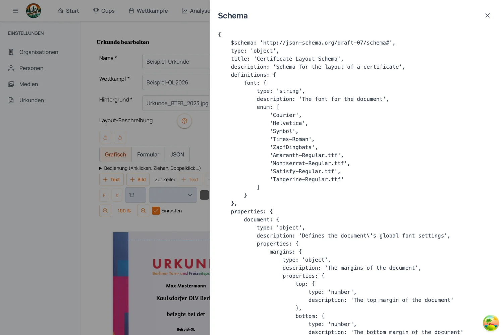

# 6 Urkunden

> **Deutsch** · [English](06-certificates.md)

Eine **Urkunde** ist in Resulter eine Vorlage. Aus ihr erzeugt die Anwendung für jeden Teilnehmer
eines Wettkampfs ein PDF mit dessen Namen, Platz, Zeit und Verein. Dieses Kapitel beschreibt die
Verwaltung der Vorlagen und das Prinzip des Layouts. Die drei Möglichkeiten, ein Layout zu
bearbeiten, stehen in den Kapiteln 3 bis 5.

## Die Liste der Urkunden

Die Seite **Urkunden** (Seitenleiste, Abschnitt **Einstellungen**) zeigt alle Vorlagen.

Angemeldete Benutzer sehen die Liste. **Anlegen, Bearbeiten und Löschen** dürfen nur
Administratoren.

| Element | Bedeutung |
|---|---|
| Plus-Knopf über der Tabelle | Neue Urkunde anlegen |
| Pfeil-Knopf rechts oben | Liste neu laden |
| Spalte **Aktionen** | Urkunde bearbeiten (Stift) oder löschen (Papierkorb) |
| Spalte **Name** | Name der Vorlage, sortierbar, mit Filterfeld darunter |
| Spalte **Wettkampf** | Der Wettkampf, für den die Vorlage angelegt wurde |
| Spalte **Hintergrund** | Dateiname des Hintergrundbilds |
| Spalte **Hintergrund-Vorschau** | Verkleinerte Ansicht des Hintergrunds |

Die Tabelle zeigt 10 Einträge je Seite (einstellbar von 5 bis 500) und merkt sich Sortierung und
Filter, solange die Sitzung im Browser offen ist.

## Eine Urkunde anlegen oder bearbeiten

Mit dem Plus-Knopf oder dem Stift öffnet sich die Seite **Urkunde bearbeiten**. Links stehen die
Felder und der Editor, rechts die Vorschau.

### Felder

| Feld | Bedeutung |
|---|---|
| **Name** \* | Frei wählbarer Name der Vorlage |
| **Wettkampf** \* | Der Wettkampf, mit dem die Vorschau erzeugt wird |
| **Hintergrund** \* | Das Bild, auf das der Text gedruckt wird (Auswahl mit Suche und Vorschau) |
| **Layout-Beschreibung** | Das Layout des Textes (siehe unten und Kapitel 7 bis 9) |
| **Primär** | Markierung der Hauptvorlage |

Ein Stern (\*) kennzeichnet Pflichtfelder. Ein leeres Pflichtfeld ist rot umrandet. Gespeichert
wird mit dem Diskettenknopf unter dem Formular, mit dem Pfeil daneben kommt man zur Liste zurück.

**Hintergrund:** Die Auswahl zeigt die Bilder aus der Medienverwaltung (Seitenleiste **Medien**).
Dort werden Hintergrundbilder und Logos hochgeladen. Der Hintergrund wird als ganzes Bild
proportional in die Seite eingepasst und zentriert.

**Primär:** Der Haken wird mit der Urkunde gespeichert. Im Programmcode wird er derzeit nirgends
ausgewertet (Stand 4.12.3). Er hat also keine erkennbare Wirkung.

### Die Vorschau

Rechts erzeugt die Anwendung das echte PDF, so wie es auch für die Teilnehmer entsteht.

- Die Vorschau lädt automatisch neu, kurz nachdem man etwas am Layout geändert hat. Der
  runde Pfeil oben rechts lädt sie sofort neu.
- Sie verwendet Beispieldaten für die Person (Max Mustermann, Kaulsdorfer OLV Berlin, H35-,
  32:14, 1. Platz) und den Namen des gewählten Wettkampfs. Die grafische Seitenansicht des
  Editors arbeitet dagegen mit festen Beispielwerten und zeigt als Wettkampfnamen
  „Beispiel-OL“. Der Unterschied ist in den Bildern dieses Handbuchs gut zu sehen.
- Die Vorschau ist die maßgebliche Darstellung. Die Seitenansicht im Editor ist eine
  Annäherung (siehe [Kapitel 10](10-certificate-reference.de.md#grenzen-der-seitenansicht)).
- Ist das Layout fehlerhaft, zeigt die Vorschau statt der Urkunde ein PDF mit den Fehlertexten. Die
  Fehler zeigt auch der Editor selbst an (siehe
  [Kapitel 9](09-certificate-editor-json.de.md#fehlermeldungen)).

## Das Layout: Fließtext in Absätzen

Das Layout beschreibt keinen Text an festen Koordinaten, sondern **Fließtext**. Das bestimmt die
ganze Bedienung:

- Eine **Seite** besteht aus **Absätzen**, die von oben nach unten untereinander stehen.
- Ein **Absatz** hat einen Abstand nach oben und unten, optional einen Einzug links und rechts
  und enthält einen oder mehrere **Blöcke**, die in einer Zeile nebeneinander stehen.
- Ein **Block** ist ein **Text** (mit Schriftgröße, Schrift, Fett, Kursiv, Farbe) oder ein
  **Bild** (mit Breite).
- Wo ein Block in der Zeile steht, bestimmen **Tabulatoren** des Absatzes: Positionen mit
  einer Ausrichtung (links, rechts, zentriert, Anker). Der Block steht auf dem ersten Tabulator
  hinter dem Ende des vorigen Blocks.
- Ein Absatz ohne eigene Tabulatoren hat einen zentrierten Tabulator bei 261,5 pt, der
  Text steht also in der Mitte der Seite.
- Die **Seitenränder** gehören zum Dokument. Fehlt die Angabe, gelten 36 pt rundum. Gibt es
  Dokumenteinstellungen ohne Ränder, gelten oben und unten 30 pt, links und rechts 20 pt.

Weil der Text fließt, verschiebt sich alles darunter, wenn man einen Absatz höher macht oder
größer schreibt. Die Seitenansicht des Editors gleicht das beim Verschieben und Skalieren
standardmäßig aus (siehe [Kapitel 7](07-certificate-editor-graphic.de.md)).

Die Begründung für dieses Modell steht in
[ADR 0009](../adr/0009-certificate-layout-as-json-flowing-text-with-itext.de.md).

## Platzhalter

In Texten können Platzhalter stehen, die beim Erzeugen durch die Daten des Teilnehmers ersetzt
werden, zum Beispiel `{{GIVEN_NAME}} {{FAMILY_NAME}}`. Die Liste steht in
[Kapitel 10](10-certificate-reference.de.md#platzhalter).

## Die Hilfe zum Schema

Neben der Überschrift **Layout-Beschreibung** öffnet der Knopf mit dem Fragezeichen die
Beschreibung des Layout-Formats (JSON-Schema) in einer Seitenleiste. Sie listet alle erlaubten
Felder, Schriften und Wertebereiche auf.

## Eine Urkunde einem Wettkampf zuordnen

Die Auswahl der Urkunde steht im Formular des Wettkampfs (Feld **Urkunde**). Wie Teilnehmer die
Urkunde dann herunterladen und was Administratoren in der Statistik der erzeugten Urkunden
sehen, wird in [Kapitel 3](03-events-and-results.de.md) beschrieben.
