# 7 Urkunden-Editor: Grafisch

> **Deutsch** · [English](07-certificate-editor-graphic.md)

Der grafische Editor ist die Standardansicht beim Bearbeiten einer Urkunde. Er zeigt die Seite
im Format A4 mit dem Hintergrundbild und lässt die Textblöcke und Bilder direkt anfassen,
verschieben, vergrößern und beschriften. Darunter steht, mit denselben Änderungen, das
Formular (siehe [Kapitel 8](08-certificate-editor-form.de.md)).

Umgeschaltet wird mit den drei Reitern **Grafisch**, **Formular** und **JSON** über dem Editor.
Alle drei Reiter bearbeiten dasselbe Layout. Was man in einem ändert, sieht man sofort in den
anderen.

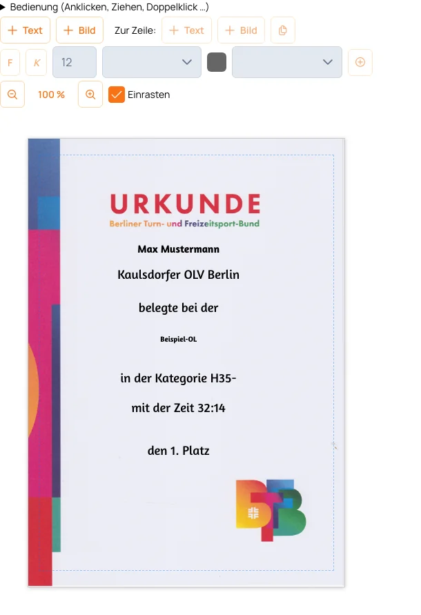

## Aufbau

Von oben nach unten:

1. **Bedienung.** Ein aufklappbarer Hilfetext mit den wichtigsten Handgriffen.
2. **Hinzufügen.** Knöpfe, um Text und Bilder einzufügen (siehe
   [Hinzufügen](#hinzufügen)).
3. **Format-Leiste.** Fett, Kursiv, Schriftgröße, Schrift, Farbe, Ausrichtung und
   Tabulator-Knöpfe für den ausgewählten Block.
4. **Zoom und Einrasten.** Vergrößern, Verkleinern und der Schalter **Einrasten**.
5. **Seite.** Die A4-Seite mit den Blöcken. Die gestrichelte blaue Linie sind die Seitenränder.

Die Leisten haben immer dieselbe Höhe. Knöpfe, die gerade nicht zum Auswahlzustand passen, sind
ausgegraut und nicht verschwunden. So springt die Seite nicht, wenn man einen Block anklickt.

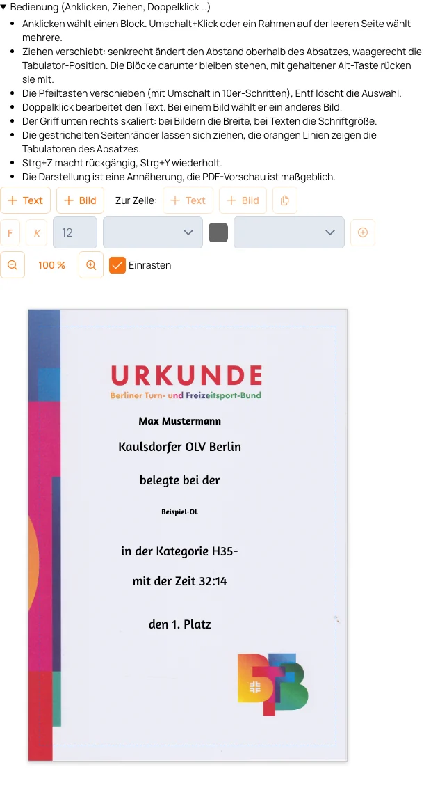

Die Seitenansicht verwendet Beispieldaten (Max Mustermann, Kaulsdorfer OLV Berlin,
Beispiel-OL, H35-, 32:14, 1. Platz). Schrift, Zeilenhöhe und Bildproportionen entsprechen dem
PDF. Zeilenumbrüche langer Texte bildet sie nicht ab. Maßgeblich bleibt die
[PDF-Vorschau](06-certificates.de.md#die-vorschau).

## Blöcke auswählen

- **Klick** wählt einen Block. Er bekommt einen orangen Rahmen, und die Format-Leiste wird aktiv.
  Ein Klick auf eine leere Stelle der Seite hebt die Auswahl auf.
- **Umschalt+Klick** fügt einen Block zur Auswahl hinzu oder nimmt ihn heraus.
- Ein **Rahmen**, den man auf einer leeren Stelle der Seite aufzieht, wählt alle Blöcke, die er
  berührt. Mit gehaltener Umschalt-Taste kommen sie zur bestehenden Auswahl dazu.

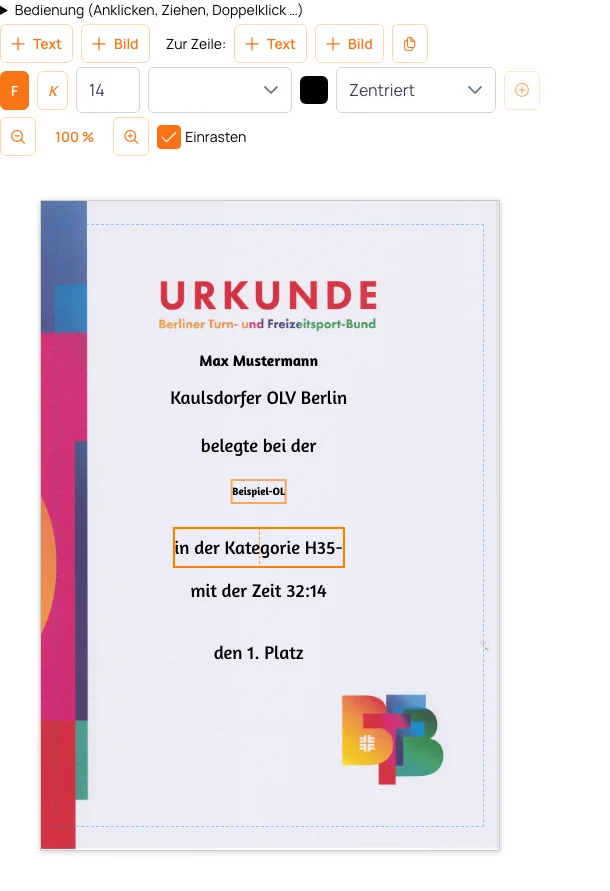

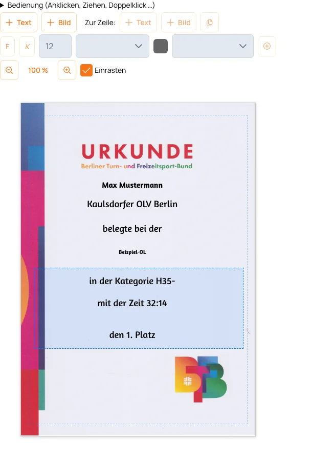

Mit mehreren Blöcken wirken Verschieben, Pfeiltasten, **Entf** und die Format-Leiste auf alle.
Der Skalier-Griff und die Tabulator-Knöpfe gelten nur für den zuletzt gewählten Block.

## Verschieben

Ein Block wird mit gedrückter Maustaste gezogen. Die Richtung der ersten Bewegung entscheidet,
ob senkrecht oder waagerecht verschoben wird. Beides gleichzeitig geht nicht, damit eine leicht
schiefe Bewegung nichts verstellt.

| Bewegung | Wirkung im Layout |
|---|---|
| Senkrecht | Ändert den Abstand oberhalb des Absatzes. |
| Waagerecht | Ändert die Position des Tabulators, auf dem der Block steht. |

Es gibt keine Sperren: Blöcke lassen sich auch über den Seitenrand und ins Negative schieben,
ob es passt, entscheidet man selbst. Die Seitenansicht lässt Blöcke über den Rand hinausragen
und hält ringsum 40 Pixel Platz, damit sie greifbar bleiben. Im PDF wird alles
abgeschnitten, was außerhalb der Seite liegt.

### Was mit den Blöcken darunter passiert

Weil das Layout Fließtext ist, würde jeder höher gesetzte Absatz alles darunter mitnehmen.
Der Editor verhindert das beim senkrechten Verschieben: Der **nächste Absatz** bekommt den
umgekehrten Abstand, sodass alles darunter an seinem Platz bleibt. Das kann dazu führen, dass der
Abstand des folgenden Absatzes negativ wird. Das ist erlaubt.

Mit gehaltener **Alt-Taste** gilt das alte Verhalten: Alles darunter rückt mit.

### Einrasten und Hilfslinien

Beim Ziehen rasten die Kanten und die Mitte des Blocks ein, wenn sie weniger als 6 Pixel von
einem Ziel entfernt sind. Ziele sind die Seitenmitte, die Seitenränder und die Kanten und
Mitten der anderen Blöcke. Eine pinke Linie zeigt, woran der Block gerade einrastet.

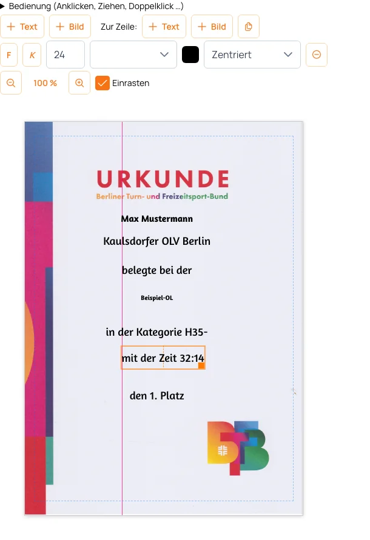

Der Schalter **Einrasten** neben dem Zoom schaltet das ab. Das Einrasten arbeitet mit dem
zuerst angefassten Block. Bei mehreren ausgewählten Blöcken folgt der Rest ihm ohne eigene
Hilfslinien.

### Mit der Tastatur

Ist ein Block ausgewählt, verschieben die Pfeiltasten ihn um einen Punkt, mit gehaltener
Umschalt-Taste um zehn. Hoch und runter ändern den Abstand, links und rechts den Tabulator.
Auch hier gilt: Ohne Alt bleibt der Rest stehen.

## Text bearbeiten

**Doppelklick** auf einen Textblock öffnet ein Eingabefeld direkt auf der Seite. **Eingabe**
(oder ein Klick daneben) übernimmt den Text, **Esc** bricht ab. Mit **Eingabe** lässt sich auch
ein ausgewählter Block zum Bearbeiten öffnen.

Während der Bearbeitung zeigt die Format-Leiste statt der Formatierung die **Platzhalter**
(zum Beispiel `CATEGORY`). Ein Klick fügt `{{CATEGORY}}` an der Cursor-Stelle ein, ohne dass die
Bearbeitung endet. Die Liste der Platzhalter steht in
[Kapitel 10](10-certificate-reference.de.md#platzhalter).

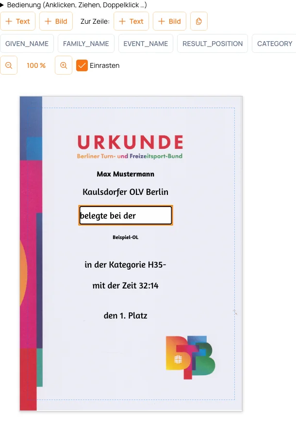

## Die Format-Leiste

Die Leiste gilt für alle ausgewählten **Textblöcke**. Ohne Auswahl und bei Bildblöcken ist sie
ausgegraut.

| Element | Wirkung |
|---|---|
| **F** | Fett ein und aus |
| **K** | Kursiv ein und aus |
| Zahlenfeld | Schriftgröße in Punkt |
| Schriftauswahl | Schrift des Blocks. Der Strich „–“ entfernt sie, dann gilt die Dokumentschrift. |
| Farbfeld | Schriftfarbe |
| Ausrichtung | Ausrichtung des Tabulators, auf dem der Block steht (links, rechts, zentriert, Anker) |
| Plus-Kreis | Eigenen Tabulator für den Block anlegen (siehe [Tabulatoren](#tabulatoren)) |
| Minus-Kreis | Tabulator des Blocks entfernen |

Zu **Fett und Kursiv:** Ob die Schrift dabei wirklich fett oder kursiv gesetzt wird, hängt von
der Schrift ab. Hat das Dokument für den Stil eine eigene Schrift (zum Beispiel „Schrift fett“),
wird sie verwendet. Sonst täuscht der PDF-Druck den Stil nur vor, indem er die Buchstaben
umrandet oder schräg stellt. Die Seitenansicht ahmt das nach.

Die **Ausrichtung** gehört dem Tabulator, nicht dem Block. Alle Blöcke auf demselben Tabulator
ändern sich mit.

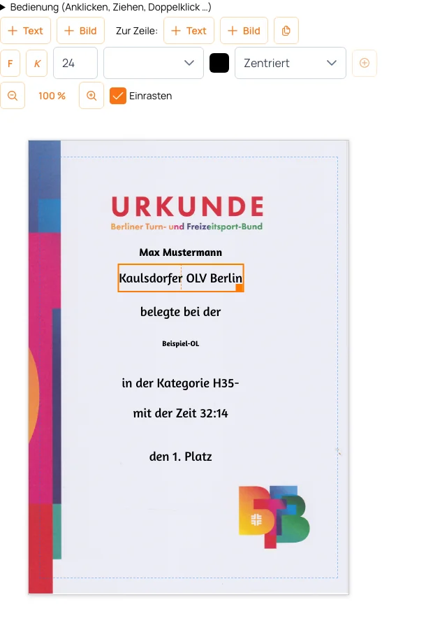

## Skalieren

Der ausgewählte Block hat unten rechts einen kleinen orangen Griff. Zieht man ihn, ändert sich
bei einem **Bild** die Breite um die gezogene Strecke (die Höhe folgt dem Seitenverhältnis des
Bilds). Bei einem **Text** wächst die Schriftgröße im gleichen Verhältnis wie die Breite, auf ganze
Punkte gerundet, mindestens 1.

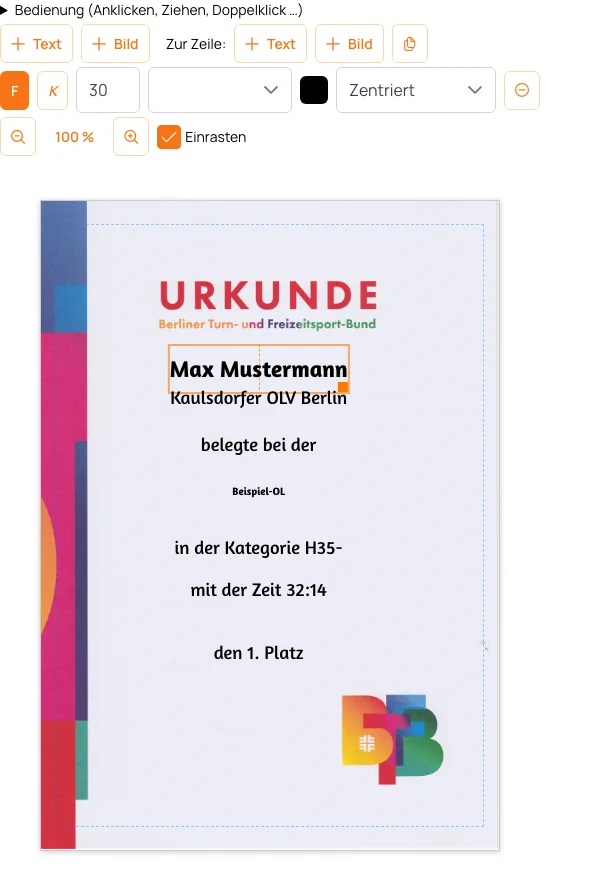

Wie beim Verschieben bleibt der **Absatz darunter** an seinem Platz. Mit gehaltener **Alt-Taste**
rückt er mit. Die Lage des Absatzes darunter stimmt bis auf einen halben Punkt, weil der
Abstand ganzzahlig ist. Beim Skalieren rastet die rechte Kante des Blocks ein, solange
**Einrasten** an ist.

Bei zentrierten oder rechtsbündigen Blöcken rastet der Griff ein, nicht die sichtbare Kante des
Texts. Dort ist das nur ungefähr richtig.

## Hinzufügen

Die Knöpfe über der Seite legen neue Blöcke an.

| Knopf | Wirkung |
|---|---|
| **Text** (links) | Neuer Absatz mit einem Textblock am Ende der Seite |
| **Bild** (links) | Wie oben, mit einem Bild aus der Medienliste |
| **Zur Zeile:** **Text** | Neuer Textblock in der Zeile des ausgewählten Blocks |
| **Zur Zeile:** **Bild** | Neuer Bildblock in der Zeile des ausgewählten Blocks |
| Kopier-Knopf | Dupliziert den Absatz des ausgewählten Blocks direkt dahinter |

Der neue Block ist ausgewählt und lässt sich sofort verschieben. Ein neuer Absatz steht
unter dem letzten Absatz der Seite. Ihn an die richtige Stelle zu schieben ist der übliche nächste
Schritt.

**Zur Zeile** hängt den Block hinter die vorhandenen Blöcke des Absatzes. Er steht auf dem
nächsten Tabulator hinter dem vorigen Block, gibt es keinen mehr, auf dem nächsten Vielfachen
von 50 pt. Damit entstehen Zeilen mit Text links und rechts.

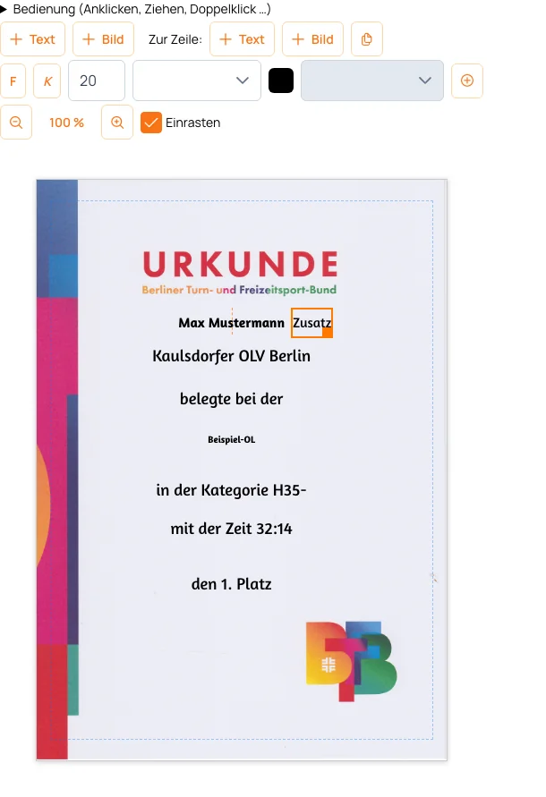

Ein **Duplikat** liegt zunächst genau unter dem Original, weil es dieselben Abstände hat. Den
Absatz darunter schiebt es nach unten, ohne dass der Editor das ausgleicht.

### Bilder auswählen

**Bild** öffnet einen Dialog mit allen Bildern der Medienverwaltung, jeweils mit Vorschau und
Dateiname. Ein Klick legt den Block mit diesem Bild an (Breite 100 pt).

Ein **Doppelklick** auf einen vorhandenen Bildblock öffnet denselben Dialog. So tauscht man das
Bild aus, ohne den Block zu löschen. Die Breite stellt man mit dem Griff oder im Formular ein.

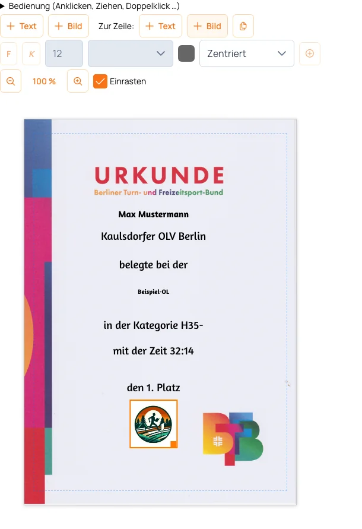

Ist die Medienliste leer, steht im Dialog „Keine Bilder vorhanden.“ Bilder werden in der
Medienverwaltung hochgeladen.

## Entfernen

**Entf** oder **Rückschritt** löscht alle ausgewählten Blöcke. Ist ein Block der letzte seines
Absatzes, entfällt der Absatz mit. Zurückholen geht mit **Rückgängig** (siehe unten).

## Tabulatoren

Der Absatz des ausgewählten Blocks zeigt seine Tabulatoren als **orange gestrichelte
senkrechte Linien**. Auf ihnen stehen die Blöcke.

Ein Block auf dem 50-Punkt-Raster (ohne eigenen Tabulator) lässt sich nicht waagerecht
verschieben, weil seine Position nirgends eingetragen ist. Der **Plus-Kreis** legt dafür einen
eigenen Tabulator an der Stelle an, an der der Block steht (links ausgerichtet). Danach lässt er
sich verschieben. Der **Minus-Kreis** löscht den Tabulator des Blocks wieder. Die Blöcke auf
ihm rutschen dann auf den nächsten Tabulator.

Der Standard-Tabulator bei 261,5 pt (zentriert) besteht nur, solange der Absatz keine eigenen
Tabulatoren hat. Er lässt sich nicht löschen. Löscht man den letzten eigenen Tabulator, ist er
wieder da.

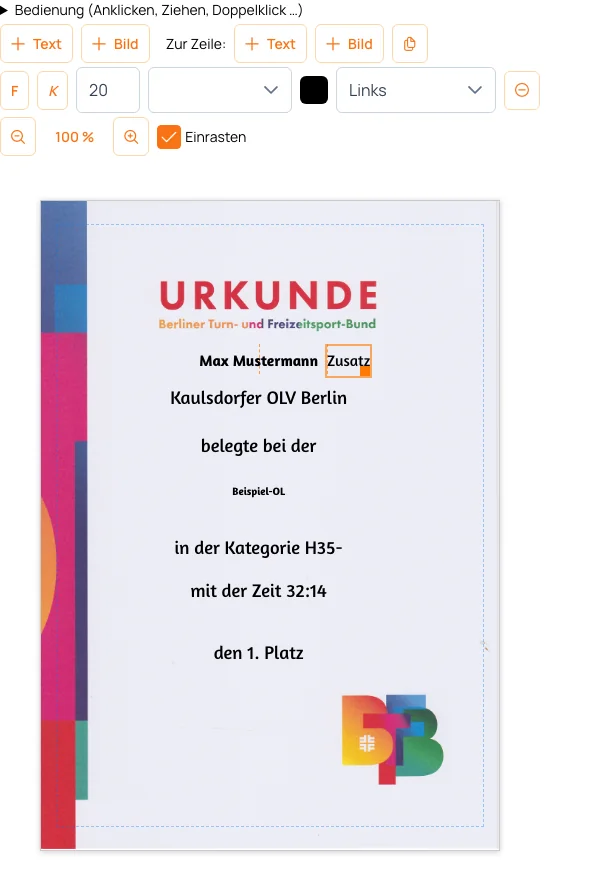

## Seitenränder

Die blau gestrichelte Linie zeigt die Seitenränder. Jede der vier Seiten lässt sich mit der Maus
ziehen. Beim ersten Ziehen schreibt der Editor alle vier Ränder in die Dokumenteinstellungen,
weil das Backend alle vier braucht. Die Seite sieht dadurch nicht anders aus, die Werte
stehen aber danach im Formular unter **Dokument**.

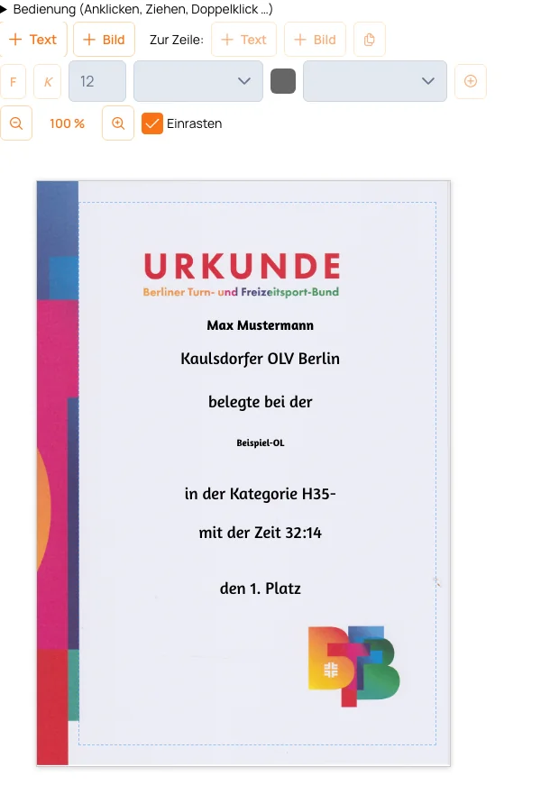

Die Position der Blöcke wird vom oberen und linken Rand aus gemessen. Verschiebt man einen Rand,
wandert deshalb der gesamte Text mit.

## Zoom

Die Lupen-Knöpfe vergrößern und verkleinern die Seite von 50 % bis 200 % in Schritten von 25 %.
Ein Klick auf die Prozentzahl setzt auf 100 % zurück. Bei breiter Seite erscheint eine
Bildlaufleiste.

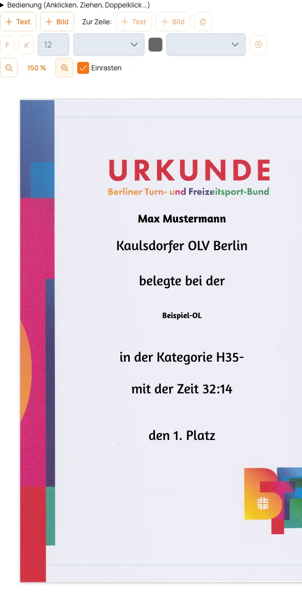

## Rückgängig und Wiederholen

Über den Reitern stehen zwei runde Pfeil-Knöpfe. Sie machen die letzte Änderung rückgängig oder
stellen sie wieder her. Dasselbe tun **Strg+Z** und **Strg+Y** (auf dem Mac **Cmd**).
**Umschalt+Strg+Z** wiederholt ebenfalls.

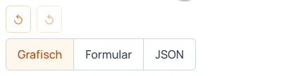

- Änderungen, die weniger als 0,6 Sekunden auseinanderliegen, zählen als ein Schritt. Ein ganzes
  Ziehen oder Skalieren lässt sich also in einem Zug zurücknehmen.
- Der Verlauf umfasst alle Änderungen am Layout, auch die aus dem Formular und dem JSON.
- Eine neue Änderung verwirft die Schritte zum Wiederholen.
- Nach dem Rückgängigmachen ist nichts mehr ausgewählt, weil sich die Nummern der Blöcke
  verschoben haben können.
- Beim Wechsel zu einer anderen Urkunde beginnt der Verlauf neu.
- In Eingabefeldern gilt das Rückgängig des Browsers. Das Textfeld im JSON-Reiter hat sein eigenes.

## Grenzen

- Zeilenumbruch langer Texte und Seitenumbruch sind in der Seitenansicht nicht abgebildet.
- Die Breite eines Textes wird mit der echten Schrift gemessen. Gegenüber dem PDF bleiben
  Abweichungen bis etwa 5 pt.
- Die mitgelieferten Schriften Amaranth, Montserrat, Satisfy und Tangerine zeigt die
  Seitenansicht mit den echten Schriftdateien. Sie werden erst beim Öffnen der Urkundenseite
  geladen. Die PDF-Standardschriften (Helvetica, Times, Courier) erscheinen mit ähnlichen
  Systemschriften.

Weitere Einzelheiten stehen in [Kapitel 10](10-certificate-reference.de.md#grenzen-der-seitenansicht).
