# 7 Certificate editor: Graphic

> [Deutsch](07-certificate-editor-graphic.de.md) · **English**

The graphic editor is the default view when editing a certificate. It shows the page in A4 format
with the background image and lets you grab, move, enlarge and label the text blocks and images
directly. The form is a separate view (see [chapter 8](08-certificate-editor-form.md)); both change the same layout.

You switch with the three tabs **Graphic**, **Form** and **JSON** above the editor.
All three tabs edit the same layout. What you change in one is immediately visible in the
others.

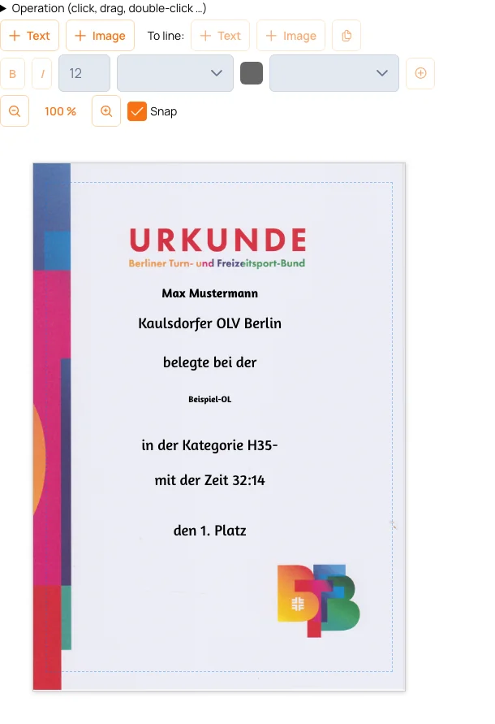

## Structure

From top to bottom:

1. **Operation (click, drag, double-click …).** A collapsible help text with the most important
   actions.
2. **Adding.** Buttons to insert text and images (see
   [Adding](#adding)).
3. **Format bar.** Bold, italic, font size, font, colour, alignment and
   tab stop buttons for the selected block.
4. **Zoom and snapping.** Zoom in, zoom out and the switch **Snap**.
5. **Page.** The A4 page with the blocks. The dashed blue line shows the page margins.

The bars always have the same height. Buttons that do not fit the current selection state are
greyed out instead of hidden. This way the page does not jump when you click a block.

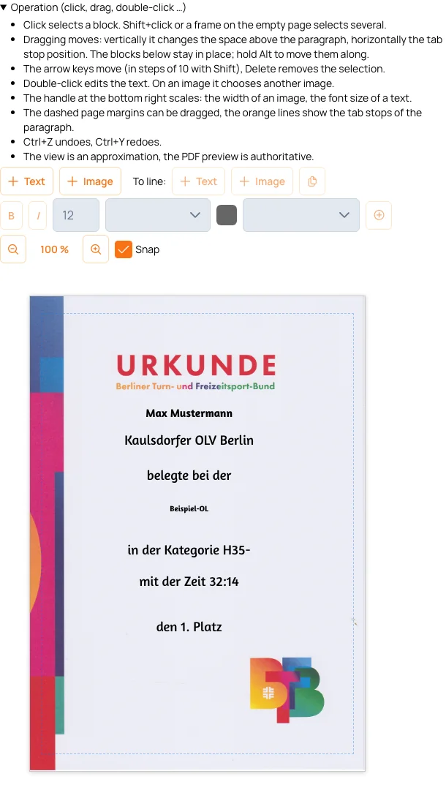

The page view uses sample data (Max Mustermann, Kaulsdorfer OLV Berlin,
Beispiel-OL, H35-, 32:14, 1st place). Font, line height and image proportions match the
PDF. Line breaks of long texts are not reproduced. The
[PDF preview](06-certificates.md#the-preview) remains authoritative.

## Selecting blocks

- **Click** selects a block. It gets an orange frame, and the format bar becomes active.
  A click on an empty spot of the page clears the selection.
- **Shift+click** adds a block to the selection or removes it.
- A **frame** drawn on an empty spot of the page selects all blocks it touches. With the Shift
  key held, they are added to the existing selection.

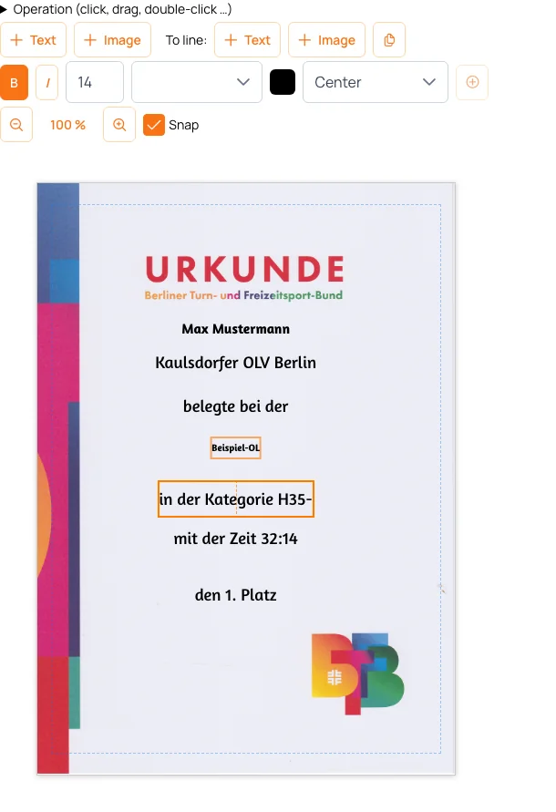

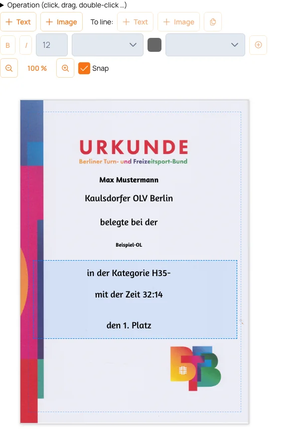

With several blocks, moving, the arrow keys, **Delete** and the format bar act on all of them.
The scale handle and the tab stop buttons apply only to the most recently selected block.

## Moving

A block is dragged with the mouse button held down. The direction of the first movement decides
whether it moves vertically or horizontally. Both at once is not possible, so that a slightly
slanted movement does not change anything by mistake.

| Movement | Effect on the layout |
|---|---|
| Vertical | Changes the spacing above the paragraph. |
| Horizontal | Changes the position of the tab stop the block stands on. |

There are no restrictions: blocks can also be pushed beyond the page margin and into negative
values, and you decide yourself whether it fits. The page view lets blocks stick out over the
edge and keeps 40 pixels of space all around so that they stay reachable. In the PDF,
everything outside the page is cut off.

### What happens to the blocks below

Because the layout is flowing text, every paragraph moved up would take everything below it
along. The editor prevents this when moving vertically: the **next paragraph** gets the
opposite spacing, so that everything below stays in its place. This can make the
spacing of the following paragraph negative. That is allowed.

With the **Alt key** held, the old behaviour applies: everything below moves along.

### Snapping and guide lines

While dragging, the edges and the centre of the block snap when they are less than 6 pixels from
a target. Targets are the page centre, the page margins and the edges and
centres of the other blocks. A pink line shows what the block is currently snapping to.

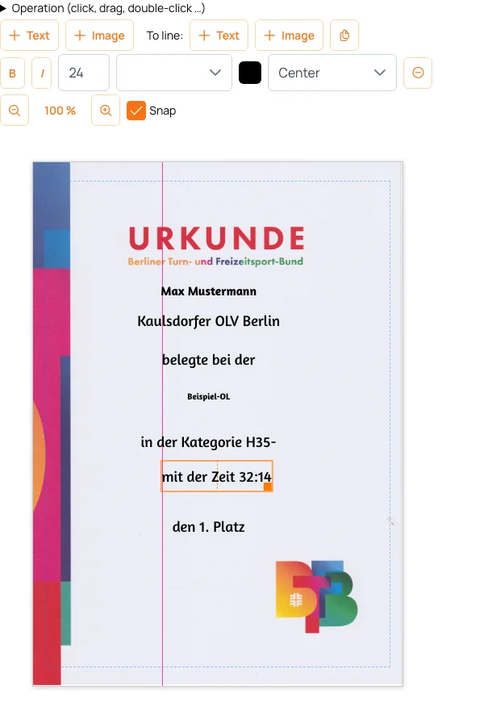

The switch **Snap** next to the zoom turns this off. Snapping works with the block grabbed
first. With several selected blocks, the rest follows it without guide lines of their own.

### With the keyboard

When a block is selected, the arrow keys move it by one point, with the Shift
key held by ten. Up and down change the spacing, left and right the tab stop.
Here, too: without Alt, the rest stays in place.

## Editing text

**Double-click** on a text block opens an input field directly on the page. **Enter**
(or a click next to it) accepts the text, **Esc** cancels. **Enter** also opens a selected block
for editing.

During editing, the format bar shows the placeholders (**Insert placeholder**, for example
`CATEGORY`) instead of the formatting. A click inserts `{{CATEGORY}}` at the cursor position
without ending the editing. The list of placeholders is in
[chapter 10](10-certificate-reference.md#placeholders).

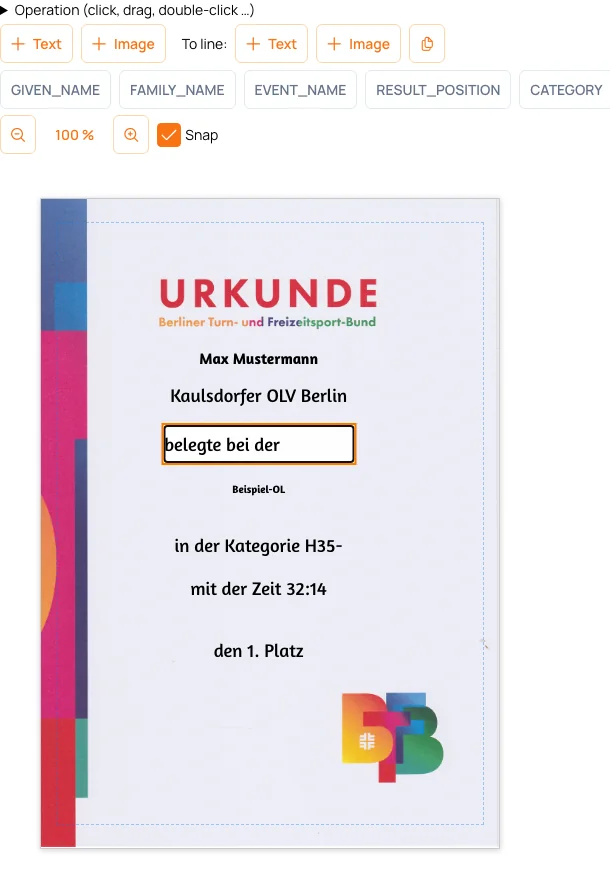

## The format bar

The bar applies to all selected **text blocks**. Without a selection and for image blocks it is
greyed out.

| Element | Effect |
|---|---|
| **B** | Bold on and off |
| **I** | Italic on and off |
| Number field | Font size in points |
| Font selection | Font of the block. The dash "–" removes it, then the document font applies. |
| Colour field | Font colour |
| Alignment | Alignment of the tab stop the block stands on (left, right, centred, anchor) |
| Plus circle | Create a tab stop of its own for the block (see [Tab stops](#tab-stops)) |
| Minus circle | Remove the tab stop of the block |

About **bold and italic:** Whether the font is really set bold or italic depends on the font.
If the document has a font of its own for the style (for example "Bold font"), it is used.
Otherwise the PDF output only fakes the style by outlining the letters or slanting
them. The page view imitates this.

The **alignment** belongs to the tab stop, not to the block. All blocks on the same tab stop
change with it.

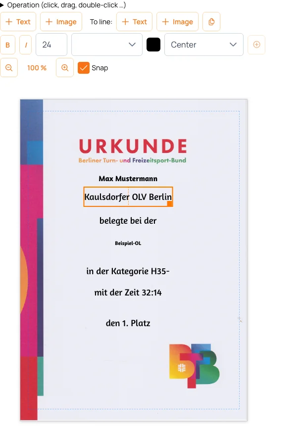

## Scaling

The selected block has a small orange handle at the bottom right. When you drag it, the width of
an **image** changes by the dragged distance (the height follows the aspect ratio of the
image). For a **text**, the font size grows in the same ratio as the width, rounded to whole
points, at least 1.

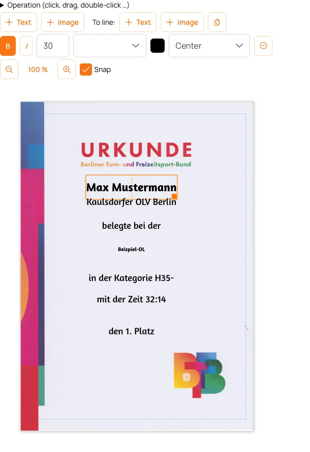

As with moving, the **paragraph below** stays in its place. With the **Alt key** held,
it moves along. The position of the paragraph below is correct to within half a point, because
the spacing is an integer. While scaling, the right edge of the block snaps as long as
**Snap** is on.

For centred or right-aligned blocks, the handle snaps, not the visible edge of the
text. There it is only approximately right.

## Adding

The buttons above the page create new blocks.

| Button | Effect |
|---|---|
| **Text** (left) | New paragraph with a text block at the end of the page |
| **Image** (left) | As above, with an image from the media list |
| **To line:** **Text** | New text block in the line of the selected block |
| **To line:** **Image** | New image block in the line of the selected block |
| Copy button | Duplicates the paragraph of the selected block directly after it |

The new block is selected and can be moved immediately. A new paragraph is placed below the last
paragraph of the page. Moving it to the right place is the usual next step.

**To line** attaches the block after the existing blocks of the paragraph. It stands on the
next tab stop after the previous block, or, if there is none left, on the next multiple of
50 pt. This creates lines with text on the left and right.

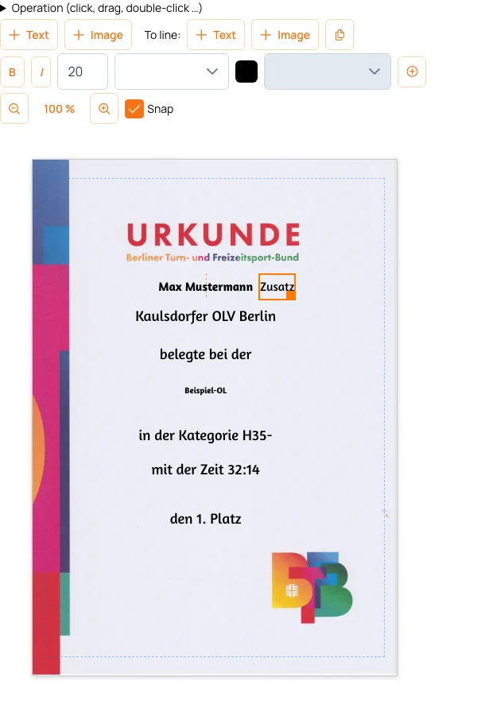

A **duplicate** first lies exactly below the original, because it has the same spacing. It pushes
the paragraph below it down, without the editor compensating for this.

### Choosing images

**Image** opens a dialog with all images of the media management, each with a preview and
file name. A click creates the block with this image (width 100 pt).

A **double-click** on an existing image block opens the same dialog. This is how you swap the
image without deleting the block. You set the width with the handle or in the form.

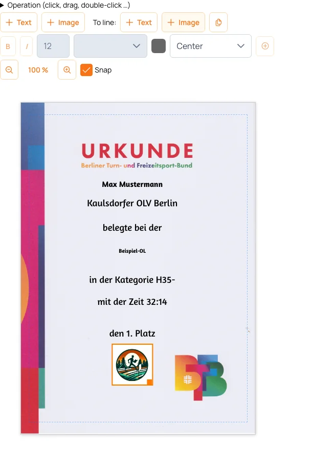

If the media list is empty, the dialog says "No images available." Images are uploaded in the
media management.

## Removing

**Delete** or **Backspace** deletes all selected blocks. If a block is the last one in its
paragraph, the paragraph is removed as well. You can get it back with **Undo** (see below).

## Tab stops

The paragraph of the selected block shows its tab stops as **orange dashed
vertical lines**. The blocks stand on them.

A block on the 50-point grid (without a tab stop of its own) cannot be moved horizontally,
because its position is not recorded anywhere. The **plus circle** creates a tab stop of its own
for it at the place where the block stands (left-aligned). After that it can be moved. The
**minus circle** deletes the tab stop of the block again. The blocks on it then slide to the
next tab stop.

The default tab stop at 261.5 pt (centred) exists only as long as the paragraph has no tab stops
of its own. It cannot be deleted. If you delete the last tab stop of your own, it is back.

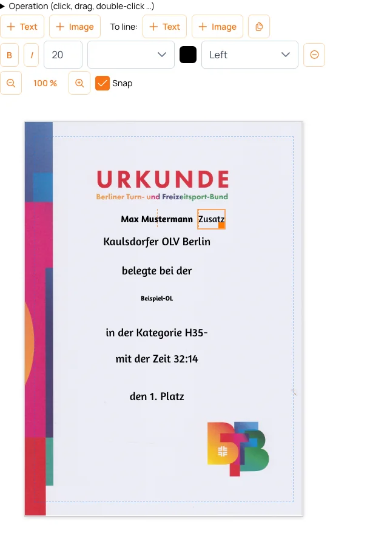

## Page margins

The blue dashed line shows the page margins. Each of the four sides can be dragged with the
mouse. On the first drag, the editor writes all four margins into the document settings,
because the backend needs all four. The page does not look different as a result, but the values
are then in the form under **Document**.

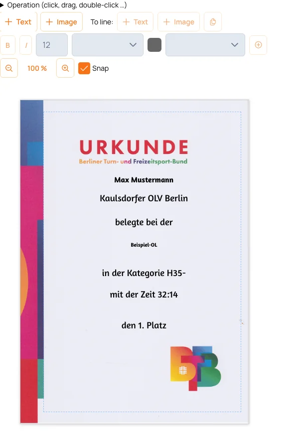

The position of the blocks is measured from the top and left margin. If you move a margin,
the entire text therefore moves with it.

## Zoom

The magnifier buttons zoom the page in and out from 50 % to 200 % in steps of 25 %.
A click on the percentage resets to 100 %. If the page is wide, a scroll bar appears.

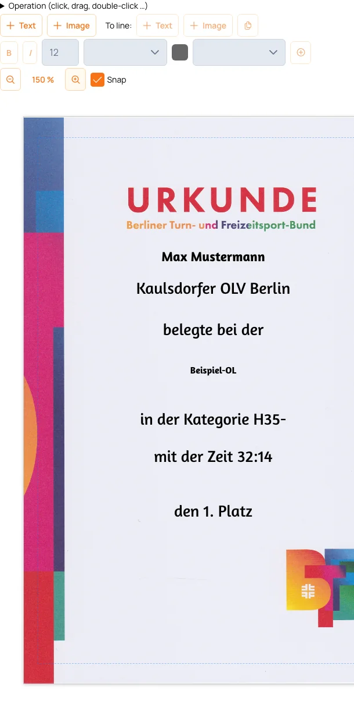

## Undo and redo

Above the tabs are two round arrow buttons. They undo the last change or restore it. **Ctrl+Z**
and **Ctrl+Y** (on the Mac **Cmd**) do the same. **Shift+Ctrl+Z** also redoes.

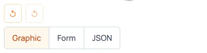

- Changes less than 0.6 seconds apart count as one step. A whole drag or scaling operation can
  therefore be undone in one go.
- The history covers all changes to the layout, including those from the form and the JSON.
- A new change discards the steps for redo.
- After undoing, nothing is selected any more, because the numbers of the blocks may have
  shifted.
- When you switch to another certificate, the history starts anew.
- In input fields, the browser's undo applies. The text field in the JSON tab has its own.

## Limits

- Line breaks of long texts and page breaks are not reproduced in the page view.
- The width of a text is measured with the real font. Deviations of up to about 5 pt from the PDF
  remain.
- The bundled fonts Amaranth, Montserrat, Satisfy and Tangerine are shown in the
  page view with the real font files. They are only loaded when the certificate page is opened.
  The PDF standard fonts (Helvetica, Times, Courier) appear with similar
  system fonts.

Further details are in [chapter 10](10-certificate-reference.md#limits-of-the-page-view).
