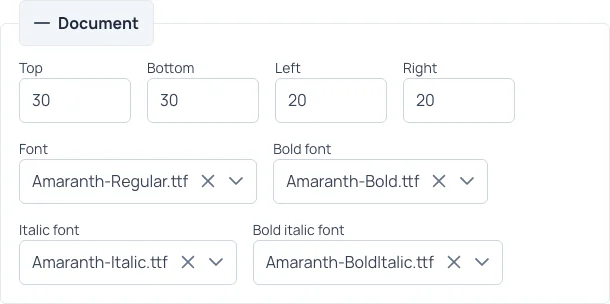
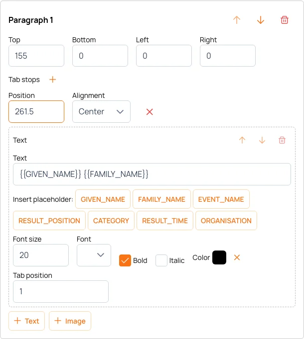

# 8 Certificate editor: Form

> [Deutsch](08-certificate-editor-form.de.md) · **English**

The tab **Form** shows the layout as input fields. It is suited for exact numbers, for
settings the page view does not have (document fonts, spacing at the bottom, left and
right), and for reordering. In the tab **Graphic**, the same list is below the page. A
change here appears immediately in the page view and vice versa.

The form is built from top to bottom: **Document**, then the **paragraphs** in the
order in which they stand on the page, and finally **Add paragraph**.

## Document

The group **Document** is collapsed. A click on the heading opens it.

| Field | Meaning |
|---|---|
| **Top**, **Bottom**, **Left**, **Right** | Page margins in points |
| **Font** | Font for normal text |
| **Bold font** | Font used for bold text |
| **Italic font** | Font for italic text |
| **Bold italic font** | Font for bold and italic text |

- The four margins belong together. The backend needs all four. The editor therefore writes
  all four when you first change a margin and keeps the appearance of the page. A
  cleared field falls back to 36 pt.
- The document fonts apply to all texts that have no font of their own. The cross in
  a field removes the setting. Which fonts exist is described in
  [chapter 10](10-certificate-reference.md#fonts).
- Without an entry for **Bold font** and **Italic font**, bold and italic text is faked
  (see [chapter 7](07-certificate-editor-graphic.md#the-format-bar)).

## Paragraphs

Each paragraph has a group of its own with the heading **Paragraph 1**, **Paragraph 2** and so
on. In the graphic view, the paragraph of the selected block has an orange outline.

On the right of the heading are three buttons: **Move up**, **Move down** (reorder the paragraph)
and **Remove** (trash can).

### Spacing

| Field | Meaning | Value without an entry |
|---|---|---|
| **Top** | Spacing above the paragraph | 4 pt |
| **Bottom** | Spacing below the paragraph | 4 pt |
| **Left** | Indent from the left margin | 0 pt |
| **Right** | Indent from the right margin | 0 pt |

A value you enter **replaces** the default spacing; it is not added to it. Negative values
are allowed. This is useful for moving a paragraph closer to the previous one or for pushing an
image out of the page to the left. An empty field shows the default value as pale
placeholder text and removes the entry from the layout.

### Tab stops

Under **Tab stops**, the plus creates a new tab stop (position 100, left). Each
tab stop has a **Position** in points (from the left margin) and an **Alignment**:

| Alignment | The block … |
|---|---|
| **Left** | starts at the position |
| **Right** | ends at the position |
| **Center** | is centred around the position |
| **Anchor** | aligns on a character (according to the specification of the PDF library) |

The cross removes a tab stop. If a paragraph has none, the default tab stop applies, centred
at 261.5 pt.

### Blocks

Each block has a header line with its type (**Text** or **Image**) and the buttons
**Move up**, **Move down** and **Remove**. The order of the blocks in the form is
not the order in the line. The **Tab position** is what counts (see below).

**Text block**

| Field | Meaning |
|---|---|
| **Text** | The text, with placeholders |
| **Insert placeholder** | Buttons that insert `{{…}}` at the cursor position |
| **Font size** | in points, 12 without an entry |
| **Font** | Font of the block, empty = document font |
| **Bold**, **Italic** | Style |
| **Color** | Font colour. **Set color** fixes one, the cross removes it (then black). |
| **Tab position** | Number of the tab stop the block stands on (see below) |

**Image block**

| Field | Meaning |
|---|---|
| **Image** | Image from the media management |
| **Width** | Width in points, 100 without an entry. The height follows the aspect ratio. |

An image stands with its bottom edge on the baseline of the line, so with text and image in one
line it is on the same line as the text.

### The tab position of a block

The **Tab position** is not a coordinate. It is the **order of the blocks** in the line.
Blocks with a lower number stand first, without an entry 1 applies. Each block goes onto the first
tab stop after the end of the previous block. With **To line** in the graphic editor, the
number is set automatically one higher than the largest in the paragraph.

### Adding blocks and paragraphs

Below the blocks of a paragraph, **Text** and **Image** add a block. **Add paragraph**
at the end of the form creates a new paragraph with an empty text block
(font size 20). A layout without paragraphs shows "No paragraph yet."

## Errors in the layout

If the JSON text in the background cannot be read, the form shows, instead of the fields, the
message that the layout is not a valid layout JSON, with the cause. To fix it, switch
to the tab **JSON** ([chapter 9](09-certificate-editor-json.md)). Violations of the schema are
listed by the form above the input fields in red text.
