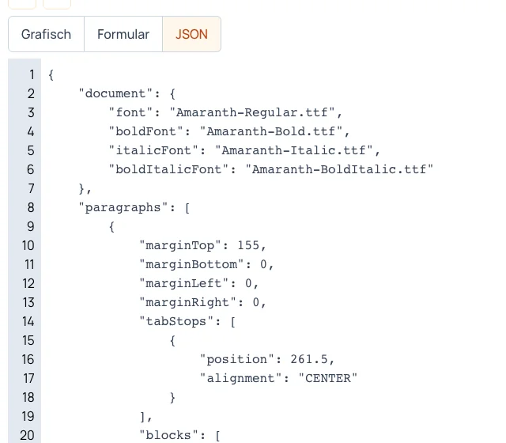
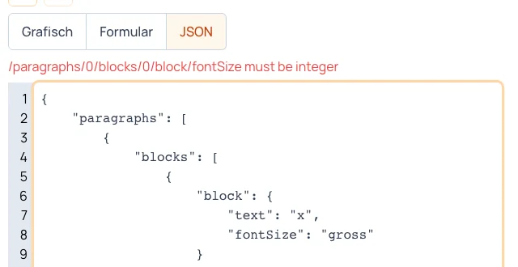

# 9 Urkunden-Editor: JSON

> **Deutsch** · [English](09-certificate-editor-json.md)

Der Reiter **JSON** zeigt das Layout als Text. Er ist der Expertenmodus: Alles, was die beiden
anderen Reiter können, steht hier als Text, und es gibt Einstellungen, die man nur hier setzt.
Das Layout wird in diesem Format in der Datenbank gespeichert.



Das Textfeld hat Zeilennummern, die bei der Fehlersuche helfen. Wer hier tippt, ändert das
Layout genauso wie in den anderen Reitern. Die Seitenansicht und die Vorschau folgen. Ein Wechsel
zum Reiter **Grafisch** oder **Formular** zeigt das Ergebnis.

## Aufbau des Layouts

Ein Layout ist ein Objekt mit zwei Teilen:

```json
{
    "document": {
        "margins": { "top": 30, "bottom": 30, "left": 20, "right": 20 },
        "font": "Amaranth-Regular.ttf",
        "boldFont": "Amaranth-Bold.ttf",
        "italicFont": "Amaranth-Italic.ttf",
        "boldItalicFont": "Amaranth-BoldItalic.ttf"
    },
    "paragraphs": [
        {
            "marginTop": 155,
            "tabStops": [{ "position": 261.5, "alignment": "CENTER" }],
            "blocks": [
                {
                    "block": {
                        "text": "{{GIVEN_NAME}} {{FAMILY_NAME}}",
                        "fontSize": 20,
                        "bold": true
                    },
                    "tabPosition": 1
                }
            ]
        }
    ]
}
```

| Feld | Bedeutung |
|---|---|
| `document` | Einstellungen für die ganze Seite (optional) |
| `document.margins` | Seitenränder `top`, `bottom`, `left`, `right` (alle vier, wenn überhaupt) |
| `document.font`, `boldFont`, `italicFont`, `boldItalicFont` | Dokumentschriften |
| `paragraphs` | Liste der Absätze (Pflicht) |
| `marginTop`, `marginBottom`, `marginLeft`, `marginRight` | Abstände eines Absatzes |
| `tabStops` | Liste mit `position` und `alignment` (`LEFT`, `RIGHT`, `CENTER`, `ANCHOR`) |
| `blocks` | Liste der Blöcke (Pflicht); jeder Eintrag hat `block` und optional `tabPosition` |
| `block.text` | Text mit Platzhaltern |
| `block.fontSize`, `bold`, `italic`, `font`, `fontRGBColor` | Format eines Textblocks (`fontRGBColor` hat `r`, `g`, `b` von 0 bis 255) |
| `block.media`, `block.width` | Bildblock: Dateiname des Bilds und Breite |

Die genaue, vollständige Beschreibung liefert das JSON-Schema. Es lässt sich in der Anwendung
ansehen: Der Knopf mit dem Fragezeichen neben **Layout-Beschreibung**
([Kapitel 6](06-certificates.de.md#die-hilfe-zum-schema)). Die Quelle liegt im Repository unter
`backend/src/main/resources/schema/certificate_schema.json`.

**Bei Bildern** steht in `media` der **Dateiname** aus der Medienverwaltung, nicht eine
Nummer. Benennt man ein Bild um, muss man den Namen im Layout anpassen.

**Fehlende Ränder:** Gibt es kein `document`, gelten 36 pt rundum. Gibt es `document` ohne
`margins`, gelten oben und unten 30 pt, links und rechts 20 pt. Gibt es `margins`, müssen alle
vier Werte darin stehen, sonst bricht das Backend ab. Der Editor schreibt deshalb stets alle vier.

## Fehlermeldungen



Der Editor prüft das Layout beim Tippen und zeigt die Fehler in roter Schrift über dem Textfeld:

- **Schema-Fehler** nennen den Pfad und die Regel, zum Beispiel
  `/paragraphs/0/blocks/0/block/fontSize must be integer`. Der Pfad zählt ab null: Absatz 0 ist
  der erste Absatz. Diese Meldungen erscheinen in allen drei Reitern.
- **Syntaxfehler** (zum Beispiel ein fehlendes Komma) erscheinen nur im JSON-Reiter. Die Reiter
  **Grafisch** und **Formular** weisen dann darauf hin und schicken zum JSON-Reiter.

Der Speichern-Knopf bleibt trotz Fehlern bedienbar. Die Prüfung im Editor ist eine Warnung, keine
Sperre. Das Backend prüft das Layout mit demselben Schema, bevor es das PDF erzeugt. Bei einem
Fehler zeigt die Vorschau ein PDF mit den Fehlertexten statt der Urkunde. Ein Layout sollte also erst gespeichert werden, wenn der Editor keine Fehler mehr
meldet.
