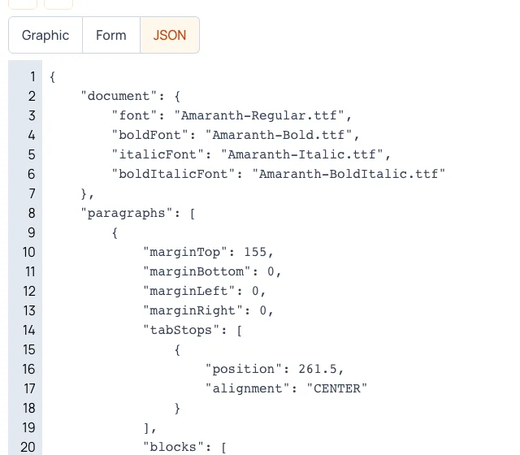
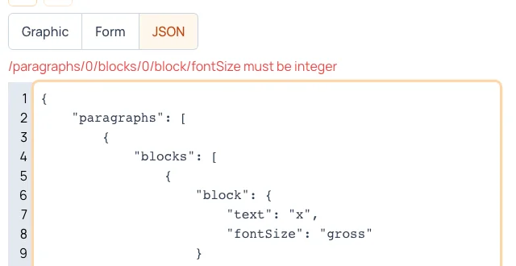

# 9 Certificate editor: JSON

> [Deutsch](09-certificate-editor-json.de.md) · **English**

The tab **JSON** shows the layout as text. It is the expert mode: everything the other two tabs
can do is here as text, and there are settings that can only be made here.
The layout is stored in the database in this format.



The text field has line numbers that help with troubleshooting. Typing here changes the
layout just as in the other tabs. The page view and the preview follow. Switching
to the tab **Graphic** or **Form** shows the result.

## Structure of the layout

A layout is an object with two parts:

```json
{
    "document": {
        "margins": { "top": 30, "bottom": 30, "left": 20, "right": 20 },
        "font": "Amaranth-Regular.ttf",
        "boldFont": "Amaranth-Bold.ttf",
        "italicFont": "Amaranth-Italic.ttf",
        "boldItalicFont": "Amaranth-BoldItalic.ttf"
    },
    "paragraphs": [
        {
            "marginTop": 155,
            "tabStops": [{ "position": 261.5, "alignment": "CENTER" }],
            "blocks": [
                {
                    "block": {
                        "text": "{{GIVEN_NAME}} {{FAMILY_NAME}}",
                        "fontSize": 20,
                        "bold": true
                    },
                    "tabPosition": 1
                }
            ]
        }
    ]
}
```

| Field | Meaning |
|---|---|
| `document` | Settings for the whole page (optional) |
| `document.margins` | Page margins `top`, `bottom`, `left`, `right` (all four, if at all) |
| `document.font`, `boldFont`, `italicFont`, `boldItalicFont` | Document fonts |
| `paragraphs` | List of paragraphs (required) |
| `marginTop`, `marginBottom`, `marginLeft`, `marginRight` | Spacing of a paragraph |
| `tabStops` | List with `position` and `alignment` (`LEFT`, `RIGHT`, `CENTER`, `ANCHOR`) |
| `blocks` | List of blocks (required); each entry has `block` and optionally `tabPosition` |
| `block.text` | Text with placeholders |
| `block.fontSize`, `bold`, `italic`, `font`, `fontRGBColor` | Format of a text block (`fontRGBColor` has `r`, `g`, `b` from 0 to 255) |
| `block.media`, `block.width` | Image block: file name of the image and width |

The exact, complete description is provided by the JSON schema. It can be viewed in the
application: the button with the question mark next to **Layout description**
([chapter 6](06-certificates.md#the-schema-help)). The source is in the repository at
`backend/src/main/resources/schema/certificate_schema.json`.

**For images,** `media` contains the **file name** from the media management, not a
number. If you rename an image, you have to adjust the name in the layout.

**Missing margins:** If there is no `document`, 36 pt applies on all sides. If there is a `document`
without `margins`, 30 pt applies at the top and bottom and 20 pt on the left and right. If there are `margins`, all
four values must be in it, otherwise the backend aborts. The editor therefore always writes all four.

## Error messages



The editor checks the layout while you type and shows the errors in red text above the text field:

- **Schema errors** name the path and the rule, for example
  `/paragraphs/0/blocks/0/block/fontSize must be integer`. The path counts from zero: paragraph 0 is
  the first paragraph. These messages appear in all three tabs.
- **Syntax errors** (for example a missing comma) appear only in the JSON tab. The tabs
  **Graphic** and **Form** then point this out and refer you to the JSON tab.

The Save button remains usable despite errors. The check in the editor is a warning, not a
block. The backend checks the layout against the same schema before it generates the PDF. In case
of an error, the preview shows a PDF with the error texts instead of the certificate. A layout should therefore only be saved once the editor reports no more
errors.
